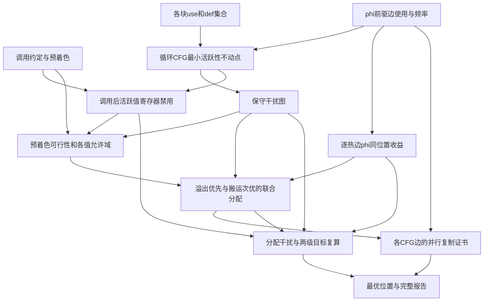

# K54　完整CFG的最优溢出与加权phi合并

格式：reasoning4；来源族：`dag300-new53-register-allocation`。

来源性质：DAG300本地原型启发/改编；原始模型难度未登记，不能把参考解Oracle通过当成源题易/中/难。
[来源原始声明与SHA](../../datasets/parallel-medium-calibrated-native-coalescing/author/K54/provenance.json) · [完整业务规格](../../datasets/parallel-medium-calibrated-native-coalescing/tasks/reasoning4/weighted-phi-coalescing/workspace/engines/analysis/SPEC.md)

A/S/C/I：2/0/2/1，结构 **H**；固定基线五次实测 **M**，严格 **3/5**。
[测前评审原文](../../_authoring/history/medium-native-coalescing-20261112/测前设计与来源.md) · [测前评审元数据](../../_authoring/history/medium-native-coalescing-20261112/asci-review.json)

评审原文给出算法、状态、分支汇合和最小反例；早期四轴从原文提取，后期使用冻结元数据。结构档和实测档分别保存。

五次公开通过5/5，核心转换用例55/60，平均reward 1.487500/2。
严格通过要求该题全部冻结验收及完整性交付通过；核心转换用例通过率单独报告。

五次明细：r1 失败，reward=0.8125；r2 通过，reward=2.0；r3 失败，reward=0.625；r4 通过，reward=2.0；r5 通过，reward=2.0。

[100次原始评分索引](../results/index.json) · [本题五次原始收据](../../datasets/parallel-medium-calibrated-native-coalescing/author/K54/five-runs.json)

核心失败接纳依据：Five fresh trials yield3/5 strict with5/5 public checks. r3 makes genuine weighted phi-copy errors: all spilled values collapse to one internal -1, although logical spill slots differ. A new two-value ordinary call-live example reproduces expected copy3 versus actual0. r1 exceeds the unchanged90-second API budget on the normal22-value CFG, using late repeated legality checks and spill-first enumeration; trusted reference solves that same instance in2.323 seconds at2CPU/3072MiB. No candidate timeout was retried. All acceptance remains semantic, allowing arbitrary equal-optimal allocations; no noncore robustness checks were added. Original K53 remains E4/5 separately and source family53 is admitted once.

[作者侧SVG](../../docs/dags/K54.svg) · [Mermaid源码](../../docs/dags/K54.mmd)

DAG为作者的潜在业务/算法分解；未给Agent，不是唯一开发顺序，也不代表已实测多Agent加速。
