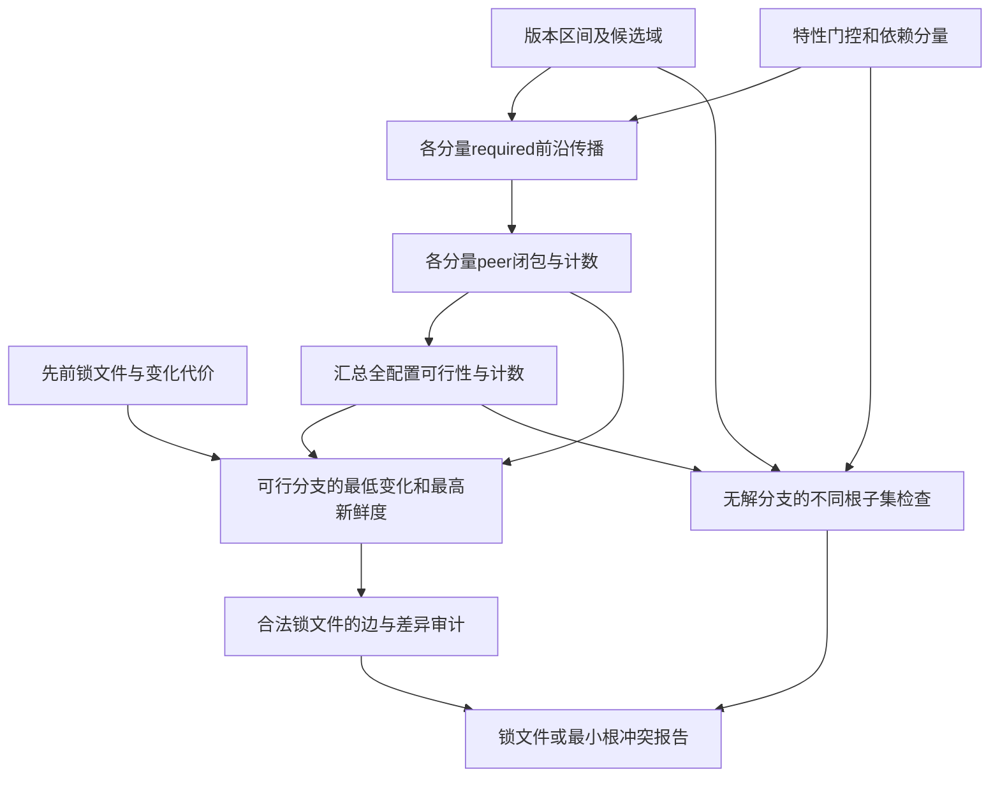

# K64　包依赖闭包与冲突的中等规模对照

格式：context8；来源族：`dag300-new63-package-constraint-solver`。

来源性质：DAG300本地原型启发/改编；原始模型难度未登记，不能把参考解Oracle通过当成源题易/中/难。
[来源原始声明与SHA](../../datasets/parallel-medium-calibrated-native-package-scale/author/K64/provenance.json) · [完整业务规格](../../datasets/parallel-medium-calibrated-native-package-scale/tasks/context8/feature-package-scale/workspace/packages/analysis/SPEC.md)

A/S/C/I：2/0/2/1，结构 **H**；固定基线五次实测 **M**，严格 **2/5**。
[测前评审原文](../../_authoring/history/medium-native-package-scale-20261112/测前设计与来源.md) · [测前评审元数据](../../_authoring/history/medium-native-package-scale-20261112/asci-review.json)

评审原文给出算法、状态、分支汇合和最小反例；早期四轴从原文提取，后期使用冻结元数据。结构档和实测档分别保存。

五次公开通过4/5，核心转换用例46/60，平均reward 1.125000/2。
严格通过要求该题全部冻结验收及完整性交付通过；核心转换用例通过率单独报告。

五次明细：r1 失败，reward=0.8125；r2 失败，reward=0.8125；r3 通过，reward=2.0；r4 通过，reward=2.0；r5 失败，reward=0.0。

[100次原始评分索引](../results/index.json) · [本题五次原始收据](../../datasets/parallel-medium-calibrated-native-package-scale/author/K64/five-runs.json)

核心失败接纳依据：Five fresh valid trials yield2/5 strict. Two failed finished solutions have ordinary core constraint errors independently reproduced: skipping a sibling required dependency, and retaining an empty peer requirement after backtracking. The fifth failure is the unchanged2M cumulative-token cap and is retained as an execution failure, not used as a mathematical-hardness witness. The new scale-control keeps all original algorithms; only the12th paired-component count is reduced6^12->6^6. Development calibration is disclosed; K63 remains H0/5 separately. One source family is admitted once.

[作者侧SVG](../../docs/dags/K64.svg) · [Mermaid源码](../../docs/dags/K64.mmd)

DAG为作者的潜在业务/算法分解；未给Agent，不是唯一开发顺序，也不代表已实测多Agent加速。
