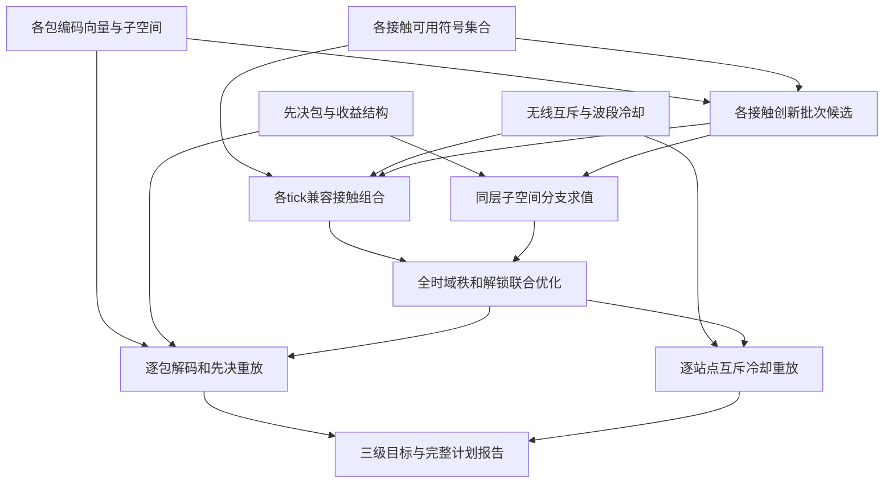

# L114　编码子空间与前置交付的全局地面链路

格式：reasoning4；来源族：`dag300new113-spacecraft-groundlink-budget`。

来源性质：DAG300本地原型启发/改编；原始模型难度未登记，不能把参考解Oracle通过当成源题易/中/难。
[来源原始声明与SHA](../../datasets/parallel-medium-calibrated-native-coded-link/author/L114/provenance.json) · [完整业务规格](../../datasets/parallel-medium-calibrated-native-coded-link/tasks/reasoning4/coded-downlink/workspace/engines/analysis/SPEC.md)

A/S/C/I：2/2/2/1，结构 **H**；固定基线五次实测 **M**，严格 **2/5**。
[测前评审原文](../../_authoring/history/medium-native-coded-link-20261112/测前设计与来源.md) · [测前评审元数据](../../_authoring/history/medium-native-coded-link-20261112/asci-review.json)

评审原文给出算法、状态、分支汇合和最小反例；早期四轴从原文提取，后期使用冻结元数据。结构档和实测档分别保存。

五次公开通过5/5，核心转换用例42/60，平均reward 1.087500/2。
严格通过要求该题全部冻结验收及完整性交付通过；核心转换用例通过率单独报告。

五次明细：r1 通过，reward=2.0；r2 失败，reward=0.625；r3 失败，reward=0.1875；r4 失败，reward=0.625；r5 通过，reward=2.0。

[100次原始评分索引](../results/index.json) · [本题五次原始收据](../../datasets/parallel-medium-calibrated-native-coded-link/author/L114/five-runs.json)

核心失败接纳依据：五次严格2/5，另有两次完整16/16交付。已在干净只读提交副本的新最小合法例复现rate2核心状态转移构造错误；第2次四个正式API超时有完整历史枚举代码证据，可信状态DP在相同预算下均小于0.65秒。属于核心业务实现及预算相对算法效率失败，非格式/鲁棒性/导入兼容性问题。原易档L113保留，来源113只计一次；结构H与实测M分别标注。

[作者侧SVG](../../docs/dags/L114.svg) · [Mermaid源码](../../docs/dags/L114.mmd)

DAG为作者的潜在业务/算法分解；未给Agent，不是唯一开发顺序，也不代表已实测多Agent加速。
