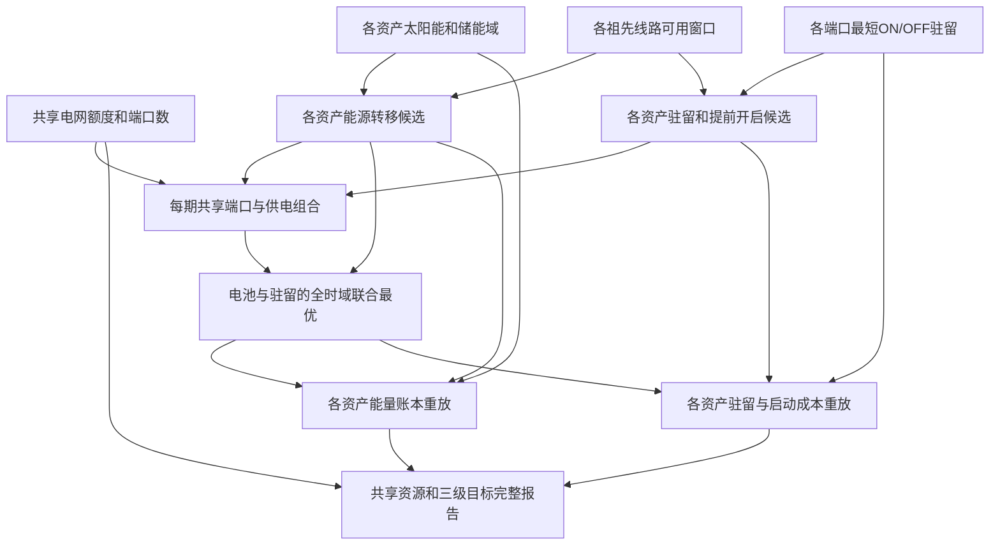

# M103　端口驻留与储能的全时域恢复

格式：context8；来源族：`dag300new102-microgrid-restoration`。

来源性质：DAG300本地原型启发/改编；原始模型难度未登记，不能把参考解Oracle通过当成源题易/中/难。
[来源原始声明与SHA](../../datasets/parallel-medium-calibrated-native-unit-commitment/author/M103/provenance.json) · [完整业务规格](../../datasets/parallel-medium-calibrated-native-unit-commitment/tasks/context8/port-residency-restoration/workspace/packages/analysis/SPEC.md)

A/S/C/I：2/2/2/1，结构 **H**；固定基线五次实测 **M**，严格 **2/5**。
[测前评审原文](../../_authoring/history/medium-native-unit-commitment-20261112/测前设计与来源.md) · [测前评审元数据](../../_authoring/history/medium-native-unit-commitment-20261112/asci-review.json)

评审原文给出算法、状态、分支汇合和最小反例；早期四轴从原文提取，后期使用冻结元数据。结构档和实测档分别保存。

五次公开通过5/5，核心转换用例43/60，平均reward 1.112500/2。
严格通过要求该题全部冻结验收及完整性交付通过；核心转换用例通过率单独报告。

五次明细：r1 通过，reward=2.0；r2 失败，reward=0.5625；r3 失败，reward=0.4375；r4 失败，reward=0.5625；r5 通过，reward=2.0。

[100次原始评分索引](../results/index.json) · [本题五次原始收据](../../datasets/parallel-medium-calibrated-native-unit-commitment/author/M103/five-runs.json)

核心失败接纳依据：五次严格2/5，两次完整16/16交付，公开5/5、核心43/60。三份干净只读原提交的新合法小例分别复现：漏掉部分供电、反向优化启动费用、未舍弃最短开启时间与未来正端口容量冲突产生的不可行分支。后两者涉及新增持续端口业务目标/状态依赖，前者为保留的供电规则；没有将全部失败或档位变化归因于新增机制。非NaN/类型/格式/导入兼容问题，评分和正式试次不变。原M102易档保留，来源102只接纳一次，结构H和基线实测M分别报告。

[作者侧SVG](../../docs/dags/M103.svg) · [Mermaid源码](../../docs/dags/M103.mmd)

DAG为作者的潜在业务/算法分解；未给Agent，不是唯一开发顺序，也不代表已实测多Agent加速。
