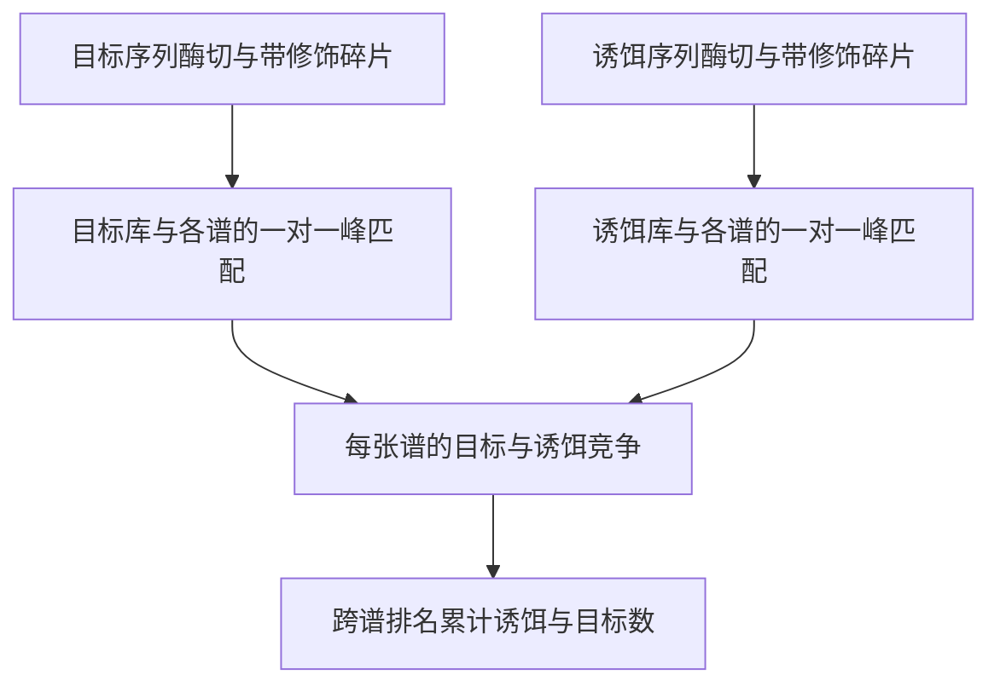

# Q08　碎片质谱的一对一峰匹配

格式：reasoning4；来源族：`dag300new161-peptide-mass-matching`。

来源性质：DAG300本地原型启发/改编；原始模型难度未登记，不能把参考解Oracle通过当成源题易/中/难。
[来源原始声明与SHA](../../datasets/parallel-medium-calibrated-v1/author/Q08/provenance.json) · [完整业务规格](../../datasets/parallel-medium-calibrated-v1/tasks/reasoning4/peptide-mass-matching/workspace/engines/analysis/SPEC.md)

A/S/C/I：1/0/2/1，结构 **M**；固定基线五次实测 **M**，严格 **3/5**。
[测前评审原文](../../_authoring/history/parallel20-screen-20261112/20题测前结构评审.md) · [测前评审元数据](../../_authoring/history/parallel20-screen-20261112/asci-review.json)

评审原文给出算法、状态、分支汇合和最小反例；早期四轴从原文提取，后期使用冻结元数据。结构档和实测档分别保存。

五次公开通过4/5，核心转换用例43/45，平均reward 1.476923/2。
严格通过要求该题全部冻结验收及完整性交付通过；核心转换用例通过率单独报告。

五次明细：r1 通过，reward=2.0；r2 失败，reward=0.769231；r3 通过，reward=2.0；r4 失败，reward=0.615385；r5 通过，reward=2.0。

[100次原始评分索引](../results/index.json) · [本题五次原始收据](../../datasets/parallel-medium-calibrated-v1/author/Q08/five-runs.json)

核心失败接纳依据：严格通过 3/5。第 2 次把质量误差再次取反，实际导致两个谱的置信排名倒置；第 4 次达到预算时的存档在公开的正常峰匹配中取到了强度 5，最优强度为 7。保留预算标记与补充反例，补充反例不进入正式评分。

[作者侧SVG](../../docs/dags/Q08.svg) · [Mermaid源码](../../docs/dags/Q08.mmd)

DAG为作者的潜在业务/算法分解；未给Agent，不是唯一开发顺序，也不代表已实测多Agent加速。
