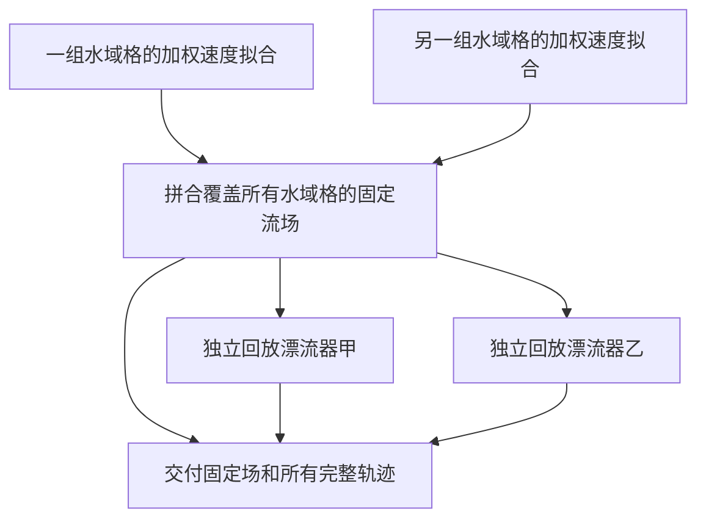

# Q20　海流场反演与漂流轨迹

格式：reasoning4；来源族：`dag300new199-ocean-current-drifter-inversion`。

来源性质：DAG300本地原型启发/改编；原始模型难度未登记，不能把参考解Oracle通过当成源题易/中/难。
[来源原始声明与SHA](../../datasets/parallel-medium-calibrated-v1/author/Q20/provenance.json) · [完整业务规格](../../datasets/parallel-medium-calibrated-v1/tasks/reasoning4/ocean-current-drifter-inversion/workspace/engines/analysis/SPEC.md)

A/S/C/I：1/0/2/0，结构 **M**；固定基线五次实测 **M**，严格 **2/5**。
[测前评审原文](../../_authoring/history/parallel20-screen-20261112/20题测前结构评审.md) · [测前评审元数据](../../_authoring/history/parallel20-screen-20261112/asci-review.json)

评审原文给出算法、状态、分支汇合和最小反例；早期四轴从原文提取，后期使用冻结元数据。结构档和实测档分别保存。

五次公开通过5/5，核心转换用例34/40，平均reward 1.150000/2。
严格通过要求该题全部冻结验收及完整性交付通过；核心转换用例通过率单独报告。

五次明细：r1 失败，reward=0.583333；r2 失败，reward=0.583333；r3 失败，reward=0.583333；r4 通过，reward=2.0；r5 通过，reward=2.0。

[100次原始评分索引](../results/index.json) · [本题五次原始收据](../../datasets/parallel-medium-calibrated-v1/author/Q20/five-runs.json)

核心失败接纳依据：严格通过 2/5。三个失败存档在可并列的海流场上把第二个不同候选向量误作第二种不同误差，造成置信余量应为 0 却报正数；这是拟合不确定性的核心定义。

[作者侧SVG](../../docs/dags/Q20.svg) · [Mermaid源码](../../docs/dags/Q20.mmd)

DAG为作者的潜在业务/算法分解；未给Agent，不是唯一开发顺序，也不代表已实测多Agent加速。
