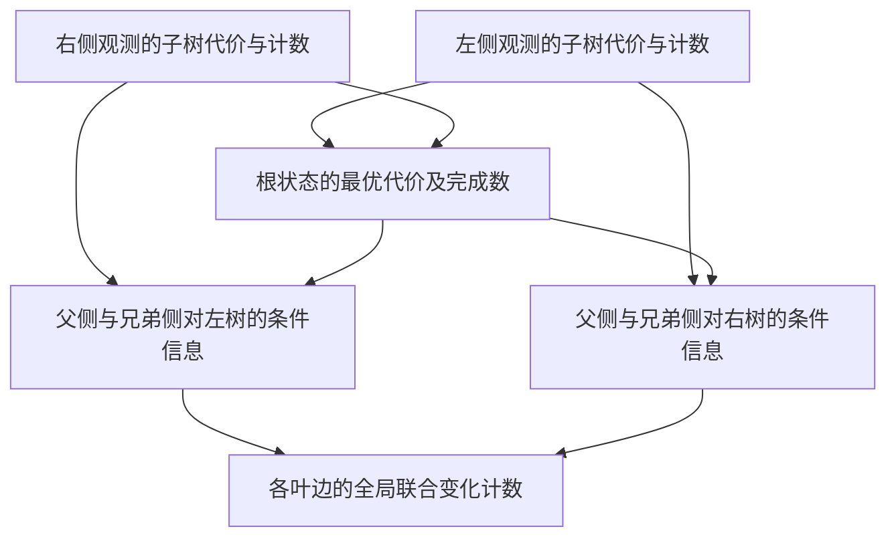

# S02　祖先性状变化的全局支持度

格式：reasoning4；来源族：`capstone-original-ancestral-support`。

来源性质：项目自编；原始模型难度未登记，不能把参考解Oracle通过当成源题易/中/难。
[来源原始声明与SHA](../../datasets/parallel-medium-calibrated-inference/author/S02/provenance.json) · [完整业务规格](../../datasets/parallel-medium-calibrated-inference/tasks/reasoning4/ancestral-support/workspace/engines/analysis/SPEC.md)

A/S/C/I：1/0/2/0，结构 **M**；固定基线五次实测 **M**，严格 **2/5**。
[测前评审原文](../../_authoring/history/medium-inference-20261112/测前结构与预估.md) · [测前评审元数据](../../_authoring/history/medium-inference-20261112/asci-review.json)

评审原文给出算法、状态、分支汇合和最小反例；早期四轴从原文提取，后期使用冻结元数据。结构档和实测档分别保存。

五次公开通过5/5，核心转换用例46/60，平均reward 1.137500/2。
严格通过要求该题全部冻结验收及完整性交付通过；核心转换用例通过率单独报告。

五次明细：r1 失败，reward=0.25；r2 通过，reward=2.0；r3 失败，reward=0.75；r4 失败，reward=0.6875；r5 通过，reward=2.0。

[100次原始评分索引](../results/index.json) · [本题五次原始收据](../../datasets/parallel-medium-calibrated-inference/author/S02/five-runs.json)

核心失败接纳依据：五次严格通过2/5且公开输入全部通过。三次失败均有真实的全局历史计数错误：r1把非全局最优的父状态计入边支持，出现负数；r3与r4在祖先到后代传播中重复计入子树重数。三个节点、严格正的非对角迁移代价即可重现；不是异常值、隐藏字段或同优排序问题。r2与r5完整交付通过。

[作者侧SVG](../../docs/dags/S02.svg) · [Mermaid源码](../../docs/dags/S02.mmd)

DAG为作者的潜在业务/算法分解；未给Agent，不是唯一开发顺序，也不代表已实测多Agent加速。
