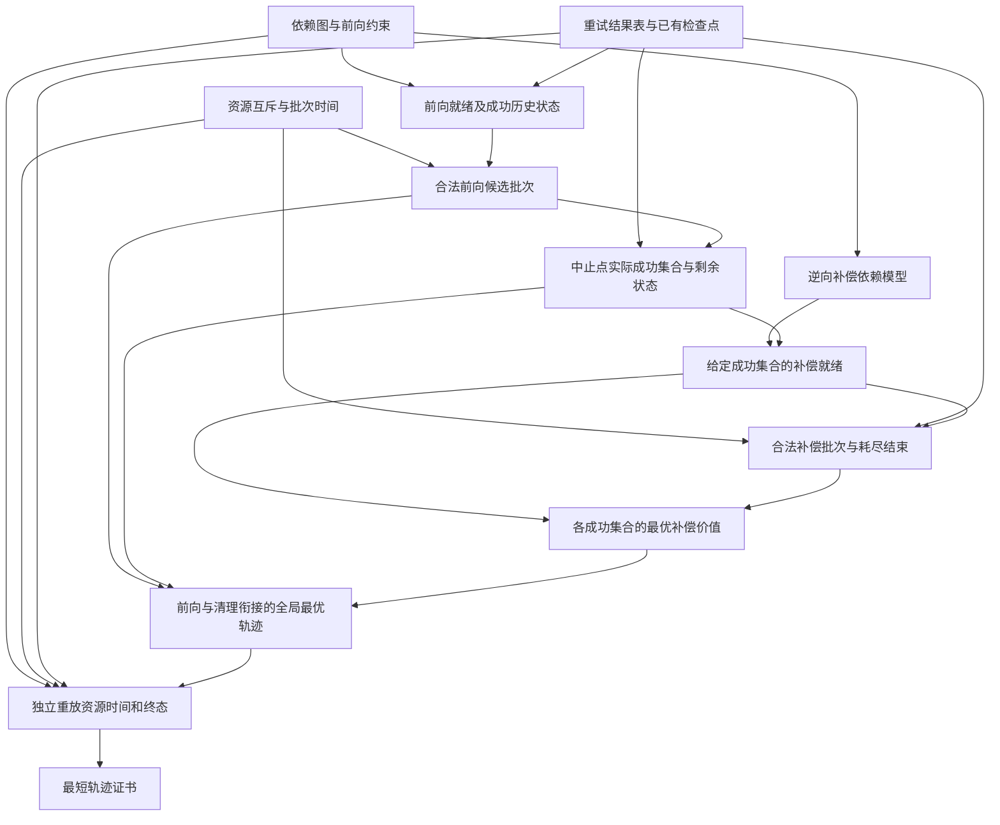

# S129　重试与逆依赖回滚的最短补偿事务

格式：reasoning4；来源族：`dag300new129-saga-compensation-planner`。

来源性质：DAG300本地原型启发/改编；原始模型难度未登记，不能把参考解Oracle通过当成源题易/中/难。
[来源原始声明与SHA](../../datasets/parallel-medium-calibrated-native-saga/author/S129/provenance.json) · [完整业务规格](../../datasets/parallel-medium-calibrated-native-saga/tasks/reasoning4/minimum-time-saga/workspace/engines/analysis/SPEC.md)

A/S/C/I：2/2/2/0，结构 **H**；固定基线五次实测 **M**，严格 **2/5**。
[测前评审原文](../../_authoring/history/medium-native-saga-20261112/测前设计与来源.md) · [测前评审元数据](../../_authoring/history/medium-native-saga-20261112/asci-review.json)

评审原文给出算法、状态、分支汇合和最小反例；早期四轴从原文提取，后期使用冻结元数据。结构档和实测档分别保存。

五次公开通过5/5，核心转换用例51/60，平均reward 1.200000/2。
严格通过要求该题全部冻结验收及完整性交付通过；核心转换用例通过率单独报告。

五次明细：r1 失败，reward=0.625；r2 通过，reward=2.0；r3 失败，reward=0.625；r4 通过，reward=2.0；r5 失败，reward=0.75。

[100次原始评分索引](../results/index.json) · [本题五次原始收据](../../datasets/parallel-medium-calibrated-native-saga/author/S129/five-runs.json)

核心失败接纳依据：五次普通模式严格2/5、公开5/5、核心51/60。r1/r3在新三动作正值反例中先补偿父a，再补偿仍未结束的成功子b，虽最小时长标量正确却给出非法逆依赖轨迹；严格验收按状态重放拒绝，不是强制参考顺序。r5在终态失败f之后又执行下一前向批次g，新两动作例已复现。三次均有真实业务状态/计划错误，不是预算、导入、格式或非核心边界。两份独立参考和手算支持正确计划，测前已验证其他等时最优轨迹可通过。按129号唯一题族接纳，结构H与实测M同时记录。

[作者侧SVG](../../docs/dags/S129.svg) · [Mermaid源码](../../docs/dags/S129.mmd)

DAG为作者的潜在业务/算法分解；未给Agent，不是唯一开发顺序，也不代表已实测多Agent加速。
