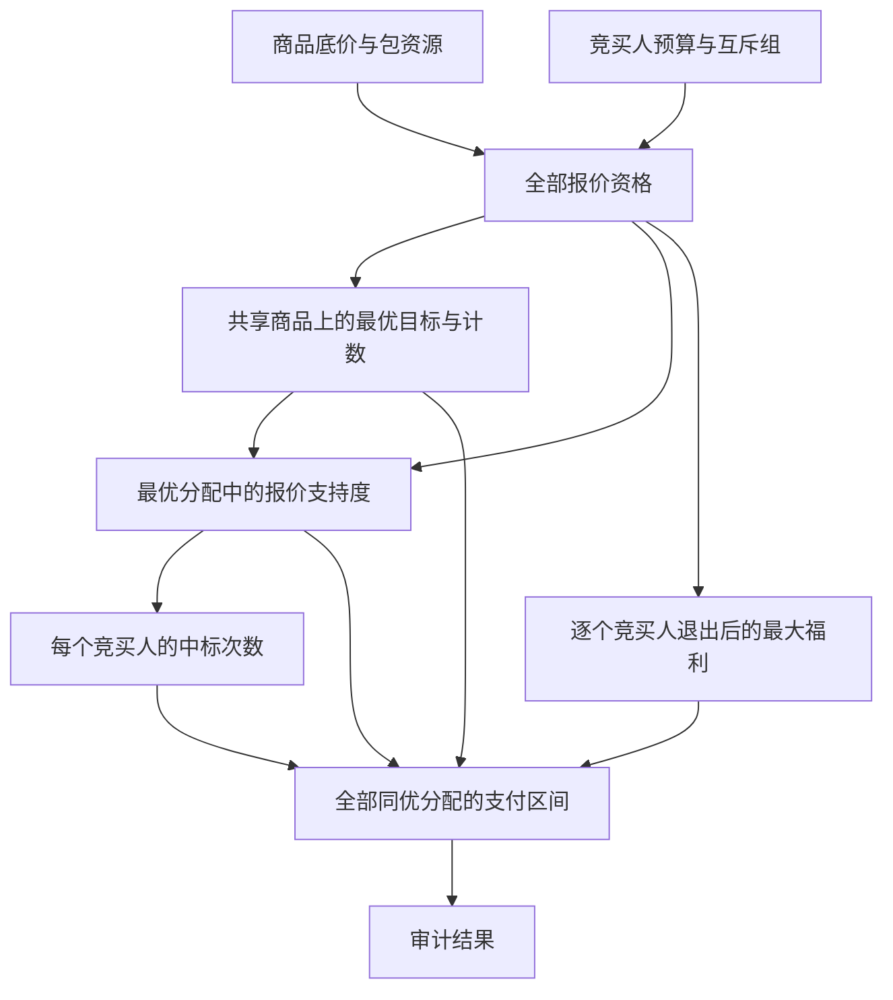

# U109　组合拍卖全部最优分配与反事实支付

格式：reasoning4；来源族：`dag300new109-combinatorial-auction-clearing`。

来源性质：DAG300本地原型启发/改编；原始模型难度未登记，不能把参考解Oracle通过当成源题易/中/难。
[来源原始声明与SHA](../../datasets/parallel-medium-calibrated-native-auction/author/U109/provenance.json) · [完整业务规格](../../datasets/parallel-medium-calibrated-native-auction/tasks/reasoning4/bundle-auction-optimal-audit/workspace/engines/analysis/SPEC.md)

A/S/C/I：2/0/2/0，结构 **H**；固定基线五次实测 **M**，严格 **3/5**。
[测前评审原文](../../_authoring/history/medium-native-auction-20261112/测前设计与来源.md) · [测前评审元数据](../../_authoring/history/medium-native-auction-20261112/asci-review.json)

评审原文给出算法、状态、分支汇合和最小反例；早期四轴从原文提取，后期使用冻结元数据。结构档和实测档分别保存。

五次公开通过5/5，核心转换用例52/60，平均reward 1.450000/2。
严格通过要求该题全部冻结验收及完整性交付通过；核心转换用例通过率单独报告。

五次明细：r1 失败，reward=0.5；r2 通过，reward=2.0；r3 失败，reward=0.75；r4 通过，reward=2.0；r5 通过，reward=2.0。

[100次原始评分索引](../results/index.json) · [本题五次原始收据](../../datasets/parallel-medium-calibrated-native-auction/author/U109/five-runs.json)

核心失败接纳依据：五次有效普通模式试次严格通过3/5、公开5/5、核心52/60。r1存在真实第三目标方向错误和同一报价集合重复计数，正值极小反例均已在只读提交中复现；r3枚举全部可行报价集合导致正式第11/12例超时，未重跑这些超时。两个独立参考在相同2CPU/3072MiB离线容器下完成相同大例，最慢1.35秒，且计数有10!/12!闭式核验。因此两次失分均有核心算法依据，非导入兼容性、格式排序或非核心边界。结构H和实测M分别记录，按109号唯一题族接纳。

[作者侧SVG](../../docs/dags/U109.svg) · [Mermaid源码](../../docs/dags/U109.mmd)

DAG为作者的潜在业务/算法分解；未给Agent，不是唯一开发顺序，也不代表已实测多Agent加速。
