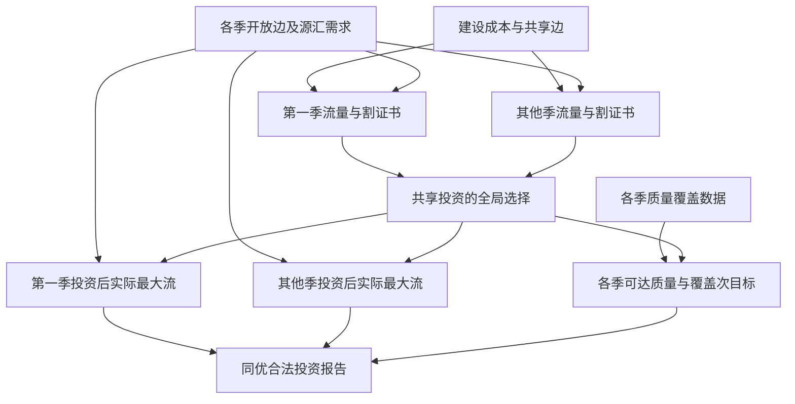

# V163　共享建设的跨季节生态廊道

格式：multistage4；来源族：`dag300new163-ecological-corridor-planning`。

来源性质：DAG300本地原型启发/改编；原始模型难度未登记，不能把参考解Oracle通过当成源题易/中/难。
[来源原始声明与SHA](../../datasets/parallel-medium-calibrated-native-corridors/author/V163/provenance.json) · [完整业务规格](../../datasets/parallel-medium-calibrated-native-corridors/tasks/multistage4/seasonal-corridor-investment/workspace/stages/analysis/SPEC.md)

A/S/C/I：2/0/2/0，结构 **H**；固定基线五次实测 **M**，严格 **3/5**。
[测前评审原文](../../_authoring/history/medium-native-corridors-20261112/测前设计与来源.md) · [测前评审元数据](../../_authoring/history/medium-native-corridors-20261112/asci-review.json)

评审原文给出算法、状态、分支汇合和最小反例；早期四轴从原文提取，后期使用冻结元数据。结构档和实测档分别保存。

五次公开通过5/5，核心转换用例52/60，平均reward 1.450000/2。
严格通过要求该题全部冻结验收及完整性交付通过；核心转换用例通过率单独报告。

五次明细：r1 通过，reward=2.0；r2 通过，reward=2.0；r3 失败，reward=0.6875；r4 失败，reward=0.5625；r5 通过，reward=2.0。

[100次原始评分索引](../results/index.json) · [本题五次原始收据](../../datasets/parallel-medium-calibrated-native-corridors/author/V163/five-runs.json)

核心失败接纳依据：五次有效普通模式试次严格3/5、公开5/5、核心52/60。r4把原生和改编合同均明确的无向廊道建成单向弧，两节点单边正值反例已在只读提交中复现；r3对子集与每季所有割做乘积枚举，正式第9/10/12例超时。未重跑模型超时，相同2CPU/3072MiB下的可信标准库分支定界参考分别约0.0001/0.058/0.085秒完成，测前联合MILP和128小图穷举已独立核验目标。两次失败均有核心业务或算法性能依据，不是导入、任意平局或异常边界。按163号唯一题族接纳，结构H与实测M并列。

[作者侧SVG](../../docs/dags/V163.svg) · [Mermaid源码](../../docs/dags/V163.mmd)

DAG为作者的潜在业务/算法分解；未给Agent，不是唯一开发顺序，也不代表已实测多Agent加速。
