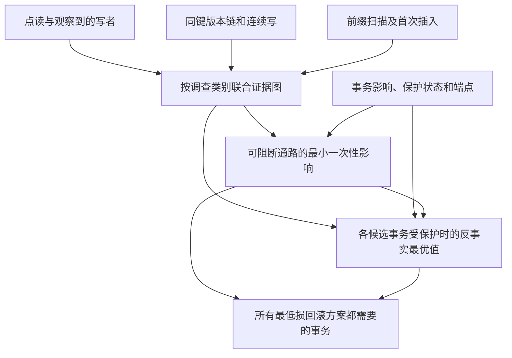

# W07　多版本事务的传播隔离

格式：reasoning4；来源族：`dag300new43-mvcc-serializability`。

来源性质：DAG300本地原型启发/改编；原始模型难度未登记，不能把参考解Oracle通过当成源题易/中/难。
[来源原始声明与SHA](../../datasets/parallel-medium-calibrated-relays/author/W07/provenance.json) · [完整业务规格](../../datasets/parallel-medium-calibrated-relays/tasks/reasoning4/transaction-evidence-containment/workspace/engines/analysis/SPEC.md)

A/S/C/I：1/0/2/1，结构 **M**；固定基线五次实测 **M**，严格 **3/5**。
[测前评审原文](../../_authoring/history/medium-relays-20261112/测前评审与对照.md) · [测前评审元数据](../../_authoring/history/medium-relays-20261112/asci-review.json)

评审原文给出算法、状态、分支汇合和最小反例；早期四轴从原文提取，后期使用冻结元数据。结构档和实测档分别保存。

五次公开通过5/5，核心转换用例47/50，平均reward 1.500000/2。
严格通过要求该题全部冻结验收及完整性交付通过；核心转换用例通过率单独报告。

五次明细：r1 通过，reward=2.0；r2 通过，reward=2.0；r3 失败，reward=0.714286；r4 失败，reward=0.785714；r5 通过，reward=2.0。

[100次原始评分索引](../results/index.json) · [本题五次原始收据](../../datasets/parallel-medium-calibrated-relays/author/W07/five-runs.json)

核心失败接纳依据：五次严格通过 3/5，公开检查全部通过。第三次在 41、43 个事务的正常传播图中逐组枚举候选回滚子集，两个核心用例均触及原有 90 秒限时。两种作者解独立核对同一结果。第四次虽及时返回，但在一份 41 事务的输入上漏掉两事务的同价方案：隔离 pool 花 7，隔离 east 和 west 合计也花 7，因此没有任何单个事务必回滚。提交却把一项报成必回滚。上述失败的输入完全没有扫描记录。旧 F07 的严格比例同为 3/5，但其一次失败只是不同的合法拓扑顺序；新版两次失败都直接影响业务。

[作者侧SVG](../../docs/dags/W07.svg) · [Mermaid源码](../../docs/dags/W07.mmd)

DAG为作者的潜在业务/算法分解；未给Agent，不是唯一开发顺序，也不代表已实测多Agent加速。
