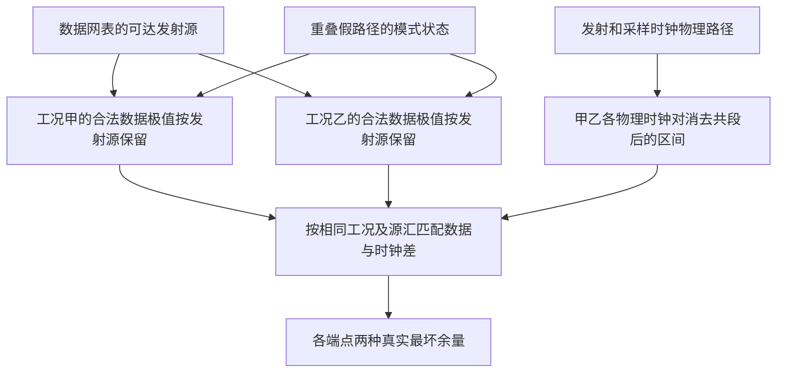

# W11　共享时钟下的真实时序余量

格式：reasoning4；来源族：`dag300new68-static-timing`。

来源性质：DAG300本地原型启发/改编；原始模型难度未登记，不能把参考解Oracle通过当成源题易/中/难。
[来源原始声明与SHA](../../datasets/parallel-medium-calibrated-coupled/author/W11/provenance.json) · [完整业务规格](../../datasets/parallel-medium-calibrated-coupled/tasks/reasoning4/correlated-clock-timing/workspace/engines/analysis/SPEC.md)

A/S/C/I：1/0/2/1，结构 **M**；固定基线五次实测 **M**，严格 **3/5**。
[测前评审原文](../../_authoring/history/medium-coupled-20261112/测前评审与对照.md) · [测前评审元数据](../../_authoring/history/medium-coupled-20261112/asci-review.json)

评审原文给出算法、状态、分支汇合和最小反例；早期四轴从原文提取，后期使用冻结元数据。结构档和实测档分别保存。

五次公开通过5/5，核心转换用例47/60，平均reward 1.375000/2。
严格通过要求该题全部冻结验收及完整性交付通过；核心转换用例通过率单独报告。

五次明细：r1 通过，reward=2.0；r2 失败，reward=0.75；r3 通过，reward=2.0；r4 通过，reward=2.0；r5 失败，reward=0.125。

[100次原始评分索引](../results/index.json) · [本题五次原始收据](../../datasets/parallel-medium-calibrated-coupled/author/W11/five-runs.json)

核心失败接纳依据：严格通过 3/5，旧版 F11 为 4/5。第二次把端点 z 的保持余量从应有的 +2 算成 −2，误报违例。第五次公开检查通过，但 11 个正式业务输入未通过；例如端点 q 的建立余量应为 −21，却报告 +12，漏报违例。两次存档均能直接调用转换，正常预算结束，错误改变了时序结论。该中档涵盖当前测试规模下的业务正确性；其中一次成功可通过枚举全部路径实现。

[作者侧SVG](../../docs/dags/W11.svg) · [Mermaid源码](../../docs/dags/W11.mmd)

DAG为作者的潜在业务/算法分解；未给Agent，不是唯一开发顺序，也不代表已实测多Agent加速。
