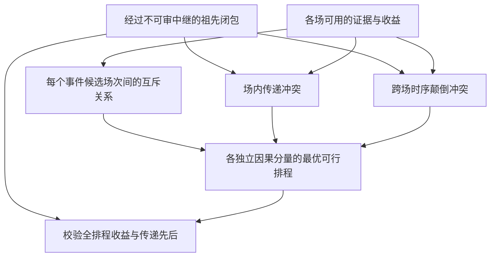

# X13　跨链审查场次的最优排程

格式：context8；来源族：`dag300new62-crdt-reconciliation`。

来源性质：DAG300本地原型启发/改编；原始模型难度未登记，不能把参考解Oracle通过当成源题易/中/难。
[来源原始声明与SHA](../../datasets/parallel-medium-calibrated-scale/author/X13/provenance.json) · [完整业务规格](../../datasets/parallel-medium-calibrated-scale/tasks/context8/cross-chain-review-sessions/workspace/packages/analysis/SPEC.md)

A/S/C/I：1/0/2/1，结构 **M**；固定基线五次实测 **M**，严格 **2/5**。
[测前评审原文](../../_authoring/history/medium-scale-20261112/测前规模对照.md) · [测前评审元数据](../../_authoring/history/medium-scale-20261112/asci-review.json)

评审原文给出算法、状态、分支汇合和最小反例；早期四轴从原文提取，后期使用冻结元数据。结构档和实测档分别保存。

五次公开通过5/5，核心转换用例55/60，平均reward 1.287500/2。
严格通过要求该题全部冻结验收及完整性交付通过；核心转换用例通过率单独报告。

五次明细：r1 通过，reward=2.0；r2 失败，reward=0.75；r3 通过，reward=2.0；r4 失败，reward=0.9375；r5 失败，reward=0.75。

[100次原始评分索引](../results/index.json) · [本题五次原始收据](../../datasets/parallel-medium-calibrated-scale/author/X13/five-runs.json)

核心失败接纳依据：五次严格通过2/5，公开检查5/5，核心55/60。r2在第11、12例进程失败，r4第11例超时，r5第11、12例超时；三次均正常结束模型阶段，未触发token或总时限截止。两种精确参考方法在实际Linux环境解出同一12例，失败涉及正常48–84事件、3–4场次的核心可扩展性。r2的进程退出不能单独确认为OOM，按原始process类别记录；不重试这些已评分大用例。任意合法同优排程均可通过。旧W13五次全过，新版仅替换四个更大业务输入，是公开登记的规模对照，结构仍A1/S0/C2/I1、实测中档。

[作者侧SVG](../../docs/dags/X13.svg) · [Mermaid源码](../../docs/dags/X13.mmd)

DAG为作者的潜在业务/算法分解；未给Agent，不是唯一开发顺序，也不代表已实测多Agent加速。
