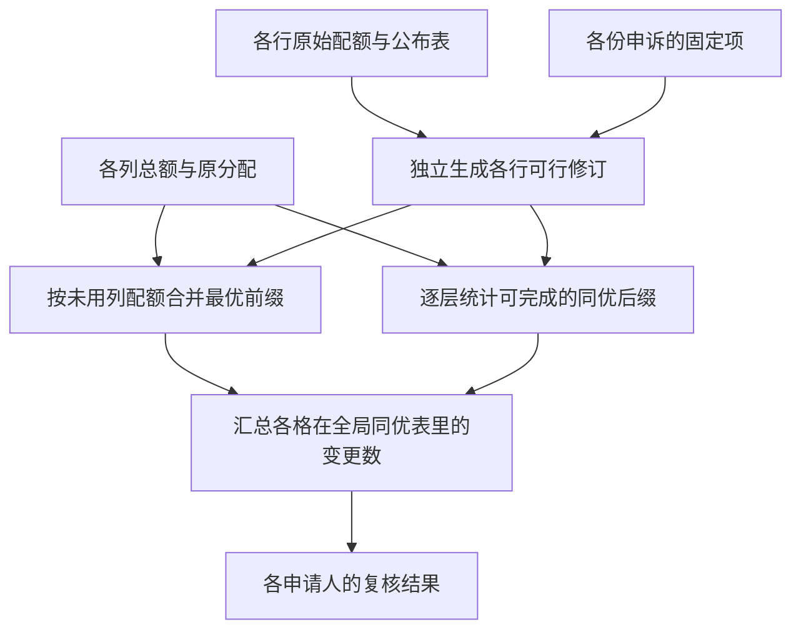

# Z10　配额申诉后各项分配的变动频率

格式：context8；来源族：`dag300-new85-survey-raking`。

来源性质：DAG300本地原型启发/改编；原始模型难度未登记，不能把参考解Oracle通过当成源题易/中/难。
[来源原始声明与SHA](../../datasets/parallel-medium-calibrated-apportionment/author/Z10/provenance.json) · [完整业务规格](../../datasets/parallel-medium-calibrated-apportionment/tasks/context8/appeal-change-frequencies/workspace/packages/analysis/SPEC.md)

A/S/C/I：1/0/2/1，结构 **M**；固定基线五次实测 **M**，严格 **2/5**。
[测前评审原文](../../_authoring/history/medium-apportionment-20261112/测前设计与反例.md) · [测前评审元数据](../../_authoring/history/medium-apportionment-20261112/asci-review.json)

评审原文给出算法、状态、分支汇合和最小反例；早期四轴从原文提取，后期使用冻结元数据。结构档和实测档分别保存。

五次公开通过5/5，核心转换用例54/60，平均reward 1.250000/2。
严格通过要求该题全部冻结验收及完整性交付通过；核心转换用例通过率单独报告。

五次明细：r1 失败，reward=0.8125；r2 通过，reward=2.0；r3 通过，reward=2.0；r4 失败，reward=0.75；r5 失败，reward=0.6875。

[100次原始评分索引](../results/index.json) · [本题五次原始收据](../../datasets/parallel-medium-calibrated-apportionment/author/Z10/five-runs.json)

核心失败接纳依据：五次严格通过2/5、公开检查5/5、核心54/60。r1第12例超时，r4第11、12例超时，r5第10至12例超时，三次模型阶段均正常结束且未触发token或总时限截止。两个独立动态规划在实际Linux环境解出同一12例；最后一例全体回避申诉的最优表总数由12阶错排递推独立确认为176214841，非对角格的支持数16019531。任务需要统计全部同优表与逐格频率，不能仅求一份最小费用流或逐表列举。失败来自核心计数的可扩展性，未增加异常输入、隐藏条件或非核心边界。结构M、实测M，同一85号题族只接纳一次。

[作者侧SVG](../../docs/dags/Z10.svg) · [Mermaid源码](../../docs/dags/Z10.mmd)

DAG为作者的潜在业务/算法分解；未给Agent，不是唯一开发顺序，也不代表已实测多Agent加速。
