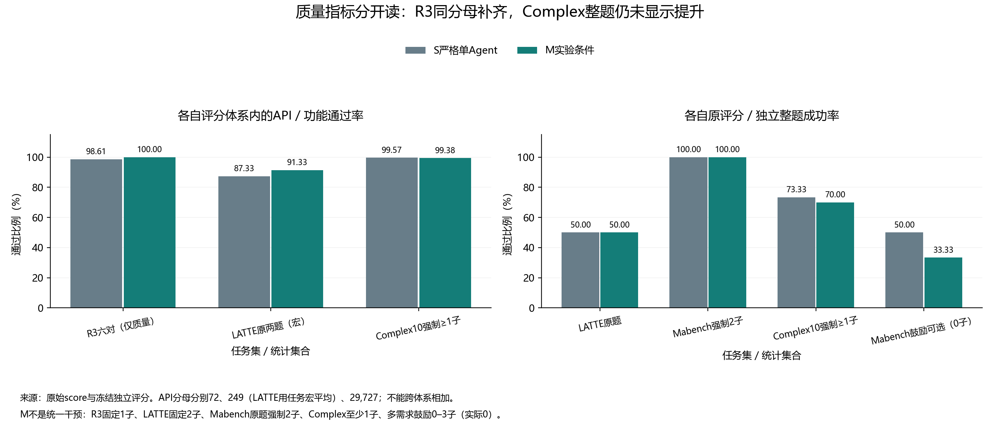
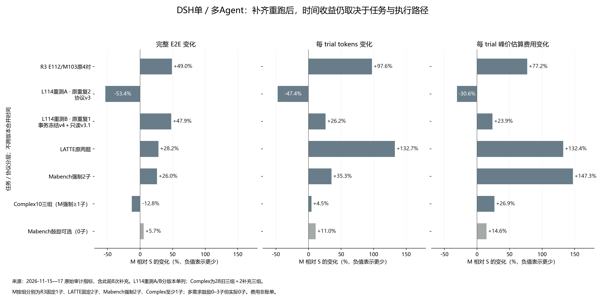
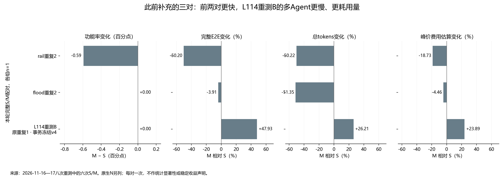

# DSH 单Agent／委派策略跨任务集对照：最新入口

**2026-11-17｜最新为v4导读版；旧版、旧结果及异常说明同时保留。**

**[阅读最新修订报告](revisions/v4-overview/DSH单多Agent跨任务集对照报告.md)** · **[下载同事审阅包v4](downloads/DSH对照实验-同事审阅包-20261117-v4导读版.zip)** · [逐次数据与模式映射](revisions/v4-overview/README.md)

这份报告先用通俗语言解释五类实验做了什么、为什么做，再给出各自结论，最后展开API／功能通过率、完整E2E、tokens、缓存、估算费用和trace图表。实际Harness始终是DSH，模型为DeepSeek V4 Pro普通模式；LATTE和Mabench/τ-bench在这里指任务来源，不是运行了LATTE或LangGraph Harness。

## 本版重点澄清

- **Complex10**：N原生无附加委派提醒，S运行时禁止委派，M显式要求至少1名实际工作子、时机和分工自主；不是仅鼓励。
- **Mabench多需求**：鼓励评估、允许模型自己决定是否委派，不强制子Agent数量，0至3名均合法；六次M实际0子，不能用于证明实际多Agent协作的净收益。
- **L114配对重测A（原重复2·协议v3）**：同一道L114的S/M各一次，协议v3＋信用控制v2，核心均12/12，E2E884.5→412.6秒。
- **L114配对重测B（原重复1·事务冻结v4）**：同一道L114的另一次S/M配对，事务冻结v4＋只读分类v3.1，沿用信用控制v2，核心均12/12，E2E510.0→754.5秒。
- A/B合计4次trial，因参考处理机制、调度和实际负载不同，耗时、tokens、缓存和费用分层展示，不混成同协议的平均加速。版本字段及原始清单SHA见[可核对证据](revisions/v4-overview/evidence/l114-pair-protocols.json)。

## 图表与可复算数据

相应SVG和全部CSV/JSON位于[最新版本目录](revisions/v4-overview/README.md)。主对照选定130个唯一attempt，主范围运营145条、完整运营153条，三者不能相加。153条原始指标对象、选择规则及各组数值与v3一致；两条历史未知usage不清零，费用为已结算用量按冻结费率估算，非账单。

离线复算：下载并解压v4审阅包，在解压目录执行`python portable_recalculate.py`。只读包内摘要和提示哈希，不调用模型，也不依赖作者C盘／WSL路径。包提供指标摘要和脱敏证据摘录，不包含所有原生完整会话、候选仓库或镜像，不能仅凭本包重执行真实付费实验。

## 历史版本、异常及既有原始结果

- [上一版v3报告](revisions/v3-colleague/DSH单多Agent跨任务集对照报告.md) · [上一版完整审阅包](downloads/DSH对照实验-同事审阅包-20261117.zip)。v3和v4包均按发布前冻结字节原样保存，未覆盖。
- [153条指标摘要](revisions/v4-overview/all-attempts153.csv)、[主145条](revisions/v4-overview/reporting-cells145.csv)、[历史探索审计附录](revisions/v4-overview/审计附录-Mabench前8次.md)保留失败、缺分、协议／输出上限／超时／预算异常及旧unknown说明；没有重评或删除旧attempt。
- 既有[R3原报告及数据](../dsh-reference-decomposition-v4pro-20261115-r3/README.md)、[R2](../dsh-reference-decomposition-v4pro-20261115-r2/README.md)、[R1](../dsh-reference-decomposition-v4pro-20261115-r1/README.md)、[LATTE任务实验](../dsh-latte-original-tasks-v4pro-20261115/README.md)和[Mabench原阶段结果](../dsh-tau-mabench-v4pro-20261115/README.md)继续保留，目录内容未改。

**版本说明**：冻结报告或包内“本次尚未push”的文字记录的是审阅包制作时状态；GitHub发布入口以本页及所在提交为准，不改包内字节。原运行环境的完整结果仍由作者保留，这次没有以“上传报告”替代全部原生trace公开审计。

版本及下载SHA见[publication.json](publication.json)，本目录文件SHA见[SHA256SUMS](SHA256SUMS)。本次只发布文档与已完成指标，新增模型请求0，不含私有MLP-PPT24或LATTE上游源码。
