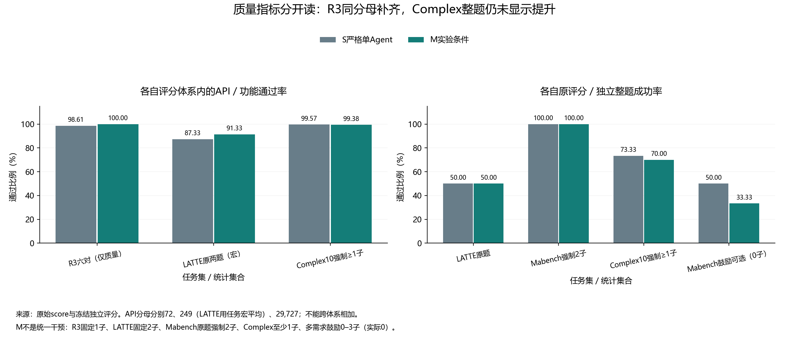
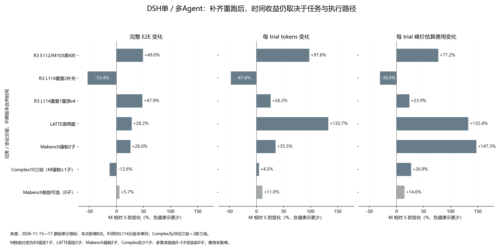
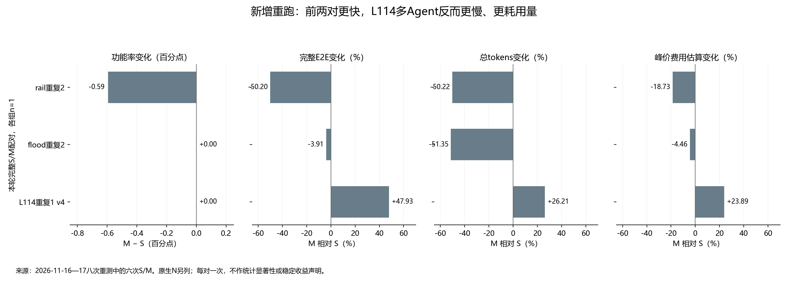

# DSH 单 Agent／委派策略跨任务集对照报告

**同事审阅版：2026-11-17（北京时间）｜数据仍为2026-11-15—17已登记结果及8次补充｜本次只修订说明，新增模型请求0。**

本报告只汇总DSH在四类任务来源上的受控实验，不包含随后进行的六Harness新Medium20原生矩阵或LATTE native五题补跑。下文“本轮8次”专指原登记的Complex6次与R3两次补充，不是这次文字修订又新增8次。S/M/N是实验条件缩写，M在不同研究中有不同强度，必须按下节解释。主表中的数字与上一版完全相同。

## 结论先读

现有结果证明DSH具备实际创建、执行和接收子Agent结果的能力；**准确率、完整E2E、tokens和费用分别变化，没有稳定的四项同时改善**。本次按事先登记的整对／整组三条件纳入8次，不从多次attempt里挑高分。

1. **R3参考分工**：L114两次重复的补充分别单列。既有重复2中M加速；本轮重复1双方正式核心12/12、完整16项也通过，但M完整E2E **510.0→754.5秒（+47.93%）**、tokens **2,171,028→2,740,158（+26.21%）**、峰价费用估算 **$0.374140→$0.463528（+23.89%）**。实际一子工作并有时间重叠，仍未带来净加速。六对的同分母质量敏感性现为 **S71/72、M72/72**；新旧协议／调度不同，不合并时间，也不能将新增五个检查通过归因于并行本身。
2. **Complex10**：原28个完整三组配对加本轮两个整组三条件后，得到**30个完整配对、N/S/M各30次**。S/M功能为 **29600/29727→29543/29727**，整题 **22/30→21/30**；M平均完整E2E **-12.77%**，tokens **+4.46%**、峰价费用估算 **+26.88%**。时间收益存在于这个组合视图，准确率和成本没有同步改善。
3. **LATTE原两题不变**：功能任务宏平均87.33%→91.33%，整题同为3/6；M六次各2子，E2E+28.21%、tokens+132.72%、费用估算+132.43%。
4. **Mabench／τ-bench不变**：正式强委派仅最后4次，两组各2/2成功，M均有2名工作子，但更慢、更耗tokens和费用。多需求组是**鼓励评估、允许模型自己决定是否委派，不强制子 Agent 数量**的可选配置，允许0–3子；实际6次M均0子，不能当实际多Agent净收益证据。

**原错误、缺分、HTTP402、本地信用中止、两条历史未知用量和旧报告全部保留。** 本轮8次均正常取得评分、531/531请求结算、新未知0，估算费用$3.855153016，非账单。没有新增付费试验或改题／改评分。

## 1. 任务来源、运行模式和预算：先区分配置，再看结果

实际执行者始终是 **DSH / Agent Team 0.2.1-rc.2**，模型固定 **DeepSeek V4 Pro普通模式，出口`thinking.type=disabled`，单次响应上限32768**。本报告没有用LATTE或LangGraph Harness执行这些任务。LATTE指模块扩展/调试两道任务的来源；Mabench/τ-bench指固定Mabench实现中的retail任务、业务API、模拟用户和原评分器，不称为“LangGraph论文系统效果”。Complex10是同事提供的7+3道复杂编码任务；R3是E112/M103/L114参考分工系列的第三轮及后续整对补充。

### 1.1 各组究竟是原生、鼓励还是强制

| 实验 | 组 | 提示与运行时约束 | 子Agent数量要求 | 时机与分工由谁决定 | 实际观测 |
|---|---|---|---|---|---|
| Complex10 | N原生 | 只给原TASK与标准原生Harness上下文；附加行为提示为空，Team开启 | 最低0，不要求创建 | 模型自主决定是否委派、何时委派、如何分工 | 30次中12次创建，共35个子ID |
| Complex10 | S严格单Agent | 条件提示禁止委派；运行时禁用Team及legacy委派入口 | 0 | 父独立完成全部任务 | 30次均0子 |
| Complex10 | M显式至少一子 | 明确要求至少1名真实子完成实质工作并回传；不是仅鼓励，也没有代模型创建会话的宿主脚本 | 至少1；不预设恰好几名 | 具体时机、角色、文件归属及是否追加均由模型自定 | 30/30次有子，共58个子ID |
| R3参考分工 | S / M | S本人完成主算法及同一参考验证工作；M明确规定一名fresh reference-validator，父做主算法，子做参考验证 | S=0；M恰好1 | M在读完公开SPEC/contract后、修改主实现前创建；属于规定分工和规定触发窗口 | 选定六对的M均1子，共6子 |
| LATTE原两题 | S / M | S独立完成相同A/B/C分区；M显式创建两子分别做B/C，父做A并整合 | S=0；M恰好2 | 研究方案预先规定职责与必要依赖；不是完全自主拆分 | M六次共12子 |
| Mabench原0、2题 | S / M | S禁委派；M明确要求两名只读调查子，并有运行时检查点阻止过早父产品查询及未经子结果回收的业务写入 | S=0；M恰好2 | 身份/订单输入具备后、父产品查询前创建；父唯一与用户交互及写状态 | M两次各2名工作子 |
| Mabench多需求20、23、41题 | S / M | S禁委派；M主动提醒评估委派机会、开放Team；没有必须先创建子的查询/写入门禁 | S=0；M允许0–3，最低0 | 模型自主判断是否值得委派，且只能处理已经公开、输入就绪的互补只读分支 | M六次均0子、0次spawn |

**“自由选择时机”不等于“可以选择不创建”**：Complex10的M可以自选时机和分工，但实验指令仍强制至少1名工作子；Mabench多需求M则**允许模型自己决定是否委派，不强制子 Agent 数量**，0子本身就是合法结果。Mabench可选组有鼓励性提示，因此也不能称为完全不加干预的原生组。Complex10没有额外的“仅鼓励委派”组，主表S→M比较的是严格单Agent与至少一子条件；原生N另列。强制表示实验规定必须委派，并非宿主替模型自动创建；真实子会话仍须由模型调用原生工具建立。

Complex10的最低一子要求来自提示与事后工作/回传验收，未加载强制在特定工具前创建子的检查点；Mabench原0/2题则确有这种运行时前置门禁，二者不能混称为相同的强制方式。子ID总数是跨试次累计创建数量，不是同一时刻并发成员数；至少一子实际工作/回传的按试次验收，也不意味着每一个累计创建ID都成功完成了同等工作。

条件原文和冻结SHA随包提供：[Complex10三组提示](evidence/conditions/complex-original/prompts.json)、[Mabench可选M完整提示](evidence/conditions/mabench-optional-r1/prompts/multi.txt)、[Mabench强制两子完整提示](evidence/conditions/mabench-forced/prompts/multi.txt)、[R3固定一子提示](evidence/conditions/r3-v4/guided.txt)、[LATTE固定两子提示](evidence/conditions/latte-tasks/prompts/multi.txt)。[条件来源登记](evidence/condition-source-registry.json)核验了11个历史运行目录的40份提示均与原冻结SHA一致，当前没有改动任何真实实验提示。

### 1.2 任务、重复、预算和调度

| 集合 | 选定任务与重复 | 每trial父子共享上限 | 调度与版本边界 |
|---|---|---|---|
| R3 | E112/M103/L114各2次配对，S/M共12条 | 1200秒、估算$3；2CPU/3072MiB | 原E112/M103四对；L114重复2既有恢复对，重复1新事务冻结v4对；资源不跨版本平均 |
| Complex10 | 10题×3次重复×N/S/M，共90条选定记录 | 1800秒、估算$3；2CPU/2048MiB | 原28个完整三组slot，加rail/flood重复2整组三条件；最多4Harbor，本批HTTP4/每trial2 |
| LATTE任务 | TP模块扩展、DBG调试，各S/M各3次，共12条 | 1200秒、估算$3 | 原四Harbor配置，保留原题和50/33项测试 |
| Mabench原两题 | retail/test源索引0、2，各S/M各1次，共4条 | 父/子/模拟用户合计1200秒、估算$3 | 只保留强制两子的最后4次作主对照；前8次不同干预/适配版本仅留审计 |
| Mabench多需求 | 源索引20、23、41，各S/M各2次，共12条 | 父/子/模拟用户合计1200秒、估算$3 | 首个M41 pilot，随后最多4Harbor；其收尾错误保留，其余11在相同提示的传输修复阶段完成 |

源任务编号从0开始：索引20指文件中的第21个任务，不是新增20道题。多需求与原两题是同一固定Mabench版本的不同题目子集，不是两个Harness。原两题trial ID末尾r3对应旧登记第三阶段，主对照实际每题每条件只有1次，不能读成强制两子条件各重复了3次。

同预算指同一比较内父子共享相同时间/费用**上限**，不是相同实际tokens；Mabench还计入模拟用户。相同任务/重复标签的配对不保证模型随机输出、对话措辞或工具调用顺序相同。以上CPU/内存是容器配额，不是物理主机型号；本报告未提供可消除全部争用的主机负载证据，不能推断相同配额就等于相同实际可用资源。

8次补充先运行rail原生included pilot，再rail S/M同波、flood N/S/M同波，最后L114 S→M顺序运行。最多4并发不表示始终4并发；同机器后来还有其他模块化实验。HTTP4是本批共享门禁，不证明其他会话也受同一机器总闸控制。启动前资金/资源准入等待不计入trial E2E，trial开始后的等待计入。

## 2. 主对照：质量、完整E2E与实际子Agent

箭头为S→M。**R3六对只汇总质量**，其资源指标拆成原4对、重复2补充、重复1v4三层。R3的“核心全过”仅指当次12个核心API检查全部通过；其他集合的“整题成功”按各自完整评分定义。原缺失reward没有被本文补造或重建。

| 实验／统计集合 | 每组n（S/M） | API／功能 | 成功计数 | 平均完整E2E秒 | M触发／子总数 |
| --- | --- | --- | --- | --- | --- |
| R3六个完整配对（仅质量） | 6 / 6 | 71/72 → 72/72 | 5/6 → 6/6（核心全过） | 按版本分列，不混算 | 6/6 · 6子 |
| R3 E112/M103原4对 | 4 / 4 | 47/48 → 48/48 | 3/4 → 4/4（核心全过） | 490.3 → 730.8 | 4/4 · 4子 |
| R3 L114重复2补充 | 1 / 1 | 12/12 → 12/12 | 1/1 → 1/1（核心全过） | 884.5 → 412.6 | 1/1 · 1子 |
| R3 L114重复1重测v4 | 1 / 1 | 12/12 → 12/12 | 1/1 → 1/1（核心全过） | 510.0 → 754.5 | 1/1 · 1子 |
| LATTE原两题 | 6 / 6 | 87.33% → 91.33%（任务等权） | 3/6 → 3/6 | 106.6 → 136.7 | 6/6 · 12子 |
| Mabench强制2子 | 2 / 2 | N/A（原评分无API分母） | 2/2 → 2/2 | 92.3 → 116.3 | 2/2 · 4子 |
| Complex10三组（M强制≥1子） | 30 / 30 | 29600/29727 → 29543/29727 | 22/30 → 21/30 | 560.5 → 488.9 | 30/30 · 58子 |
| Mabench多需求鼓励可选 | 6 / 6 | N/A（原评分无API分母） | 3/6 → 2/6 | 58.8 → 62.2 | 0/6 · 0子 |

分母含义仍不同：R3每次12个核心业务检查；LATTE每次TP50或DBG33项，微平均211/249→223/249，主指标为两任务等权87.33%→91.33%；Complex每条件29,727个细分语义断言来自本研究冻结的complex10-independent-semantic-v1补充评估器，覆盖返回值、输入不变性、构建/渲染/审计等，并非源任务作者原有29,727个用例或独立样本。Complex整题成功还要求原公开检查通过、受保护文件未漂移、全部补充断言通过。Mabench按数据库终态／required-output评分，**无API语义分母，记N/A**。不能跨体系相加成总准确率。例如LATTE单Agent任务宏平均=(112/150+99/99)/2=87.33%，而检查微平均=211/249=84.74%，两者不是同一个指标。

## 3. tokens、缓存和费用

单位M为百万tokens。下表总量只在同一统计集合的S/M间比较；跨集合应看每次均值或配对变化。输入已经包含命中缓存的tokens，不重复相加。

| 集合 | 输入tokens合计M | 输出tokens合计M | 总tokens合计M | 峰价估算合计USD | 平均Agent阶段秒 | 输入缓存命中率 |
| --- | --- | --- | --- | --- | --- | --- |
| R3 E112/M103原4对 | 8.345 → 16.479 | 0.149 → 0.302 | 8.493 → 16.781 | $1.556335 → $2.757846 | 420.6 → 698.6 | 94.36% → 96.02% |
| R3 L114重复2补充 | 4.659 → 2.431 | 0.055 → 0.048 | 4.714 → 2.479 | $0.622832 → $0.432438 | 812.1 → 377.5 | 96.61% → 95.62% |
| R3 L114重复1重测v4 | 2.136 → 2.684 | 0.035 → 0.056 | 2.171 → 2.740 | $0.374140 → $0.463528 | 449.1 → 730.6 | 94.76% → 96.38% |
| LATTE原两题 | 1.169 → 2.724 | 0.034 → 0.075 | 1.203 → 2.799 | $0.254098 → $0.590595 | 78.9 → 108.5 | 95.48% → 94.99% |
| Mabench强制2子 | 0.661 → 0.888 | 0.003 → 0.010 | 0.664 → 0.898 | $0.054446 → $0.134665 | 75.5 → 99.2 | 98.42% → 95.14% |
| Complex10三组（M强制≥1子） | 112.303 → 117.128 | 1.012 → 1.242 | 113.315 → 118.370 | $12.040713 → $15.277104 | 536.0 → 464.2 | 97.84% → 96.52% |
| Mabench多需求鼓励可选 | 2.494 → 2.769 | 0.015 → 0.017 | 2.510 → 2.785 | $0.233052 → $0.267135 | 45.6 → 49.5 | 98.03% → 97.74% |

费用统一按冻结峰价估算：每百万输入未命中$1.32、命中$0.044、输出$3.96；**不是供应商账单，也不是本次新查询价格**。已知usage均逐格复算一致。旧provider-schedule／weekend费用另存原字段，不能和本表峰价混用。缓存率是供应商返回的输入前缀缓存计量，不是内部任意KV／GPU缓存。

完整E2E采用Harbor trial原始起止，含该trial准备、Agent、评分和收尾；不加入启动前余额／队列等待或事后审计。控制器wrapper时间另存原数据，不能把多出的几秒审计开销混入本轮E2E。历史数据保留其既登记的trial口径；不同调度版本不混成一个时间因果估计。

## 4. 本轮8次：原件与配对变化

| 任务 | 重复 | 条件 | API／功能 | 完整E2E秒 | 总tokens | 峰价估算USD | 子数 | 终态 |
| --- | --- | --- | --- | --- | --- | --- | --- | --- |
| rail_renewal | 2 | N | 1005/1011 | 290.1 | 3,405,589 | $0.493633 | 3 | scored |
| rail_renewal | 2 | M | 1005/1011 | 272.1 | 3,013,592 | $0.440980 | 3 | scored |
| rail_renewal | 2 | S | 1011/1011 | 546.4 | 6,054,109 | $0.542640 | 0 | scored |
| flood_relief | 2 | M | 1008/1008 | 417.2 | 2,854,872 | $0.496624 | 3 | scored |
| flood_relief | 2 | S | 1008/1008 | 434.2 | 5,868,141 | $0.519788 | 0 | scored |
| flood_relief | 2 | N | 1008/1008 | 474.0 | 5,401,150 | $0.523820 | 0 | scored |
| L114 | 1 | S | 12/12 | 510.0 | 2,171,028 | $0.374140 | 0 | reference-assigned-single-normal |
| L114 | 1 | M | 12/12 | 754.5 | 2,740,158 | $0.463528 | 1 | reference-assigned-guided-normal |

八次纳入理由是先前确定的两个Complex三条件配对及L114重复1整对；**没有因为N创建了子、S满分或M变慢而改变纳入范围**。本轮正式无中止结果；功能未全过仍是有效结果，不能把rail N/M各1005/1011重跑到满分。

## 5. R3：补齐同分母后仍须分版本解释

| 质量视图 | S核心API | M核心API | 解释 |
| --- | --- | --- | --- |
| 原12次 | 59/60，5/6有分 | 67/72，6/6有分 | 原缺分、旧流程不完整保留 |
| 上一版5旧对＋重复2补充 | 71/72 | 67/72 | 历史敏感性，仍含L114重复1旧M7/12 |
| 当前4旧对＋两次L114整对补充 | 71/72（98.61%） | 72/72（100%） | 双方均6次有分；两个新配对整对选入，资源分层 |

本轮L114 S/M均核心12/12、原完整16项全过、reward2/2，双方均完成32例研究用参考验证流程。这32例是两组可见的同一附加验证工作量：S自行写参考与主实现，M由子写参考、父写主实现；不提供真值答案，冻结后再比较候选。它们不是12个正式隐藏API检查，不能以“参考流程完成”替代正式准确率。旧L114 S重复1的参考实现有`NameError completion`，框架又误将失败参考永久冻结；新v4只允许32例可运行后提交冻结，失败参考可在同预算内修复。**这同时涉及模型代码错误与框架缺陷**，不能把旧成绩一概当纯基础设施失败，也不能把新旧变化纯归因于多Agent。

本轮M子有23个原生模型响应、28个工作工具（全工具完成30个）、父收件2条；native模型span与父交叠310.347秒，实际工具dispatch与父交叠0.793秒。工作工具与全部工具口径分别保留，不能挑较大数字当产出。模型span交叠指父子原生模型调用时间区间的交集，可能含HTTP服务/排队；工具dispatch交叠是原生工具发起到完成区间的交集。二者都不是OS进程或CPU的实测并行量，也不表示缩短了净关键路径。**实际并发存在，但本轮M仍比S慢+47.93%，用量和费用也更多。** 子使用fresh上下文并被规定独立写参考，参考冻结与候选快照提供可见隔离约束；共享环境中的全部读依赖没有被本文穷尽证明，故不声称完成严格盲验证。正式准确率仍只取原评分器。

既有L114重复2则是另一结果：S884.5→M412.6秒，tokens4,714,180→2,479,033，费用$0.622832→$0.432438；一子26模型响应、33完成工具、1父收件，HTTP在途交叠274.48秒、工具dispatch仅0.088秒。两次重复的方向相反，**不能再只用较快的一次代表L114或R3的稳定收益**。

原四个E112/M103配对S47/48、M48/48，本轮新L114和既有补充都满分，使选定六对质量为S71/72、M72/72。这是明确选择规则下的事后补充质量视图，不是原始随机化六对，也不是多Agent必然提高准确率的因果证明。六对的时间／费用没有混合平均。

## 6. Complex10：两个整组三条件补齐，30对重新统计

原90题位和先前4个独立补跑均保留。主对照选用原正常的28个完整三条件配对，再按事先登记加入rail/flood重复2的6个新attempt；**不是从各条件分别选最高分，也不是原始90次全部无异常**。当前是30个完整task×replicate配对、各条件30次，共90条选定记录；Complex运营原件现为100条。

| 指标 | 原生N | 严格单S | 至少一子M |
| --- | --- | --- | --- |
| 功能断言 | 29599/29727（99.57%） | 29600/29727（99.57%） | 29543/29727（99.38%） |
| 整题全过 | 22 | 22 | 21 |
| 平均完整E2E秒 | 485.4 | 560.5 | 488.9 |
| 总tokens | 103062105 | 113315042 | 118369597 |
| 峰价费用估算USD | 12.757164904 | 12.04071264 | 15.277103512 |
| 有子试次 | 12 | 0 | 30 |
| 子ID总数 | 35 | 0 | 58 |

M相对S：完整E2E **-12.77%**、tokens **+4.46%**、费用估算 **+26.88%**；功能率低 **0.192个百分点**，整题22/30→21/30。原28配对结果仍保留为历史：整题20/28→20/28、E2E−11.72%、tokens+10.96%、费用+30.62%。新数据改变了分母和估计，图表已同步，不再用旧28对冒充最新完整结果。

| 任务ID | 三条件完整配对数 | 功能断言S→M | 整题S→M | 平均完整E2E秒S→M |
| --- | --- | --- | --- | --- |
| flood_relief | 3 | 2974/3024 → 2964/3024 | 1/3 → 2/3 | 462.9 → 463.0 |
| fulfillment_release_lab | 3 | 2943/2943 → 2937/2943 | 3/3 → 2/3 | 492.5 → 614.7 |
| grid_blackstart | 3 | 3042/3042 → 3006/3042 | 3/3 → 2/3 | 446.5 → 395.8 |
| medical_response | 3 | 3012/3015 → 3015/3015 | 2/3 → 3/3 | 496.4 → 463.3 |
| operations_release_lab | 3 | 2945/2952 → 2949/2952 | 2/3 → 2/3 | 518.8 → 447.0 |
| plant_overhaul | 3 | 2997/3033 → 3030/3033 | 2/3 → 2/3 | 471.5 → 611.2 |
| platform_restore_lab | 3 | 2841/2841 → 2835/2841 | 3/3 → 2/3 | 864.6 → 550.0 |
| rail_renewal | 3 | 3028/3033 → 3027/3033 | 2/3 → 2/3 | 486.9 → 357.0 |
| refund_settlement | 3 | 2914/2922 → 2922/2922 | 2/3 → 3/3 | 559.7 → 449.2 |
| research_migration | 3 | 2904/2922 → 2858/2922 | 2/3 → 1/3 | 805.0 → 538.0 |

本轮rail N/M各3子，均有独立模型响应、读写／执行工具和父收件；严格S0子。flood M3子、N/S0子，三个条件均1008/1008。N是自主选择，**不能把N等同单Agent，也不能将N内触发／未触发子集当随机对照**。

本轮9个Complex子均有原生独立模型响应、工作工具和父收件记录，因此可报告“创建→实际工作→父收到”。但本轮导出的结构化匹配列表没有把子结果文本逐项绑定到后续父模型请求，故“子结果进入下一轮模型输入”这一层在本轮记为未验证；不能把空列表解释为父没有收到或没有使用。其他历史批次的输入匹配覆盖不能外推这9个子。创建、工作、父收件、后续模型输入、时间交叠与净E2E收益是六种不同证据。

旧HTTP402及本地信用中止是原运营记录；本次修复按新trial与实际request边界分别核验，先前资金等待不进入新trial计时。后续充值恢复后本轮8次正常结束；用户另允许低预留继续并要求checkpoint，但实际没有修改这8次冻结门禁。这里的行政风险系数10用于本地新trial准入：把下个trial估算上限和历史未知风险相加、乘保守系数，再另加20CNY缓冲；它不是市场汇率、供应商扣费或账单。等待发生在消费身份前，不计入trial E2E。

## 7. LATTE与Mabench：模式、任务含义与trace解释

### 7.1 LATTE任务：固定两子参考分工，不是运行LATTE Harness

TP是文本处理模块扩展，DBG是信号处理函数调试。实际都由DSH完成。TP的父负责Document/Tokenizer与集成，一子做sentiment/keywords，另一子做summarizer/similarity/formatter；DBG由两子在各自副本诊断函数，父统一改正式文件。S完成同一参考分区工作，M显式创建两子，不能称自主发现分工。

TP功能112/150→124/150，但整题0/3→0/3；DBG双方99/99、3/3成功。TP共同未过的关键词n-gram频次/返回格式测试仍决定整题失败；M后两次用私有`_metadata`而检查要求公开`.metadata`，同时影响Document和Pipeline多项断言；M第一次还存在情感字典字段名不符合检查约定。公开概要/接口没有充分写清所有字段和行为边界，公开回归又主要验证接口存在及旧功能，因此保留**规格表述与测试预期之间的歧义**，不将其直接称为算法难度或多Agent能力缺陷。本文没有裁决后修改题面或把这些测试改判通过。

trace显示多Agent下父仍要读交付、整合和复验。父增量约占新增tokens的35.12%，子占64.86%，剩余来自未归属小项；这是角色用量差异的描述，不是“浪费比例”的因果估计。平均HTTP等待区间并集S15.26秒、M40.88秒，等待时其他角色可能仍工作，不能把差值当作扣除后必然获得的加速。

### 7.2 Mabench原0、2题：强制两子与单Agent

来源固定Mabench提交`2ac3562ec0bdd33cb145becdfcc3f5de87bd7d71`的retail/test，保留业务函数、原LLM模拟用户和原评分。这里的“真实对话”指每轮实际调用模拟用户模型、原样接收其返回，不是人工用户，也不是给父Agent预写一套固定回复。需求必须由实际用户消息/工具结果公开，私有任务目标和参考答案不提前给Agent。

本组M有强制两子的提示和运行时前置门禁：先取得实际身份/订单输入，再在父产品查询前建立两名fresh只读调查子；两子各有实际业务查询并回传后，父才可提交状态修改。父唯一与用户交互、确认付款/退款并写业务状态；子不能直接办理交易、联络用户、再委派或使用额外模型。因此这是**规定分工与规定触发窗口的机制对照**，不是证明模型自主找到了最优委派时机。

最后4次每题每条件仅一次。双方各2/2成功，M两次均有2名实际工作子和父收件；兄弟HTTP调用的在途交叠分别7.65/5.92秒，但工具执行重叠只有毫秒量级，业务写入仍由父串行完成。第2题两子还重复查询同一商品。M完整E2E、tokens和费用更高，不能把模型请求交叠称为交易并行或净收益。前8次探索的不同提示/适配版本仅在审计附录，不以原12次整体代表这一强制条件。

### 7.3 Mabench多需求：鼓励评估、自主可选，0子合法

**本组允许模型自己决定是否委派，不强制子 Agent 数量。** M的原提示明确写`NO minimum worker count`与`Zero workers is legitimate`，最多3名fresh只读子，0、1、2、3均可；同时鼓励在已经公开、输入就绪且协调成本值得的互补调查上使用最少必要子。没有“产品查询前必须先创建两子”的拦截，也没有因0子而判实验条件失败、补创建或追加付费重跑。S仍为运行时禁用委派的严格单Agent。完整提示已随本报告附上，不需要访问作者电脑。

三题任务含义如下，全部为源索引，不是本文编造的新需求：20是多个商品升级及鞋码/付款约束；23是头盔、行李箱、烧烤架三个跨订单售后；41是拼图规格选择加账户/多个订单地址核对。模拟用户根据实际对话自适应，不能假定所有需求首轮全部公开。第23题M重复1在4.60秒公开头盔、31.76秒公开行李箱、46.15秒公开烧烤架，第一次状态修改在28.50秒，当时后两目标尚未公开；重复2则在12.19秒前已公开三项，第一次修改37.25秒。以上披露时间均相对于当次Agent阶段起点，不是完整E2E起点。这两次不是相同信息状态下的相同“并行机会”。第41题两次M均在约4.2秒公开两项需求，仍需从工具取得输入，公开目标本身不等于全部分支都已就绪，更不是人为标定的最优spawn时间。

**实际6次M全部0子、0次spawn调用**，并已逐次核验Team工具和条件提示实际开放/出现；不是因没有开启能力而把0误记成自主选择。但这6次也没有可核验的显式不委派理由，不能进一步声称模型已正确评估成本收益，或据此证明任务不需要分解。0子只说明观察窗口内没有调用原生委派。

按分配条件完整保留12次：S3/6成功，M2/6成功。第20题4次中3次选258.71而非原规则最高可用价261.11的化妆品变体；第41题4次均先改商品导致同一订单进入不可再改状态，再改地址被API拒绝；第23题两组四次均成功。第41题可行顺序是先完成对应地址修改，再改商品，互补只读调查不能取消写入依赖。这些是原评分与业务trace的事后解释，不给Agent透传参考答案，也不因失败发生在M条件就归因于协作，因为没有实际子参与。

第一条M41试次先取得原reward0，随后出现收尾适配错误；保留原0和异常，不免分。敏感性只把它与同题S整对排除，剩S3/5、M2/5，平均E2E59.75/62.95秒；不只删较差的M。主表仍保留全部12次。[逐次能力、公开目标时间与状态修改摘录](evidence/mabench-optional-trace-extracts.json)及[整对敏感性数据](evidence/mabench-optional-sensitivity.json)可直接随包查看。

因此，本组只能解释为**“严格单Agent配置”对“鼓励可选委派配置”的分配组比较**，不能解释为“实际单Agent执行”对“实际多Agent执行”的净收益对照。它也不是完全原生无干预组，不与Complex10的N合并。

## 8. 当前可以和不能得出的结论

**Accuracy**：R3选定六对质量有小幅提高；LATTE功能检查改善但整题不变；Complex最新完整30对M功能与整题均略低。不能把不同分母合成总分，或将协议修复后的质量变化纯归因于并行。

**完整E2E**：Complex平均更快；L114两次补充一快一慢；LATTE与正式Mabench更慢。有实际子工作和span重叠是机制证据，关键路径是否缩短须看配对E2E，不能只看spawn数量。

**tokens与费用**：新上下文、父复读、重复复验与不同缓存命中会增加开销；本轮rail/flood配对M恰好用量更少，L114则更多。不能据某个样本宣称多Agent必然更省，也不能用估算当账单。资源竞争是混杂，目前没有足够证据量化其因果占比。不同研究的M还可能同时改变提示、工具许可、规定分工和流程检查点，因此这些配置对照不能被压缩成只改变“Agent数量”一个变量的统一因果试验。

## 9. 试次范围、重跑选择与账本：三个计数不要混用

主表实际选定的是**130个唯一attempt**：R3六对12条、Complex10完整三组90条、LATTE任务12条、Mabench强制两子4条、Mabench鼓励可选12条。R3“六对仅质量”与其下面三个资源分层使用相同12条，不能重复相加。N/S/M是分配条件，不按运行后有没有子来重新分组或筛掉未触发结果。

“主范围145条”还包含15条运营异常或被整对补充替代的旧记录；“完整153条”再加主汇报移出的Mabench前8次探索。因此145、153不是主对照里独立成功执行的样本数，也不是另有145/153道任务。

本轮8条为事先登记的两个Complex三条件slot与L114重复1整对。按整个task×replicate替换/补充，S与M一起纳入，不分别挑最高分。Complex原28整组加2新整组形成30；R3保留E112/M103原4对，再取两条L114整对作为不同协议的事后质量敏感性，资源不混成一个估计。此选择不是原随机化试验的无偏恢复，旧失败和未知请求照保留。

- 主范围145条：7,639发送/7,637结算/历史unknown2，已知峰价估算$53.536187760。
- 完整153条：7,743发送/7,741结算/历史unknown2，已知峰价估算$53.875767528。
- 本轮8条：531/531结算、unknown0，已知峰价估算$3.855153016。

unknown2是已经发送但无法完整确认usage的历史请求，不是费用0；所列费用是已知已结算部分，不含未知最终金额，也不是供应商账单。不同统计集合有重叠，不把这些三行相加作为总费用。

可直接复算的数据入口：[主范围145条](reporting-cells145.csv)、[完整153条](all-attempts153.csv)、[本轮8条](retest8-cells.csv)、[主统计集合](reporting-cohort-groups.csv)、[结构化指标JSON](comparison.json)、[Complex90条选定记录](selected-complex90.csv)、[R3六对](selected-r3-pairs12.csv)、[逐slot选择凭证](paired-selection.json)、[130/145/153名单关系](evidence/selection-membership.json)、[每条试次的模式映射](trial-condition-map.csv)。Mabench前8次只在[审计附录](审计附录-Mabench前8次.md)说明，历史成绩和成本没有删除。

## 10. 同事拿到哪些文件、能验证到哪一层

本目录和交付ZIP包含报告、PNG/SVG、逐次CSV、指标JSON、完整实验条件提示/冻结SHA、脱敏trace摘录、选择映射和无第三方依赖的[portable_recalculate.py](portable_recalculate.py)。只需把ZIP解压到同一目录，用Python 3执行该脚本，即可核验153条唯一性、条件集合、分母、成功数、均值、tokens、缓存率和峰价费用。**不需要作者本机的C盘或WSL目录，也不调用模型。** PNG适合直接阅读，SVG保留文本和矢量元素；Canvas是需要Codex支持的可选交互文件，不是阅读必需。

必须区分三层可复现性：本包足以复算本文汇总数字、查看实际条件原文及所列证据摘录；它不包含所有原始模型会话、候选仓库、冻结镜像和完整评分环境，因此不能仅凭本包重跑真实付费实验或穷尽审计所有工具调用。CSV/JSON里的`source`、`raw_result_path`及作者源登记中的绝对路径只是原环境定位字段，复算脚本不会读取这些路径；它们本身不构成接收者可访问的证据。旧记录的quality_interpretation有按整个研究通用填写的文字，不能替代组别开关；请以arm、逐条模式映射及随附冻结提示判读，S始终禁委派。SHA可验证所交付文件完整性，不能替代未交付原件。

原始`build_report.py`/`build_retest_update.py`是作者侧重建图表的入口，仍读取历史本机源摘要；接收者请用上述portable脚本。完整检查点未随包复制；[检查点范围说明](evidence/检查点范围说明.md)只说明作者保留460文件及核验方法，不能宣称接收者已获得这些文件、模型KV或可续接在途请求。旧版报告和作者完整运行目录另行归档保留，不是本次阅读的必要依赖。

证据限制已经落到具体结论：本轮Complex9子有创建/模型工作/工具/父收件，但进入下一轮父模型输入的自动逐项匹配未验证；R3的fresh与访问约束不等于穷尽证明盲性；HTTP/原生工具区间交叠不是CPU并行或净收益；原生不委派且无决策理由，不能推定成本判断正确；跨批资源竞争没有可识别的因果占比。论文/报告没有把这些未知补成0或当成肯定结论。

本次修订只补充运行模式、证据与交付边界，**153条原始指标对象、统计选择和数值不变**，未修改题目、评分器、真实提示或权限，新增模型请求0。原LATTE上游源码和私有MLP-PPT24不在交付中。本次尚未push GitHub，可先将同事交付ZIP直接转发审阅。
