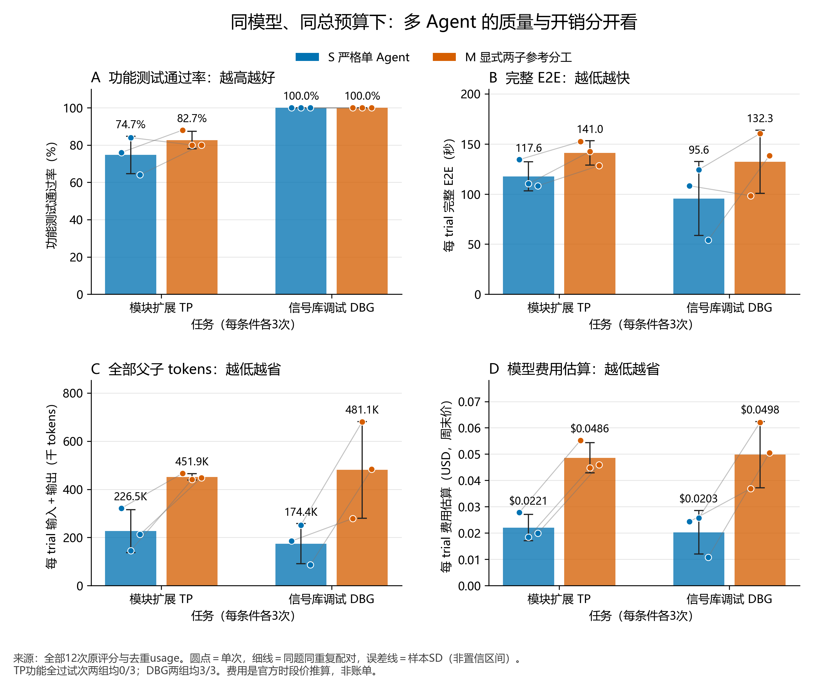
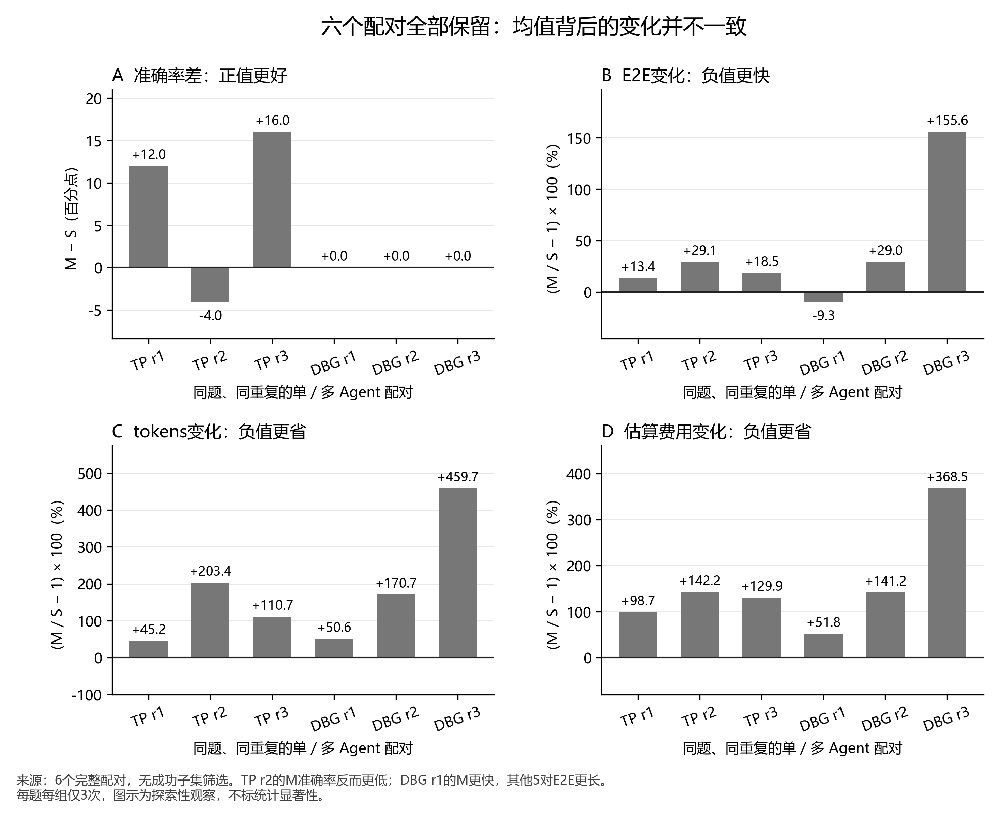
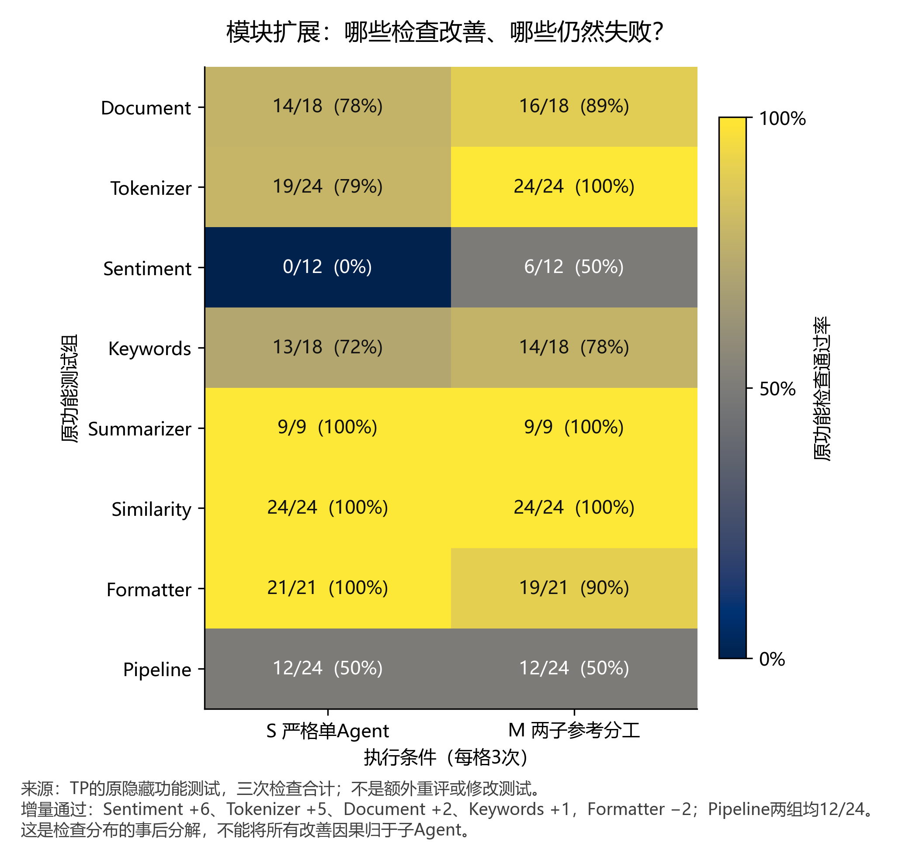
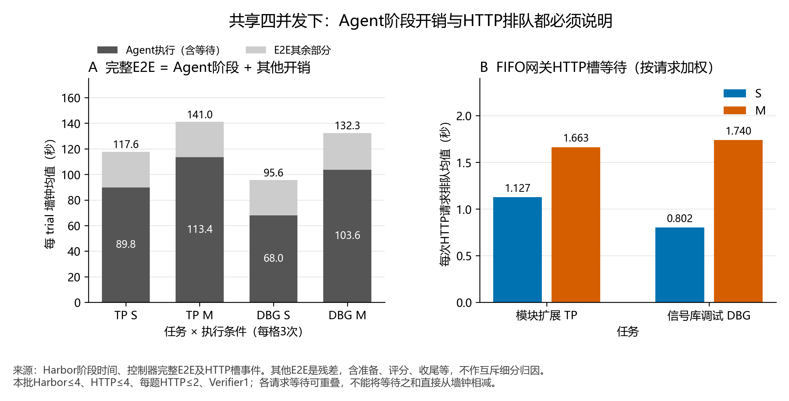
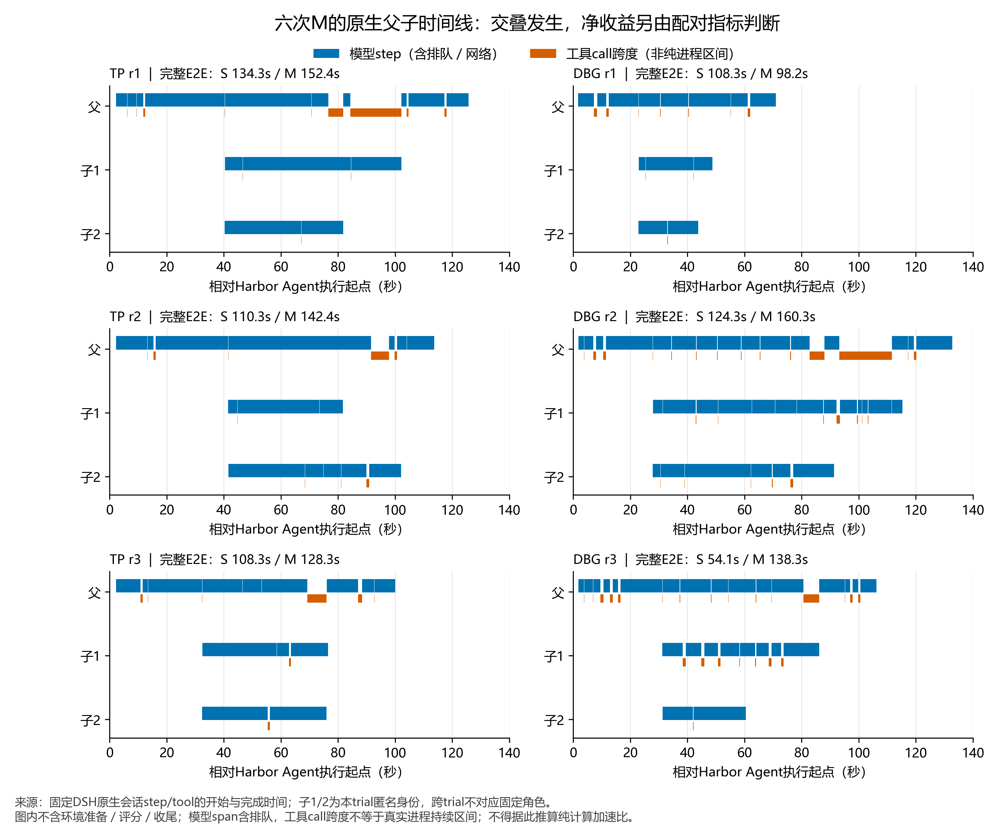

# DSH 在 LATTE 原始模块扩展与调试任务上的单／多 Agent 对照

2026-11-15 完成。**12/12 次真实试次均有原功能评分，288/288 个模型请求结算，未知用量0。** 两题各 S/M 三次；首轮4次 included pilot 验收通过后自动运行余8次。数据使用全部12次，不筛选高分、成功或更快的子集。

**结论：这轮证明了显式参考分工下的原生子 Agent 能力，但没有出现整体加速或节省。** M六次均创建两名有独立模型／工具工作的原生子，共12子和12次父接收。模块扩展平均功能通过率从74.7%提高到82.7%，但两组均0/3整题全过；调试两组均100%。两任务等权宏平均功能通过率为87.3%／91.3%，平均完整E2E为106.6／136.7秒，全部tokens为1,202,762／2,799,063；M耗时、tokens与估算成本均更高。

这是**DSH运行LATTE原始任务**的实验，不是LATTE Harness的native、frozen或planning-adapted结果，也不是LATTE论文原架构／模型的复现。M采用显式参考分工，不评估自主找到最优拆分时机。

- [全部指标 JSON](metrics.json) · [逐次 CSV](cells.csv) · [分组 CSV](groups.csv) · [同题配对 CSV](paired-contrasts.csv)
- [498项原功能检查](functional-checks.json) · [288条脱敏usage](request-usage.json)／[CSV](request-usage.csv) · [计价快照](pricing-snapshot.json)
- [原生协作摘要](native-evidence-summary.json) · [相对时间线数据](native-timeline-data.json) · [E2E阶段](e2e-phases.json) · [资源采样摘要](resources-summary.json)
- [控制变量](study-design.json) · [干预提示](intervention-prompts.json) · [完成证书](completion-audit.json) · [离线机制验收及失败保留](mechanism-acceptance.json) · [来源与脱敏](provenance.json)
- [前一轮R3对照（不同数据集，独立保留）](../dsh-reference-decomposition-v4pro-20261115-r3/README.md)

## 1. 具体任务与两组执行方式

上游固定提交：[`63e6faf767894e22024af26eb02d70809df0c848`](https://github.com/emieczkowski/latte/tree/63e6faf767894e22024af26eb02d70809df0c848)。原题、起始实现及测试断言按原字节保留；本仓库只发布结果、图表与元数据，不重新分发LATTE源码或测试代码。

| 任务 | 原始工作 | 主要准确率口径 | 在线可见范围 |
| --- | --- | --- | --- |
| TP 模块扩展 | 扩展Document/Tokenizer；实现情感、关键词、摘要、相似度、格式化和Pipeline六模块 | 原`test_suite_eval.py`的50个功能测试 | 原题、起始代码、公开接口测试及既有Document回归；隐藏功能测试仅评分环境可见 |
| DBG 调试 | 修复`signal_toolkit.py`，保持原任务只修改该正式文件的要求 | 原`test_suite.py`的33个行为测试 | 原题、起始实现和全部33个公开测试 |

TP的公开`test_suite.py`只有一个接口存在性测试，既有Document另有五个回归；**它们不代替50个隐藏功能测试的准确率**。Accuracy在本报告指功能检查通过率，不是模型HTTP成功率，也不沿用旧业务API准确率的分母。原评分套件中已注释的项目保持注释，没有增删断言或把隐藏答案写入运行提示。

S为严格单Agent，原生Team及legacy委派工具禁用，由父完成全部参考分区。M显式要求两名fresh原生子；父仍需做实际工作并负责接收、集成和公开回归。两组看到相同参考分区：TP父负责基础接口与Pipeline，两个子分别负责独立模块；DBG子在各自固定起点的诊断副本中验证并返回补丁，父为正式单文件的唯一写入者。各trial不共享前次产物。

共同配置为V4 Pro `thinking.type=disabled`、DSH/Team `0.2.1-rc.2`，每题全部父子共享1200秒及峰价估算准入上限3美元、单响应32768 tokens；没有额外80请求封顶、没有每个子各领一份预算。全部12次上限36美元，零付费自动重试。

用户最终将最初的单trial隔离方案改为**三轮各4个Harbor并发**，每轮含TP/DBG×S/M；所有父子共享HTTP≤4、每trial≤2、Verifier槽1。每容器同为2 CPU／3072 MiB，共用固定镜像、NumPy2.1.3／pytest8.3.5。**同预算上限不等于同实际用量；相同批次负载也不保证争用完全抵消。** 首轮验收要求真实模式、评分可读、监控、子工作回传与usage完整，不以高分或更快作为放行条件。

## 2. 质量、时间、tokens与费用分开看

图1：每格3次；圆点为单次，细线连接同题同重复，误差线为样本SD而非置信区间。费用图是每次均值，下表费用是三次合计。

| 任务 | 条件 | 次数 | 功能检查通过 | 整题全过 | 完整E2E均值/秒 | Agent阶段均值/秒 | tokens均值/次 | 三次费用估算/USD |
| --- | --- | --- | --- | --- | --- | --- | --- | --- |
| TP | S | 3 | 112/150 (74.7%) | 0/3 | 117.6 | 89.8 | 226,497 | 0.066212 |
| TP | M | 3 | 124/150 (82.7%) | 0/3 | 141.0 | 113.4 | 451,935 | 0.145839 |
| DBG | S | 3 | 99/99 (100.0%) | 3/3 | 95.6 | 68.0 | 174,424 | 0.060837 |
| DBG | M | 3 | 99/99 (100.0%) | 3/3 | 132.3 | 103.6 | 481,086 | 0.149458 |

M相对S的变化如下。准确率正值更好；其余项正值表示开销增加。ALL准确率为两任务等权宏平均，不是把50项和33项混为同样数量的独立任务。

| 范围 | 准确率差 | 完整E2E变化 | tokens变化 | 估算成本变化 |
| --- | --- | --- | --- | --- |
| TP | +8.0 pp | +19.9% | +99.5% | +120.3% |
| DBG | +0.0 pp | +38.4% | +175.8% | +145.7% |
| ALL | +4.0 pp | +28.2% | +132.7% | +132.4% |

S/M的整题成功率均为3/6：调试各3次全过，模块扩展各3次都未全过。因此只能说模块扩展的**部分功能检查**改善，不能写成整题成功率提高。M实际消耗更多tokens和费用；本实验没有“单Agent增加到同实际tokens”的对照，不能把质量差异全部归于并行调度。

## 3. 六个配对显示的差异

图2：TP的三个质量差分别为+12、−4、+16个百分点，并非每次都改善。DBG r1的M比S更快，其他5个配对的M完整E2E更长。它说明局部加速观察可以存在，但不能选取该一对代替全量均值。

| 任务 | 重复 | 条件 | 功能通过 | 完整E2E/秒 | 全部tokens | 周末费估算/USD | 子数 | 父收件 |
| --- | --- | --- | --- | --- | --- | --- | --- | --- |
| DBG | 1 | M | 33/33 | 98.2 | 279,258 | 0.036929 | 2 | 2 |
| DBG | 1 | S | 33/33 | 108.3 | 185,402 | 0.024327 | 0 | 0 |
| DBG | 2 | M | 33/33 | 160.3 | 680,901 | 0.062075 | 2 | 2 |
| DBG | 2 | S | 33/33 | 124.3 | 251,553 | 0.025740 | 0 | 0 |
| DBG | 3 | M | 33/33 | 138.3 | 483,099 | 0.050455 | 2 | 2 |
| DBG | 3 | S | 33/33 | 54.1 | 86,316 | 0.010770 | 0 | 0 |
| TP | 1 | M | 44/50 | 152.4 | 466,707 | 0.055208 | 2 | 2 |
| TP | 1 | S | 38/50 | 134.3 | 321,488 | 0.027780 | 0 | 0 |
| TP | 2 | M | 40/50 | 142.4 | 440,861 | 0.044736 | 2 | 2 |
| TP | 2 | S | 42/50 | 110.3 | 145,310 | 0.018471 | 0 | 0 |
| TP | 3 | M | 40/50 | 128.3 | 448,237 | 0.045895 | 2 | 2 |
| TP | 3 | S | 32/50 | 108.3 | 212,693 | 0.019961 | 0 | 0 |

## 4. 模块扩展的改善和残留失败在哪里

| 原测试组 | S通过/总数 | M通过/总数 | M新增通过 |
| --- | --- | --- | --- |
| DocumentExtensions | 14/18 | 16/18 | +2 |
| TokenizerExtensions | 19/24 | 24/24 | +5 |
| Sentiment | 0/12 | 6/12 | +6 |
| Keywords | 13/18 | 14/18 | +1 |
| Summarizer | 9/9 | 9/9 | +0 |
| Similarity | 24/24 | 24/24 | +0 |
| Formatter | 21/21 | 19/21 | -2 |
| PipelineIntegration | 12/24 | 12/24 | +0 |

M净增加12个通过检查，主要来自Sentiment（+6）与Tokenizer（+5），另有Document（+2）、Keywords（+1），被Formatter的回退（−2）部分抵消。Pipeline两组均12/24，说明最终跨模块行为仍有未通过项，未转为整题全过。这是原检查结果的事后分解，**不是对子Agent贡献的逐项因果归属**。原始公开说明的若干业务约定较简略，也限制了将所有失败解释为协作失败；本次没有据此更改题面或验收预期。

## 5. 完整E2E与资源争用

完整E2E从trial开始准备环境，覆盖所有规划、父子工具与模型、沟通、集成、自检、正式评分、证据导出及收尾；队列中尚未启动的等待与一次性镜像构建不计入单trial。后处理分析另计，没有把更大trace的离线解析时间塞进M的E2E。

全量S/M的Agent阶段均值为78.928／108.506秒，完整E2E的其余部分均值为27.665／28.156秒。额外墙钟主要出现在Agent阶段；该阶段仍包含HTTP排队与协调，不能据此把它全部归为子Agent协调的纯开销。图3的“其余部分”是完整E2E减Agent阶段的残差，不是已完成互斥归因的准备／评分／收尾细分。

| 条件 | 请求数 | 输入tokens | 输出tokens | 输入缓存命中率 | 每请求HTTP排队/秒 | 每trial评分槽等待/秒 |
| --- | --- | --- | --- | --- | --- | --- |
| S | 94 | 1,168,602 | 34,160 | 95.48% | 0.999 | 0.468 |
| M | 194 | 2,724,126 | 74,937 | 94.99% | 1.701 | 0.801 |

M请求数由94增至194、总tokens约为S的2.33倍。父子各自上下文、工具往返与父集成复验会增加推理工作，但本汇总没有把每个token精确分摊到这些行为。每请求HTTP等待S约0.999秒、M约1.701秒；等待之和可互相重叠，不能直接从完整墙钟相减。缓存率按所有已知请求的缓存输入／总输入加权，288条均可观测；缓存token是输入子集，不重复相加。

## 6. 原生协作证据：发生了交叠，不等于获得净收益

图4绘全部六次M，未筛选更好案例。时间轴相对Harbor Agent执行起点；模型step包含排队／网络，工具call跨度也不是纯进程执行区间。匿名子1/2仅在该trial内有效，不与跨trial的固定模块角色强行对应。

| 任务 | 重复 | 子数 | 有工作子数 | 父收件 | 两条父子模型step交叠/秒 | 两条工具call交叠/秒 | 精确后续请求结果匹配 |
| --- | --- | --- | --- | --- | --- | --- | --- |
| DBG | 1 | 2 | 2 | 2 | 25.053 / 20.164 | 0.000 / 0.000 | 未知（未精确匹配） |
| DBG | 2 | 2 | 2 | 2 | 61.071 / 55.662 | 1.124 / 0.204 | 未知（未精确匹配） |
| DBG | 3 | 2 | 2 | 2 | 43.020 / 28.337 | 0.200 / 0.000 | 未知（未精确匹配） |
| TP | 1 | 2 | 2 | 2 | 38.518 / 36.017 | 0.095 / 0.000 | 未知（未精确匹配） |
| TP | 2 | 2 | 2 | 2 | 39.902 / 52.174 | 0.000 / 0.004 | 未知（未精确匹配） |
| TP | 3 | 2 | 2 | 2 | 36.387 / 35.833 | 0.000 / 0.000 | 未知（未精确匹配） |

S六次均0子；M六次均两子，每个子都有独立模型步骤和完成工具，合12子、12次原生父收件。12条父子关系的模型step均有非零交叠，20.164—61.071秒；工具call跨度只有5条关系非零，0.004—1.124秒。**这不是纯工具进程级并行证书，也不能据此计算供应商纯推理加速比。**

当前摘要匹配器未获得子结果原生收件文本与后续模型请求的精确匹配：公开摘要保留为`null/unknown`，不能把匹配计数0解释成“没有进入模型”或“父没有使用结果”。另一个独立检查已证明全部12次的共同／条件提示在原生根输入和真实出口文本SHA匹配，不能混淆这两种证据。详细语义采用和每次改动的贡献仍需进一步trace审查；本次不为补证重跑付费试次。

## 7. 费用、异常与实验限制

全部父子及辅助请求按request_id去重：输入3,892,728、输出109,097，共4,001,825 tokens；288/288已结算，无未知、在途或剩余预留。S/M六次周末时段费用估算分别为0.127049032／0.295297332美元，整批0.422346364美元。保守峰价上界估算为0.844692728美元，低于36美元上限。**这些是usage×冻结价表的估算，不是账单；准入预留不是花费。**

价表冻结于2026-11-15：[官方DeepSeek价格](https://api-docs.deepseek.com/quick_start/pricing/)。峰价每百万输入miss/hit/输出为1.32／0.044／3.96美元，周末为其一半。本批所有实际请求日期均为UTC周日；[288条usage](request-usage.json)保留时间、用量与倍率，便于独立重算。缓存命中率不等于硬件KV占用率。

真实12次无Agent异常、预算／输出／超时截断或缺失原生tool span；TP功能失败原样保留，不因“正常结束”而改成满分。离线验收中两次模拟器问题（注册漏字段、队友名大小写不符合原生规则）均保留原件及摘要，它们供应商请求0、不计入真实12次。最终四个完整Harbor `network=none` fixture证明评分、严格S限制、M两子工作及父回传机制可运行，**不能把脚本化fixture当自主委派成果**。

结论仅限两个固定任务、每格三次：四并发/共享HTTP与Verifier竞争不自动抵消，预算上限相同也没有配平实际推理量；TP/DBG的评分可见性不同，不将两者当同一难度。未使用R3的复杂强制检查点或关键词只读误拦，不覆盖此前R1/R2/R3成绩；不同任务与评分分母不能直接做跨轮Accuracy排名。没有新增诊断、付费重试、LLM裁判或修改原评分断言。

## 8. 数据复核与图表重建

运行`python validate.py`核验12格／6对／498项原检查／288结算请求、各均值与成本重算及文件SHA。`python render_figures.py`用公开JSON重建五张PNG及SVG，需Matplotlib与中文字体；不调用模型。跨平台字体／Matplotlib版本可能改变图像字节，不改变数据。SVG已转文字轮廓，GitHub可直接显示。

本目录的`.gitattributes`固定文本为LF，避免Windows自动换行转换使下载后的SHA校验失败；PNG按二进制保存。重新生成图像后应重新生成公开文件哈希清单，再执行校验。

本目录仅包含脱敏用量、评分、相对span、资源和作者干预提示；不上传原生会话、模型原文、候选源码、主机路径、API key、私有MLP-PPT24或LATTE源码。源文件SHA与原始冻结哈希见[provenance](provenance.json)，公开文件哈希见[artifact-manifest](artifact-manifest.json)。
