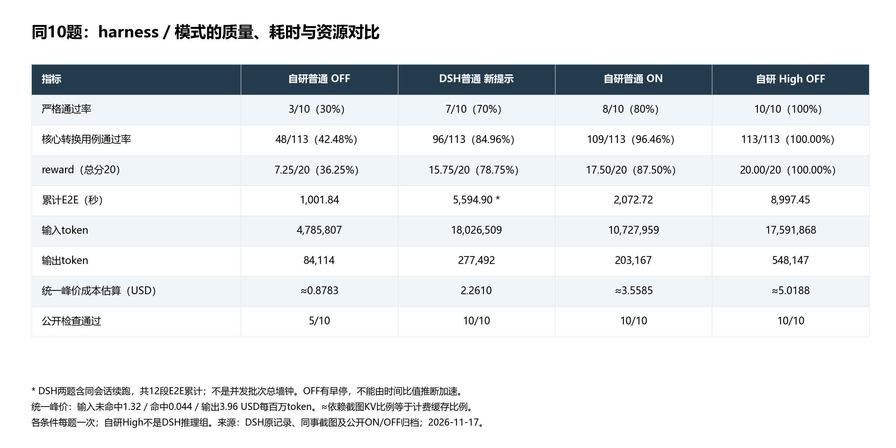
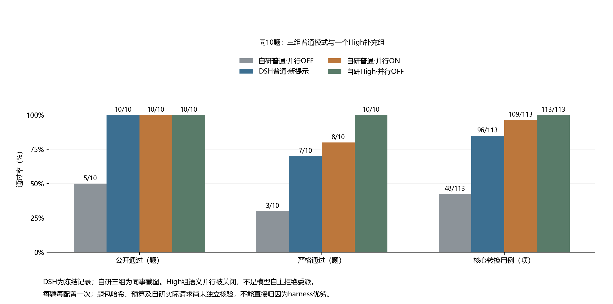
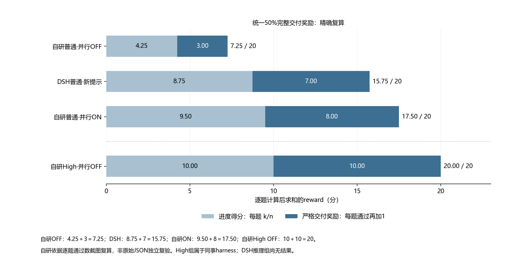
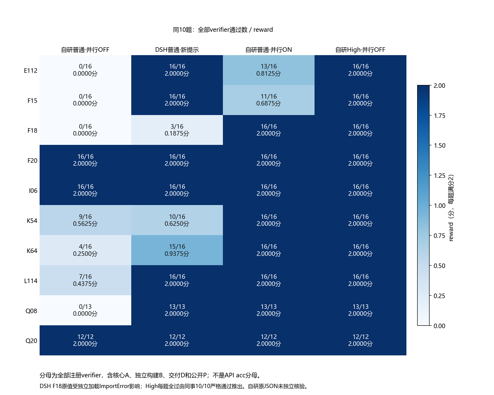
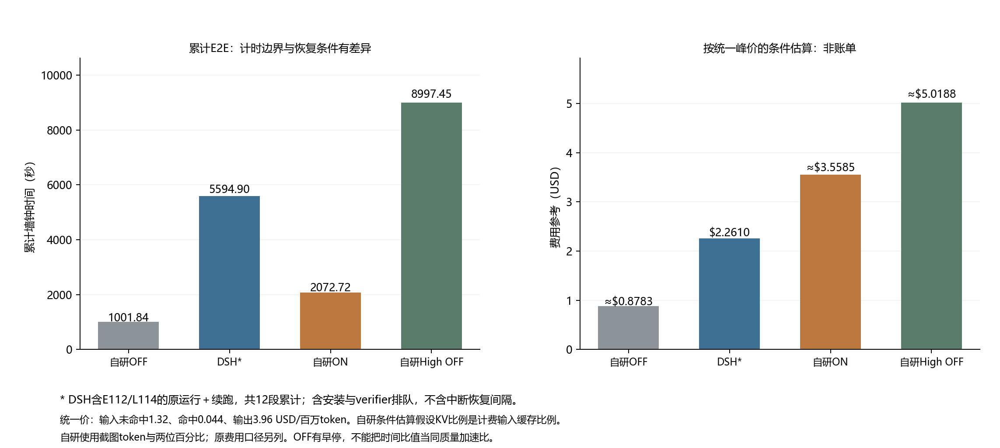

# 同10题不同harness／模式：完整指标对比

更新：2026-11-17T14:43:44+08:00。各条件每题一次；不同推理配置、控制开关与恢复条件分别列示。

## 0. 同10题完整指标总表

对应任务固定为 **E112、F15、F18、F20、I06、K54、K64、L114、Q08、Q20**；M103不在这10题内。原称API acc的指标统一写为“核心转换用例通过率”。

| 指标（对应同10题，各条件一次） | 自研普通·OFF | DSH普通·新提示 | 自研普通·ON | 自研High·OFF |
|---|---:|---:|---:|---:|
| 严格通过率 | 3/10（30%） | 7/10（70%） | 8/10（80%） | 10/10（100%） |
| 核心转换用例通过率 | 48/113（42.48%） | 96/113（84.96%） | 109/113（96.46%） | 113/113（100.00%） |
| reward（总分20） | 7.25/20（36.25%） | 15.75/20（78.75%） | 17.50/20（87.50%） | 20.00/20（100.00%） |
| 累计E2E（秒） | 1,001.84 | 5,594.90 * | 2,072.72 | 8,997.45 |
| 输入token | 4,785,807 | 18,026,509 | 10,727,959 | 17,591,868 |
| 输出token | 84,114 | 277,492 | 203,167 | 548,147 |
| 统一峰价成本估算（USD） | ≈0.8783 | 2.2610 | ≈3.5585 | ≈5.0188 |
| 公开检查通过 | 5/10 | 10/10 | 10/10 | 10/10 |

* E2E为逐题执行区间求和；DSH两题各有原运行与同会话续跑，共12段，包含安装、重复验收和verifier排队，不含中断恢复间隔。各harness计时边界与早停条件未完全一致，不把它解释成公平加速排名。

“≈”为条件估算：同事截图KV命中率暂按API计费输入缓存比例处理；DSH按真实usage中的cached token计算。统一峰价为每百万token输入未命中1.32、命中0.044、输出3.96 USD；均非账单，原口径金额另见第7节。reward按逐题全部verifier比例＋50%严格交付奖励计算，不直接由核心通过率换算。

[完整指标CSV](同10题完整指标对比.csv) · [显式与未显式同题完整指标CSV](M103同题完整指标.csv) · [显式同题专题](显式委派与未显式要求_同题对照.md) · [同10题专题](10题不同Harness模式_统一指标对比.md)

## 4. 与同事自研Harness：必须匹配这10题

对应题目为：**E112、F15、F18、F20、I06、K54、K64、L114、Q08、Q20**。其核心用例共113项，全部verifier共153项。截图中的20题task_order是顺序信息，不能当作自研已运行20题；**M103不在本次10题中**。

DSH取自主新提示组对应记录；E112、L114为原会话续跑，其余8题为连续软时间运行。自研截图称High组10题均冷启动。任务名称及逐题verifier数量一致，题包/评分内容哈希及完整预算尚未独立对齐，因此是现有成绩描述对比。

| 配置 | 公开通过 | 严格通过 | 核心转换用例 | reward /20 | 进度＋严格交付奖励 |
|---|---:|---:|---:|---:|---:|
| 自研普通·并行OFF | 5/10 | 3/10 | 48/113（42.48%） | 7.25 | 4.25＋3.00 |
| DSH普通·新提示 | 10/10 | 7/10 | 96/113（84.96%） | 15.75 | 8.75＋7.00 |
| 自研普通·并行ON | 10/10 | 8/10 | 109/113（96.46%） | 17.50 | 9.50＋8.00 |
| 自研High·并行OFF | 10/10 | 10/10 | 113/113（100.00%） | 20.00 | 10.00＋10.00 |

## 5. Reward精确复算与逐题结果

每题权重2，完整性检查按原门禁处理；本批计分式为 **`R_i = k_i/n_i + strict_i`**。即第一分为全部注册verifier通过比例，严格通过再加1分。先逐题算、再求和；不能将全体API acc或全体通过检查的微平均直接代入。

例如自研ON的E112为13/16且未严格通过，所以0.8125分；F15为11/16，所以0.6875分。其余8题严格全过，各2分，总计17.50。OFF为7.25，与同事逐题截图完全一致。High组10题严格通过，各2分，总计20。

| 任务 | DSH：全部检查；reward | 自研普通OFF：全部检查；reward | 自研普通ON：全部检查；reward | 自研High OFF | ON−DSH |
|---|---:|---:|---:|---:|---:|
| E112 | 16/16；2.0000 | 0/16；0.0000 | 13/16；0.8125 | 2.0000 | -1.1875 |
| F15 | 16/16；2.0000 | 0/16；0.0000 | 11/16；0.6875 | 2.0000 | -1.3125 |
| F18 | 3/16；0.1875 | 0/16；0.0000 | 16/16；2.0000 | 2.0000 | +1.8125 |
| F20 | 16/16；2.0000 | 16/16；2.0000 | 16/16；2.0000 | 2.0000 | +0.0000 |
| I06 | 16/16；2.0000 | 16/16；2.0000 | 16/16；2.0000 | 2.0000 | +0.0000 |
| K54 | 10/16；0.6250 | 9/16；0.5625 | 16/16；2.0000 | 2.0000 | +1.3750 |
| K64 | 15/16；0.9375 | 4/16；0.2500 | 16/16；2.0000 | 2.0000 | +1.0625 |
| L114 | 16/16；2.0000 | 7/16；0.4375 | 16/16；2.0000 | 2.0000 | +0.0000 |
| Q08 | 13/13；2.0000 | 0/13；0.0000 | 13/13；2.0000 | 2.0000 | +0.0000 |
| Q20 | 12/12；2.0000 | 12/12；2.0000 | 12/12；2.0000 | 2.0000 | +0.0000 |
| 合计 | 133/153；15.75 | 64/153；7.25 | 145/153；17.50 | 20.00 | +1.75 |

- 自研ON相对OFF增加10.25分，其中进度提高5.25、严格交付奖励提高5.00。
- 自研ON相对DSH增加1.75分，其中进度提高0.75、严格交付奖励提高1.00。
- 逐题并非全面胜出：ON在F18、K54、K64较高，DSH在E112、F15较高，其余5题相同。ON相对DSH净多通过13项核心用例，其中F18由0/12到12/12贡献12项；DSH的F18失分涉及相对导入与独立加载的兼容性，不能把这12项都算作算法或多agent能力提高。
- DSH的K54有KeyError、K64有核心超时；同事对应任务满分。它们仍需结合原代码/轨迹和同条件重复定位原因，不能只从分数判定harness机制。

## 6. 新增High结果如何解释

自研High·OFF在10题上全部严格通过，是重要的单轮结果：未开启语义并行的配置也能完成这10题，多agent不是正确交付的必要条件。它同时消耗了更多时长和输出token；这不证明题目本身简单。

当前自研只有普通OFF、普通ON、High OFF三个格，缺少High ON，属于不完整2×2配置。High OFF因开关关闭而零并行，不能用它研究“思考是否更愿意自主创建”。它也不是DSH推理结果。DSH推理High＋新提示20题组已从网络阻塞恢复并开始真实请求；其进度见[独立快照](DSH推理High_进度快照.md)，未完成结果不填入四组比较表。

## 7. E2E、token与费用：补齐对应10题

| 配置 | 累计E2E秒 | 输入token | 输出token | 缓存命中率 | 原口径费用USD | 统一峰价参考USD |
|---|---:|---:|---:|---:|---:|---:|
| 自研普通OFF | 1001.84 | 4,785,807 | 84,114 | 94.52% | 0.4393 | ≈0.8783 |
| DSH普通新提示 | 5594.90 | 18,026,509 | 277,492 | 98.40% | 2.2610 | 2.2610 |
| 自研普通ON | 2072.72 | 10,727,959 | 203,167 | 83.33% | 1.7999 | ≈3.5585 |
| 自研High OFF | 8997.45 | 17,591,868 | 548,147 | 90.76% | 2.5098 | ≈5.0188 |

E2E为逐题区间求和，不是并发批次的物理总墙钟。DSH累计5594.90秒，其中agent阶段4423.25秒；E112/L114各有原运行和同会话续跑，因此共12段，包含重复安装/验收与verifier排队，不含中断恢复间隔。327次模型请求全部结算、已选记录未知0。不能把两种计时或恢复条件当成完全相同。

费用必须区分口径：DSH原列为固定峰价保守估算，同事原金额没有完整计费时段说明。统一参考按每百万token输入未命中1.32、命中0.044、输出3.96 USD计算；公式为`[(input−cached)×1.32＋cached×0.044＋output×3.96]/1e6`。[DeepSeek官方价格](https://api-docs.deepseek.com/quick_start/pricing/)

自研统一价列仅为条件估算：假设其KV命中率就是API计费输入缓存命中比例，并以截图保留两位小数的百分比反推cached token；不是账单。由百分比舍入得到的统一峰价区间分别为OFF0.878008～0.878619、ON3.557823～3.559192、High OFF5.017705～5.019950 USD，尚不含字段定义或统计范围差异。DSH缓存数17737344来自实际usage，不用百分比反推。

因此不能把DSH原2.2610和同事原ON1.7999直接当统一价高低比较。ON旧图为1.7790，新图1.7999，差0.0209仍保留；按现有截图token/缓存率复算的金额不用于猜测这一差异的原因。

普通OFF有早停；同事两组均公开通过的5题也给出679.00→979.97秒（增加44.33%），尚未显示同质量端到端加速。High OFF的最终质量不同，时间比值同样不是纯加速比。

High另外报告351940推理token，未与输出548147重复相加。根自检进入/完成属于过程指标：High自检完成8题但严格通过10题，不能拿它替代verifier或计入reward。

[资源数据与假设](resource-comparison.json) · [DSH分段明细](DSH对应10题E2E分段明细.csv) · [资源对比CSV](同10题资源对比.csv)

## 8. 可汇报结论与限制

1. 同题M103证明DSH显式委派机制可用且确有代码贡献；其与原样组均满分，一对样本不证明稳定收益。
2. DSH自主新提示20题实际零创建；模型主要以规模小、协调风险和求解器集中为理由。它是可选策略的观察，不是工具被禁用，也不是任务太简单的充分证据。
3. 同10题的reward已统一精确算出：自研普通OFF7.25、DSH普通15.75、自研普通ON17.50；自研High OFF20。数据来源、推理配置和控制条件分别标注。
4. 自研普通ON比OFF质量提高、时间与费用也提高；与DSH相比有明显逐题取舍，并包含加载兼容性因素。不能仅以有无子agent为原因。
5. 每题每条件一次，自研普通ON/OFF有公开trace但尚未逐轨迹独立复核，High只有截图，完整评分JSON/配置仍未对齐，DSH两题有续跑，模型/预算/任务哈希未完全对齐；当前不是可作因果结论的公平harness排行榜。
6. 本报告的四组与M103比较均重分析已有成绩，没有补跑普通模式、改任务或改原分。另经用户授权启动的DSH推理High20题在独立scope运行，未与已完成成绩混算。

## 证据文件

- [DSH同题与对应10题证据](dsh-evidence.json)、[M103直接对照CSV](M103同题直接对照.csv)、[DSH对应10题CSV](DSH对应10题.csv)。
- [同事截图转录与逐题复算](colleague-screenshot-evidence.json)、[同事逐题reward图](evidence/colleague-per-task-reward.png)、[新增High结果图](evidence/colleague-thinking-off-summary.png)。
- [原DSH20题完整结果及逐题理由](appendix/ordinary20/20题结果与委派原因分析.md)、[M103显式原始成功案例](显式委派与未显式要求_同题对照.md)。

[返回综合报告](README.md)
