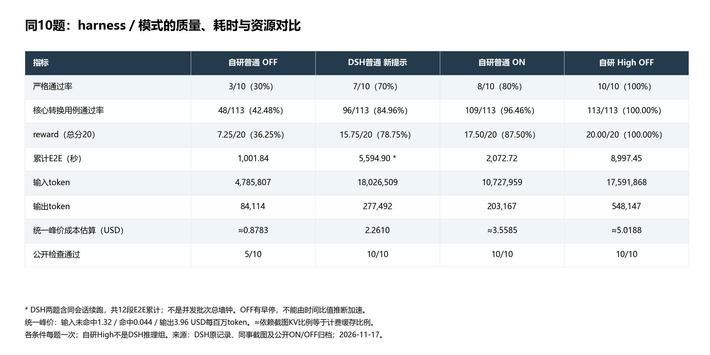
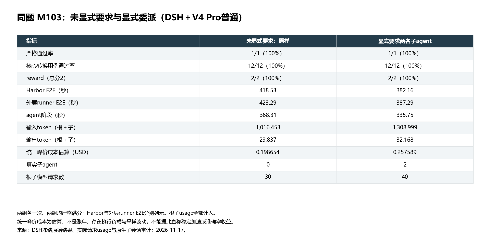
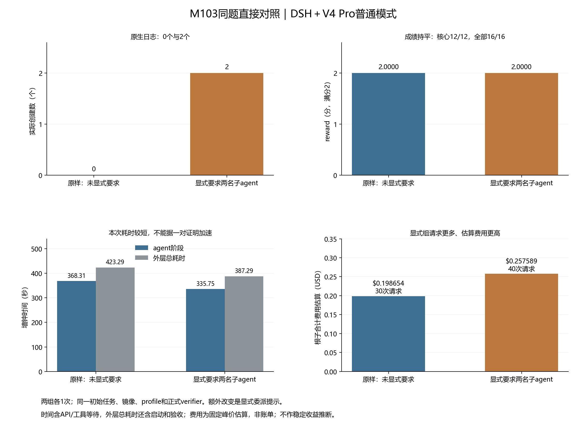
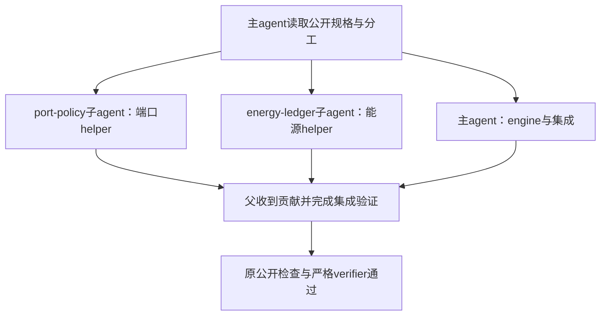
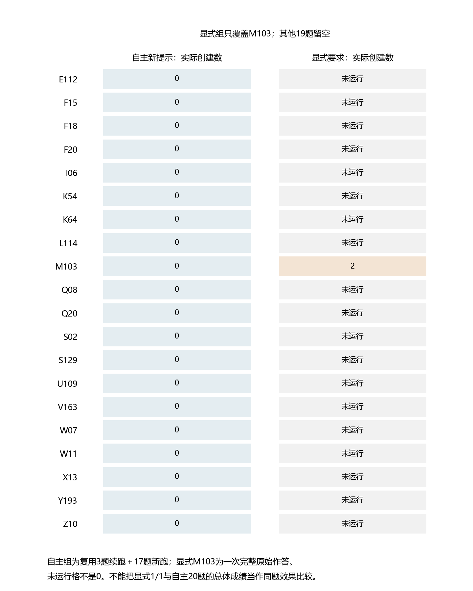
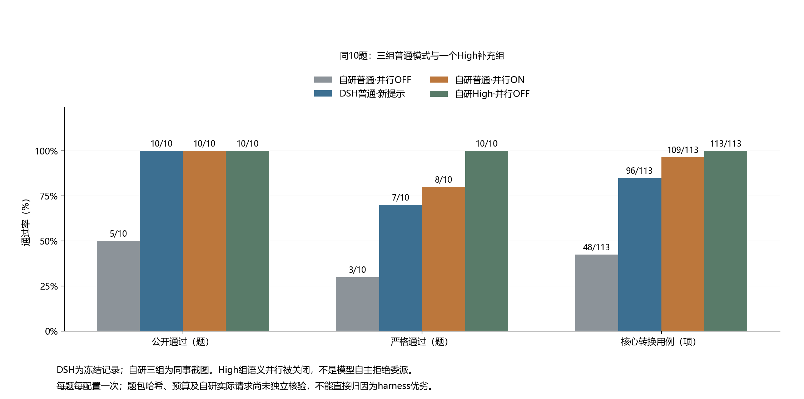
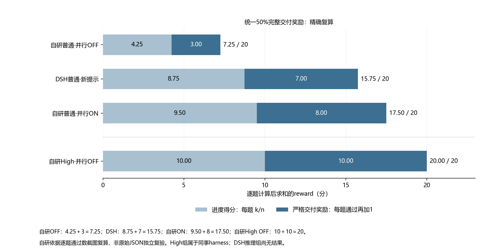
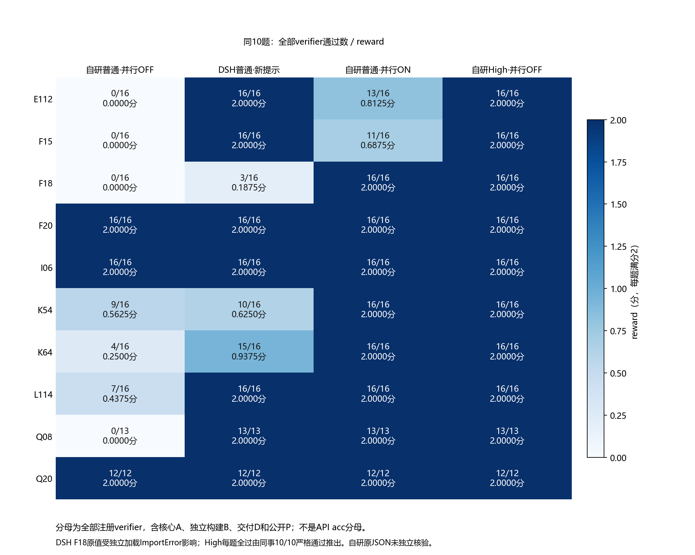
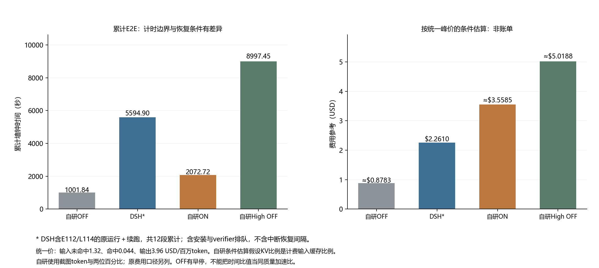

# 普通模式显式委派与未显式要求：同题对照及自研Harness综合报告

[阅读导航与实验数据目录](阅读导航.md) · [High与普通未委派原因分析](未委派原因分析.md) · [普通与补跑后High完整对比](普通模式_vs_补跑后High_20题完整对比.md)

更新：2026-11-17T14:43:44+08:00。报告重分析已有成绩；DSH推理High另行启动，进度独立列示。

**两类结论分开：** M103直接对照证明显式提示能触发真实子agent，但两组成绩同为2/2；同事提供的10题中，自研普通ON为17.50/20，DSH普通新提示为15.75/20，自研普通OFF为7.25/20。新增自研High·OFF为20/20，属于另一推理配置，不混入普通模式结论。

同事最新逐题截图已提供k/n，因此reward已精确复算，与截图逐项一致；这不是对其原始评分JSON的独立复验。

## 0. 同10题完整指标总表

对应任务固定为 **E112、F15、F18、F20、I06、K54、K64、L114、Q08、Q20**；M103不在这10题内。原称API acc的指标统一写为“核心转换用例通过率”。

| 指标（对应同10题，各条件一次） | 自研普通·OFF | DSH普通·新提示 | 自研普通·ON | 自研High·OFF |
|---|---:|---:|---:|---:|
| 严格通过率 | 3/10（30%） | 7/10（70%） | 8/10（80%） | 10/10（100%） |
| 核心转换用例通过率 | 48/113（42.48%） | 96/113（84.96%） | 109/113（96.46%） | 113/113（100.00%） |
| reward（总分20） | 7.25/20（36.25%） | 15.75/20（78.75%） | 17.50/20（87.50%） | 20.00/20（100.00%） |
| 累计E2E（秒） | 1,001.84 | 5,594.90 * | 2,072.72 | 8,997.45 |
| 输入token | 4,785,807 | 18,026,509 | 10,727,959 | 17,591,868 |
| 输出token | 84,114 | 277,492 | 203,167 | 548,147 |
| 统一峰价成本估算（USD） | ≈0.8783 | 2.2610 | ≈3.5585 | ≈5.0188 |
| 公开检查通过 | 5/10 | 10/10 | 10/10 | 10/10 |

* E2E为逐题执行区间求和；DSH两题各有原运行与同会话续跑，共12段，包含安装、重复验收和verifier排队，不含中断恢复间隔。各harness计时边界与早停条件未完全一致，不把它解释成公平加速排名。

“≈”为条件估算：同事截图KV命中率暂按API计费输入缓存比例处理；DSH按真实usage中的cached token计算。统一峰价为每百万token输入未命中1.32、命中0.044、输出3.96 USD；均非账单，原口径金额另见第7节。reward按逐题全部verifier比例＋50%严格交付奖励计算，不直接由核心通过率换算。

[完整指标CSV](同10题完整指标对比.csv) · [显式与未显式同题完整指标CSV](M103同题完整指标.csv) · [显式同题专题](显式委派与未显式要求_同题对照.md) · [同10题专题](10题不同Harness模式_统一指标对比.md)

## 1. 比较范围与分组定义

当前同事模块化20题的来源ZIP SHA-256：`8bf8b60ffdf722b9bcd54c920629554809703a0a9ddb22db396cdeae704e61af`。DSH固定0.2.1-rc.2＋V4 Pro普通模式，实际thinking.disabled已审计。

- **DSH原样、未显式要求委派**：Team工具可用，由模型选择；M103实际0子。不能称为工具被禁用的“严格单agent”。
- **DSH显式委派**：同一M103追加明确要求两名队友分别实现helper的提示；原生日志实际2子。有完整显式对照的仅M103，其他19题未运行显式条件。
- **DSH自主新提示**：要求模型自行决定分解与委派并给理由，最低子0；20题均未创建，6题认可分解。与“无任何提示”是不同条件。
- **自研普通ON/OFF**：同事语义并行功能开关。ON截图报告10题共20子分支，OFF开关关闭、无并行；其控制机制与DSH提示条件不等价。
- **自研Thinking High·OFF**：同事明确开启思考、关闭语义并行。0并行是控制条件，不能推断思考模型不愿委派。

自研截图称模型为V4 Pro、High回执有351940个推理token且10题均冷启动；High尚未独立核对其原始请求、预算、冻结版本或子分支轨迹。DSH有native审计；自研普通ON/OFF已有GitHub公开汇总与20份trace归档，本次核对其汇总和SHA-256清单一致，尚未逐轨迹复核或重评分；自研High仍为截图证据。证据层级分列。此前原版任务、reference-validator和checkpoint等其他显式实验使用不同题面或协议，不混入本次模块化题包。

## 2. M103：显式要求与未显式要求的同题直接对照

两次均正常结束；初始seed哈希、profile哈希和verifier registry哈希一致，均有原生Team工具、相同1200秒上限/3USD估算准入及同版本镜像；差别是追加显式委派提示。各一次，执行时的外部负载和采样不同。

| 指标（同题M103，各一次） | 未显式要求：原样 | 显式要求两名子agent |
|---|---:|---:|
| 严格通过率 | 1/1（100%） | 1/1（100%） |
| 核心转换用例通过率 | 12/12（100%） | 12/12（100%） |
| reward（总分2） | 2/2（100%） | 2/2（100%） |
| Harbor E2E（秒） | 418.53 | 382.16 |
| 外层runner E2E（秒） | 423.29 | 387.29 |
| agent阶段（秒） | 368.31 | 335.75 |
| 输入token（根＋子） | 1,016,453 | 1,308,999 |
| 输出token（根＋子） | 29,837 | 32,168 |
| 统一峰价成本估算（USD） | 0.198654 | 0.257589 |
| 真实子agent | 0 | 2 |
| 根子模型请求数 | 30 | 40 |

显式组多出10次模型请求，费用估算更高；本次agent阶段由368.31秒变为335.75秒，外层总耗时由423.29秒变为387.29秒。**只记录本次差异，不称为稳定加速或总体成本收益。** 两组均满分，未观察到准确率增益。

### 真实贡献证据

- port-policy子会话有8个原生模型步骤、10次成功完成工具调用，显式写入`port_policy.py`；energy-ledger有9个步骤、12次成功工具调用，显式写入`energy_ledger.py`。
- 父会话各收到2条回传，并在之后继续模型步骤。主agent显式写工具修改`engine.py`；最终公开输入实际调用端口函数16次、能源函数30次，原正式verifier16/16。
- 两子原生模型步骤墙钟区间重叠54.306秒，包含调度/等待，不能当作供应商计算并行或净加速。
- 这些证据支持真实分工、回传和模块接入；没有据此宣称已经证明父模型理解每条消息，或穷尽证明所有Bash操作都无写冲突。

图是观察到的分工关系，不表示每条边的精确发生时刻。

## 3. 显式组覆盖限制与不委派理由

不能拿显式M103的1/1成功率，和自主组20题的14/20直接比较来证明多agent提高或降低准确率。自主组有3题复用原会话续跑、另17题从stub新跑；未运行显式格不是0。

自主组认可分解的6题是E112、F18、K64、L114、W07、Z10；全部20题均无原生创建调用尝试。其可见理由主要为：实现规模较小；共享状态/目标语义导致集成风险；一个全局求解器承担大部分工作；把运行时依赖视作实现时的协调负担。接口已知时仍可并行编码，因此这些自述不是不存在并行机会的证明。部分说明只出现在结尾，也可能包含事后合理化。

M103认为短helper与全时域主搜索耦合；E112担心联合疏散约束一致性；W07认可两函数独立，却认为两段实现短、协调收益低。单次零委派不能给任务直接定为简单，也不能判断创建时机或排除模型波动。逐题完整理由见[原20题详细报告](appendix/ordinary20/20题结果与委派原因分析.md)。

## 4. 与同事自研Harness：必须匹配这10题

对应题目为：**E112、F15、F18、F20、I06、K54、K64、L114、Q08、Q20**。其核心用例共113项，全部verifier共153项。截图中的20题task_order是顺序信息，不能当作自研已运行20题；**M103不在本次10题中**。

DSH取自主新提示组对应记录；E112、L114为原会话续跑，其余8题为连续软时间运行。自研截图称High组10题均冷启动。任务名称及逐题verifier数量一致，题包/评分内容哈希及完整预算尚未独立对齐，因此是现有成绩描述对比。

| 配置 | 公开通过 | 严格通过 | 核心转换用例 | reward /20 | 进度＋严格交付奖励 |
|---|---:|---:|---:|---:|---:|
| 自研普通·并行OFF | 5/10 | 3/10 | 48/113（42.48%） | 7.25 | 4.25＋3.00 |
| DSH普通·新提示 | 10/10 | 7/10 | 96/113（84.96%） | 15.75 | 8.75＋7.00 |
| 自研普通·并行ON | 10/10 | 8/10 | 109/113（96.46%） | 17.50 | 9.50＋8.00 |
| 自研High·并行OFF | 10/10 | 10/10 | 113/113（100.00%） | 20.00 | 10.00＋10.00 |

## 5. Reward精确复算与逐题结果

每题权重2，完整性检查按原门禁处理；本批计分式为 **`R_i = k_i/n_i + strict_i`**。即第一分为全部注册verifier通过比例，严格通过再加1分。先逐题算、再求和；不能将全体API acc或全体通过检查的微平均直接代入。

例如自研ON的E112为13/16且未严格通过，所以0.8125分；F15为11/16，所以0.6875分。其余8题严格全过，各2分，总计17.50。OFF为7.25，与同事逐题截图完全一致。High组10题严格通过，各2分，总计20。

| 任务 | DSH：全部检查；reward | 自研普通OFF：全部检查；reward | 自研普通ON：全部检查；reward | 自研High OFF | ON−DSH |
|---|---:|---:|---:|---:|---:|
| E112 | 16/16；2.0000 | 0/16；0.0000 | 13/16；0.8125 | 2.0000 | -1.1875 |
| F15 | 16/16；2.0000 | 0/16；0.0000 | 11/16；0.6875 | 2.0000 | -1.3125 |
| F18 | 3/16；0.1875 | 0/16；0.0000 | 16/16；2.0000 | 2.0000 | +1.8125 |
| F20 | 16/16；2.0000 | 16/16；2.0000 | 16/16；2.0000 | 2.0000 | +0.0000 |
| I06 | 16/16；2.0000 | 16/16；2.0000 | 16/16；2.0000 | 2.0000 | +0.0000 |
| K54 | 10/16；0.6250 | 9/16；0.5625 | 16/16；2.0000 | 2.0000 | +1.3750 |
| K64 | 15/16；0.9375 | 4/16；0.2500 | 16/16；2.0000 | 2.0000 | +1.0625 |
| L114 | 16/16；2.0000 | 7/16；0.4375 | 16/16；2.0000 | 2.0000 | +0.0000 |
| Q08 | 13/13；2.0000 | 0/13；0.0000 | 13/13；2.0000 | 2.0000 | +0.0000 |
| Q20 | 12/12；2.0000 | 12/12；2.0000 | 12/12；2.0000 | 2.0000 | +0.0000 |
| 合计 | 133/153；15.75 | 64/153；7.25 | 145/153；17.50 | 20.00 | +1.75 |

- 自研ON相对OFF增加10.25分，其中进度提高5.25、严格交付奖励提高5.00。
- 自研ON相对DSH增加1.75分，其中进度提高0.75、严格交付奖励提高1.00。
- 逐题并非全面胜出：ON在F18、K54、K64较高，DSH在E112、F15较高，其余5题相同。ON相对DSH净多通过13项核心用例，其中F18由0/12到12/12贡献12项；DSH的F18失分涉及相对导入与独立加载的兼容性，不能把这12项都算作算法或多agent能力提高。
- DSH的K54有KeyError、K64有核心超时；同事对应任务满分。它们仍需结合原代码/轨迹和同条件重复定位原因，不能只从分数判定harness机制。

## 6. 新增High结果如何解释

自研High·OFF在10题上全部严格通过，是重要的单轮结果：未开启语义并行的配置也能完成这10题，多agent不是正确交付的必要条件。它同时消耗了更多时长和输出token；这不证明题目本身简单。

当前自研只有普通OFF、普通ON、High OFF三个格，缺少High ON，属于不完整2×2配置。High OFF因开关关闭而零并行，不能用它研究“思考是否更愿意自主创建”。它也不是DSH推理结果。DSH当前20题已纳入5题补跑，严格15/20；最新完整对比见第9节。原32K试次保留在历史附录，与同事High OFF截图组分开。

## 7. E2E、token与费用：补齐对应10题

| 配置 | 累计E2E秒 | 输入token | 输出token | 缓存命中率 | 原口径费用USD | 统一峰价参考USD |
|---|---:|---:|---:|---:|---:|---:|
| 自研普通OFF | 1001.84 | 4,785,807 | 84,114 | 94.52% | 0.4393 | ≈0.8783 |
| DSH普通新提示 | 5594.90 | 18,026,509 | 277,492 | 98.40% | 2.2610 | 2.2610 |
| 自研普通ON | 2072.72 | 10,727,959 | 203,167 | 83.33% | 1.7999 | ≈3.5585 |
| 自研High OFF | 8997.45 | 17,591,868 | 548,147 | 90.76% | 2.5098 | ≈5.0188 |

E2E为逐题区间求和，不是并发批次的物理总墙钟。DSH累计5594.90秒，其中agent阶段4423.25秒；E112/L114各有原运行和同会话续跑，因此共12段，包含重复安装/验收与verifier排队，不含中断恢复间隔。327次模型请求全部结算、已选记录未知0。不能把两种计时或恢复条件当成完全相同。

费用必须区分口径：DSH原列为固定峰价保守估算，同事原金额没有完整计费时段说明。统一参考按每百万token输入未命中1.32、命中0.044、输出3.96 USD计算；公式为`[(input−cached)×1.32＋cached×0.044＋output×3.96]/1e6`。[DeepSeek官方价格](https://api-docs.deepseek.com/quick_start/pricing/)

自研统一价列仅为条件估算：假设其KV命中率就是API计费输入缓存命中比例，并以截图保留两位小数的百分比反推cached token；不是账单。由百分比舍入得到的统一峰价区间分别为OFF0.878008～0.878619、ON3.557823～3.559192、High OFF5.017705～5.019950 USD，尚不含字段定义或统计范围差异。DSH缓存数17737344来自实际usage，不用百分比反推。

因此不能把DSH原2.2610和同事原ON1.7999直接当统一价高低比较。ON旧图为1.7790，新图1.7999，差0.0209仍保留；按现有截图token/缓存率复算的金额不用于猜测这一差异的原因。

普通OFF有早停；同事两组均公开通过的5题也给出679.00→979.97秒（增加44.33%），尚未显示同质量端到端加速。High OFF的最终质量不同，时间比值同样不是纯加速比。

High另外报告351940推理token，未与输出548147重复相加。根自检进入/完成属于过程指标：High自检完成8题但严格通过10题，不能拿它替代verifier或计入reward。

[资源数据与假设](resource-comparison.json) · [DSH分段明细](DSH对应10题E2E分段明细.csv) · [资源对比CSV](同10题资源对比.csv)

## 8. 可汇报结论与限制

1. 同题M103证明DSH显式委派机制可用且确有代码贡献；其与原样组均满分，一对样本不证明稳定收益。
2. DSH自主新提示20题实际零创建；模型主要以规模小、协调风险和求解器集中为理由。它是可选策略的观察，不是工具被禁用，也不是任务太简单的充分证据。
3. 同10题的reward已统一精确算出：自研普通OFF7.25、DSH普通15.75、自研普通ON17.50；自研High OFF20。数据来源、推理配置和控制条件分别标注。
4. 自研普通ON比OFF质量提高、时间与费用也提高；与DSH相比有明显逐题取舍，并包含加载兼容性因素。不能仅以有无子agent为原因。
5. 每题每条件一次，自研普通ON/OFF有公开trace但尚未逐轨迹独立复核，High只有截图，完整评分JSON/配置仍未对齐，DSH两题有续跑，模型/预算/任务哈希未完全对齐；当前不是可作因果结论的公平harness排行榜。
6. 本报告的四组与M103比较均重分析已有成绩，没有补跑普通模式、改任务或改原分。另经用户授权的DSH推理High20题及5题补跑均已结束，当前完整对比见第9节；前述四组与M103比较仍单列。

## 证据文件

- [DSH同题与对应10题证据](dsh-evidence.json)、[M103直接对照CSV](M103同题直接对照.csv)、[DSH对应10题CSV](DSH对应10题.csv)。
- [同事截图转录与逐题复算](colleague-screenshot-evidence.json)、[同事逐题reward图](evidence/colleague-per-task-reward.png)、[新增High结果图](evidence/colleague-thinking-off-summary.png)。
- [原DSH20题完整结果及逐题理由](appendix/ordinary20/20题结果与委派原因分析.md)、[M103显式原始成功案例](显式委派与未显式要求_同题对照.md)。

## 本次新增的公开来源核对

[同事普通ON/OFF公开汇总与trace归档](https://github.com/xi474/benchmark/tree/47518cc8a5cd94ea037d42eebfc819cbd8d9b951/results/parallel20-profiles-on-off-20261116)已在本次更新中核对：普通ON为8/10严格、109/113核心、17.50/20 reward；OFF为3/10、48/113、7.25/20，与截图一致。20份trace均通过公开SHA256SUMS。此项确认归档完整性与汇总一致，不等于独立重评分、全面trace审计或模型预算完全对齐。[核对收据](published-colleague-source-check.json)。High数据仍来自同事截图。

## 9. DSH当前20题对比（已纳入5题补跑）

| 指标 | 普通模式＋新提示 | High当前20题（已纳入补跑） |
|---|---:|---:|
| 公开通过 | 20/20 | 20/20 |
| 严格通过 | 14/20（70%） | 15/20（75%） |
| 核心用例通过 | 198/231（85.71%） | 192/231（83.12%） |
| reward | 31.4375/40（78.59%） | 32.1250/40（80.31%） |
| 创建子agent的任务 | 0/20 | 0/20 |
| 实际子agent总数 | 0 | 0 |
| 累计Harbor E2E秒 | 14,218.24 | 21,494.44 |
| 额外补采验收秒 | 565.51 | 0.00 |
| E2E含补采验收秒 | 14,783.75 | 21,494.44 |
| 累计agent秒 | 10,037.44 | 20,026.48 |
| 输入token | 38,880,618 | 40,290,898 |
| 输出token | 566,122 | 1,108,742 |
| 输入＋输出token | 39,446,740 | 41,399,640 |
| 缓存命中输入token | 38,318,208 | 39,790,208 |
| 输入缓存命中率 | 98.55% | 98.76% |
| 统一峰价估算USD | 4.670225 | 6.802298 |

I06、K64、L114、M103、X13均直接采用补跑后的成绩与用量；旧中止记录只在历史附录保留。5题为131K软预算，其余15题沿用原记录，参数差异明确保留。

[当前20题完整报告](appendix/high20-current/最终汇报.md) · [当前20题CSV](appendix/high20-current/20题当前结果.csv) · [历史原32K结果](appendix/high20-current/历史附录/High原始32K结果.md)

High严格通过提高5个百分点，reward增加0.6875/40；核心用例少6个（下降2.60个百分点）。两组均未创建子agent。High含补采口径E2E为普通组的1.45倍，统一峰价成本为1.46倍。

5题I06、K64、L114、M103、X13采用131072单次输出申请上限和软预算补跑，其余15题沿用32768原记录；普通组含3题同会话续跑。当前表按全部5个新试次替换，不按分数择优。每题每条件各保留一次当前成绩，不能将差异单独归因于推理模式或子agent。

E2E为逐题执行区间累计，不是并发批次墙钟。普通组原Harbor区间14218.24秒，Z10不改候选的离线补采验收另耗565.51秒，因此同时列出含补采合计14783.75秒。补采未新增模型token或费用。High本表累计21494.44秒。

核心用例通过率按核心通过数合计／231计算；它不等于全部verifier通过比例。完整性交付门禁通过时，每题reward＝全部verifier通过比例＋严格通过指示值，满分2，总分40；完整性不通过为0。严格通过还要求公开检查、产物、保护文件及独立加载／构建验收。

统一峰价固定为每百万token输入未命中1.32、输入命中0.044、输出3.96 USD，按实际usage中的缓存计数计算，属于估算。所选High20题为6.802298 USD；包括被替换的旧5题失败在内，原20＋补跑5次实际研究成本为7.641050 USD。

<!-- NO-DELEGATION-TRACE-AUDIT-20261117 -->
## 为什么High推理模式仍未创建子agent：原生trace复核

当前证据最支持“紧凑且集中在少数求解器的实现结构，与模型对协调收益的保守估计共同作用；可选提示允许维持单人策略”。没有观察到DSH把创建请求拒绝、吞掉或创建后丢失。High增加了检查队友的行为，未转化成创建行为。三个因素的贡献无法用本轮单次样本分解成因果比例。

### 证据范围与直接观察

只读审计45份原生试次：普通20题的最长保留会话、原High20题、High补跑5题；另外重新读取M103普通模式显式正对照1份。当前High统计为原15题＋新5题，旧5个32K中止仅作历史核查，不把缺失声明填成“不委派”。只提取assistant公开text决策、系统规则与工具事件，未导出thinking/reasoning正文，未发新模型请求。

| 可观测指标 | 普通新提示20题 | 当前High新提示20题 |
|---|---:|---:|
| 实际请求工具中有spawn_teammate | 20/20 | 20/20 |
| 原生user正文出现同一可选提示 | 20/20 | 20/20 |
| 声明可做工作分解 | 6/20 | 7/20 |
| 声明不委派 | 20/20 | 20/20 |
| 调用list_agents的题目 | 8/20 | 18/20 |
| list_agents报错 | 0 | 0 |
| 创建工具调用尝试 | 0 | 0 |
| 原生子session | 0 | 0 |
| 首次具名委派说明在可识别写入前／同时间 | 16/20 | 12/20 |

普通认可分解的是E112、F18、K64、L114、W07、Z10；High为F15、L114、M103、U109、W07、X13、Z10。High没有一致地把更多题判断成可分解，也没有把“分模块”转成“分给多个作者”。18题检查名单说明其注意到了Team工具；检查名单和创建队友是不同的动作。

### 任务结构：算法有难度，不必然产生足够多的独立开发工作

这些题的可见组织均是一个主引擎配两个helper。规模有限、标准库实现、规格和局部fixture现成，使一个作者也能完成较多工作。全局搜索、精确优化或动态规划的困难，常集中在同一个状态表示和目标函数；多个输入组合、搜索分支、反事实计算可由同一段程序执行，并不对应多个coding agent的实现工作包。

M103最能说明这个区别。普通称“两helper＋主流程，搜索跨三个模块”，High则认可分解，但以驻留锁、电池和电网共用DP状态拒绝。公开接口实际上把port_choices(asset,connected,was_on,remaining)与energy_choices(asset,period,battery_before,port_on,grid_limit)的输入输出和局部检查固定好了：可以并行实现两个局部规则，根agent同时实现全局DP。既有真实显式正对照确实创建2名队友，分别写port_policy.py和energy_ledger.py，根agent写主引擎、集成后严格通过；两名子agent模型阶段有54.306秒重叠。这证明可委派，不能证明所有分配都划算或本轮High也已验证真实创建。

同样，E112的危险到达场和联合规划、X13的祖先闭包和排程，在运行时先后依赖，但接口固定后可用桩和局部fixture同时开发。模型把这些共享语义当成协作风险，有合理的一面，也有把运行依赖扩大成开发依赖的一面。不能直接采信其“紧耦合”自述就把题目判为无并行机会。

还有真实单人负担与自述不一致的例子：High M103的agent阶段约46.89分钟，L114约46.39分钟且仍未严格通过。长耗时和失败说明“单人足够快稳”的估计可能失准，但不证明委派一定会减少耗时或修复失败。普通代码行数和helper占比也是事后描述，不能当作模型在作决定前已知的真实工作量。

### 提示词：允许自主选择，解释理由没有形成委派触发条件

两组原生user段都逐字包含同一份可选提示，提示文件SHA-256为003bccbd41ffbea8f316c4b1f2110ec5a0c161848c045a5dc25d18b5b6b260b0。3题普通续跑的配置快照未记录该哈希字段，这里以原生user正文逐字匹配补足核对。提示允许独立完成、只分解不委派或委派，并明确“no minimum number of teammates and no preferred choice”。它还已经指出“接口已知时，运行时依赖不妨碍独立开发”，所以问题不能简化成提示没有提到并行。

但这仍是中性、自主选择的条件：没有最低创建数，也没有要求把本地实现和委派的工作包逐项比较；检查失败或长时间调试后，只说可以改计划，没有必须重新评估的执行检查点。没有按委派行为加奖励。可见输出中，模型反复选择“短、小、保持一致更稳”，High也未改变这一倾向。这里支持“提示允许了保守单人策略”，尚不能证明具体哪个词造成了零创建。

High另有8题的首次格式化委派声明出现在可识别写入之后，普通为4题。它们的理由可能含事后总结；也可能更早已有非格式化计划。本统计包含常见Bash写入模式，仍非完整文件变更审计，不能据此还原内部决策先后。要求输出理由并不保证先做协作规划再编码。

### DSH机制：没有发现创建被禁用，工具入口的理解仍值得改进

原生系统消息明确告知Agent Teams可用，并说明如何使用spawn_teammate返回的target；冻结适配层为neutral，最低worker数0、force_delegation=false、无附加tool guard，profile允许3名成员。neutral仅加工作区与验收约束，不自动创建队友。系统中“仅显式要求时使用”的限制针对workflow工具；同段还建议一两次委派优先直接调用子agent，不能把这一限制套在spawn_teammate上。

W07、W11、K64的High公开理由把“没有队友／只有lead”与不委派联系起来。对应list_agents均成功返回仅lead且diagnostics为空。这个返回只表示当前没有已创建的队友，不表示容量为0或禁止创建。至少说明理由中出现了“现有人数”与“可创建能力”的混用，值得用提示或工具说明纠正，不能直接判成DSH创建机制故障。

普通M103真实显式组已走通创建、子工作、文件写入和最终验收；High及软预算配置的离线fixture也均走通2子路径，但后者是脚本响应，不能冒充真实High模型自主行为。因为当前High没有任何真实创建请求，仍不能排除一个尚未触发的High专属潜在故障；本轮没有证据把零调用归因于这种故障。

### 如何判断主因，以及下一步最小验证

现阶段的证据排序是：任务实现工作包偏集中及模型对协调风险的保守选择，支持最强；中性提示没有促成更积极的协作规划，是合理的共同解释；工具禁用、创建失败或日志漏记，缺少支持。DSH采用模型主动调用的机制，所以开启High并不会自动升级成多agent执行。这轮测到的是自主委派策略，不能用零创建评价多agent协作后的能力。

建议先在M103、W07、U109上保留任务、评分和High配置，做小范围提示对照。第一步只补充“list_agents仅反映已创建成员；列表只有lead时仍可调用spawn_teammate”，其余不变，用于隔离能力理解问题。若仍不委派，再单独比较“实现前列出候选独立工作、根agent同步工作和不委派的具体理由；首次本地验收失败后复核一次”的规划提示。显式要求2子只作为另列的机制正对照，不混入自主创建率。若开始调用但创建失败，再沿原生tool/result和子session定位机制；若调用成功而仍无收益，再评估工作包规模、协调开销和任务结构。以上仅为建议，本次没有启动付费实验。

### 20题逐题理由对照

以下是公开决策声明的中文概括，不是模型私有推理，也不把声明当作结构事实。

| 任务 | 普通分解／委派 | 普通可见理由概括 | High分解／委派 | High可见理由概括 |
|---|---|---|---|---|
| E112 | 是／否 | 危险场与规划器共用精确时序、碰撞和容量语义。 | 否／否 | 强调正确性、统一上下文和公开comparison评估；选择单个作者。 |
| F15 | 否／否 | 压缩坐标与最短路构成紧凑几何算法。 | 是／否 | 认可分解，但称共享区域表示、实现短，协调不划算。 |
| F18 | 是／否 | 吸收马尔可夫链数学核心集中，担心接口不一致。 | 否／否 | 称精确有理数线性代数工作量少，本地实现验证更快。 |
| F20 | 否／否 | 现有队友为空、代码有限、局部检查明确。 | 否／否 | 称没有大到值得协调的独立子问题。 |
| I06 | 否／否 | 称只有自己、两个纯helper及短主流程足够本地完成。 | 否／否 | 称工作紧凑且正确性关键，用暴力交叉验证本地实现。 |
| K54 | 否／否 | 称只有lead，最优性与先后关系宜统一实现。 | 否／否 | 称精确优化虽细致，但规模小、统一实现更少差错。 |
| K64 | 是／否 | 求解器小，comparison已提供部分语义，协调成本高。 | 否／否 | 查列表仅有lead后，称剩余是一个规模适中的完整求解器。 |
| L114 | 是／否 | 规范子空间、冷却和交付时序共享状态，担心语义偏差。 | 是／否 | 认可分解，但仍认为优化器必须与两个helper精确一致。 |
| M103 | 否／否 | 两个helper较短，状态搜索跨越三个模块。 | 是／否 | 认可分解，但以驻留、电池、电网共享DP状态为由拒绝委派。 |
| Q08 | 否／否 | 小规模同一领域实现，规格和样例已明确。 | 否／否 | 称约130行，接口已有桩，本地验证比协调更快。 |
| Q20 | 否／否 | 拟合场与轨迹追踪存在语义依赖。 | 否／否 | 称约90行标准库逻辑，接口清楚，单人风险低。 |
| S02 | 否／否 | 遍历和状态索引共用约定，实现紧凑。 | 否／否 | 称实现范围小且自洽，可直接完成并验证。 |
| S129 | 否／否 | 尝试、补偿和终态语义耦合，倾向一个本地优化器。 | 否／否 | 称2—9个动作且重放语义细致，集中实现和独立校验更稳。 |
| U109 | 否／否 | 并列解和支付共用可行性及目标语义。 | 是／否 | 认可分解，但以共享数据形状、福利oracle和实现量小拒绝。 |
| V163 | 否／否 | 短函数互相依赖，认为没有足够独立工作。 | 否／否 | 称少数小文件加公开检查和随机oracle即可验证。 |
| W07 | 是／否 | 两个helper较短，全部最小隔离集有集成风险。 | 是／否 | 认可分解，却以没有现成队友、函数短和transform消费两个helper拒绝。 |
| W11 | 否／否 | 约60行数值代码，认为整合成本高。 | 否／否 | 称没有队友，工作紧凑自洽，委派不减少时间和风险。 |
| X13 | 否／否 | 把祖先闭包→排程→transform的运行依赖当作本地实现链。 | 是／否 | 认可分解，但仍以排程依赖祖先关系和工作紧凑拒绝。 |
| Y193 | 否／否 | 状态规模有限，优化依赖统一表示。 | 否／否 | 强调共享状态与迁移记录约定，选择单人搜索实现。 |
| Z10 | 是／否 | 两个纯函数和薄主流程短，接口已明确。 | 是／否 | 认可分解，但称约100行、协调成本高于收益。 |

[完整可见决策、工具事件及源trace哈希](未委派trace审计.json) · [逐题中文与可见原文CSV](未委派理由逐题对照.csv) · [普通M103真实显式对照证据](dsh-evidence.json)

<!-- /NO-DELEGATION-TRACE-AUDIT-20261117 -->
