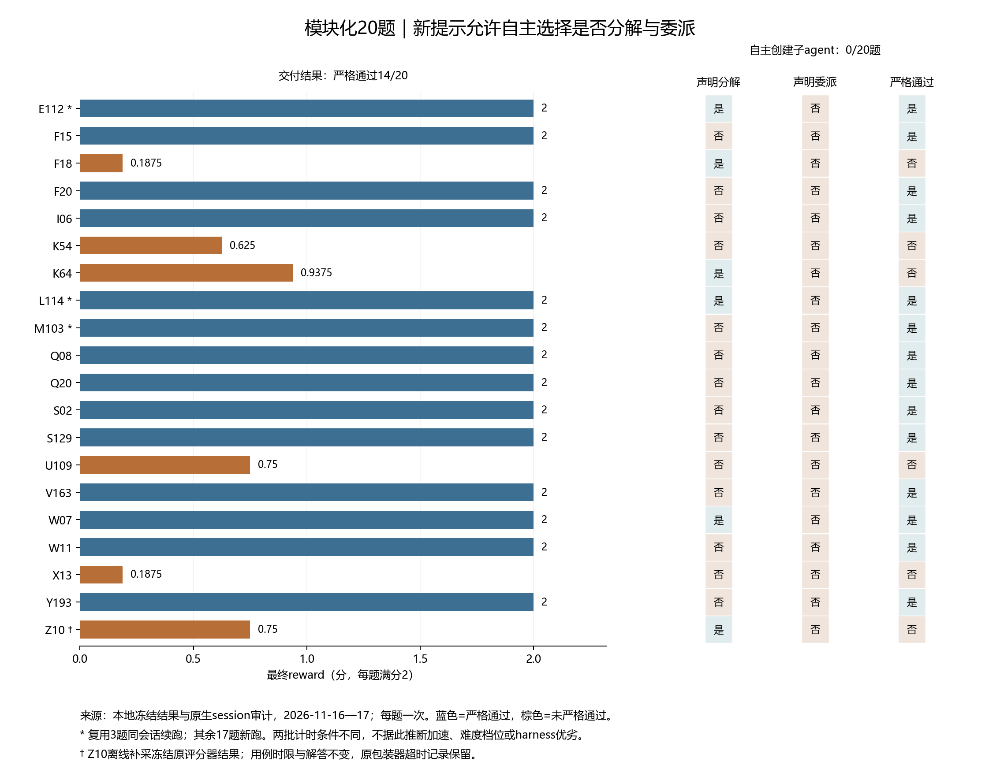

# 同事模块化20题：完整结果与未委派原因分析

完成记录：2026-11-17T13:02:16+08:00。DSH / Agent Team 0.2.1-rc.2，DeepSeek V4 Pro普通模式。每题一次：复用已结束的3题原会话续跑结果，新跑其余17题。

**当前记录更支持“模型认为协作收益不足，选择保守的单人实现”，不能直接归结为整题太简单。** 算法难度、程序内部可并行性，以及多个coding agent能否分担实现工作，是三个不同的问题。模型自述与事后代码统计支持解释，但不构成因果识别。

## 完整20题的观察

- 完成20/20；原试次无异常终态19/20；公开检查通过20/20；严格通过14/20。
- Z10原评分包装器550秒超时，RewardFileNotFoundError保留。对相同冻结产物离线补采得到完整评分；原probe90秒、交付流程180秒时限及业务规则不变，未请求模型、未修改解答。此补采不把原异常改成正常终态。
- 核心转换用例通过198/231；reward合计31.437500/40分。核心通过率单独统计，不代替严格通过或奖励。
- 最终声明分解“是”6题：E112、F18、K64、L114、W07、Z10。
- 最终声明分解“否”14题：F15、F20、I06、K54、M103、Q08、Q20、S02、S129、U109、V163、W11、X13、Y193。
- 发生创建调用尝试的题目0/20；实际创建子agent的题目0/20。实际工具可用性与普通模式均逐题核对。

## 为什么没有委派

### 1. 模型考虑的是可节省的实现工作，而非算法名称有多难

吸收马尔可夫链、最大平均环、精确分配、全时域搜索都需要实质算法设计。但如果最终是一个作者用少量函数实现同一个求解器，多个agent未必能同时承担足够重的工作。程序里的多个输入、枚举分支或反事实计算，也可能由同一个已写好的函数快速执行；这属于程序计算结构，不自动等于多个coding agent的开发工作包。

“部分题对当前模型的单人实现负担较低”仍是合理解释之一：新增记录中确有几分钟内完成并严格通过的题目，不能为了维护原先的中档设计标签而忽略它。但本轮每题只有一次，且使用软时间预算；是否正式归为简单题仍需按既定重复实测标准校准，不能以零委派直接改档。

本次20题的模块化改造都给一个业务组件增加了两个helper接口。领域算法各不相同，但可见的实现组织较统一：主引擎加两个局部函数。接口划分降低协作门槛，同时也替单个作者完成了部分规划；其净效应未被本轮单次实验单独测量。统一题目格式可以保留，真正需要检查的是分支是否各有足够的独立实现或验证工作。

### 2. 部分模块划分工作量偏斜，关键路径仍集中在一个求解器

三题最终实现中，E112联合规划helper占三个实现文件约81.8%，L114主引擎约68.5%，M103主引擎约72.7%。另一个agent即使很快完成短helper，主要求解器仍可能决定完成时间。这里的行数仅指去空行和行首注释、保留文档字符串后的事后统计，不代表认知难度、工作时间或模型决策时已知信息。

这也不是唯一原因：I06的三份代码较均衡，模型仍然选择独立完成。工作量均衡是潜在有利条件，不是必然触发条件。

### 3. 模型反复把运行时依赖当作实现协调风险，策略偏保守

例如E112规划要使用危险到达场，但接口已知时，危险场计算与规划器可以用约定数据、局部fixture同时开发；最后才需要联调。新提示已明确说明这一点，模型仍把共享语义作为单人执行的理由。因此不能把其“紧耦合”自述直接当作题目没有并行机会的事实。

### 4. 新提示允许不委派，Team也不会自动替模型分解任务

这组实验提供原生Team工具，由模型决定是否调用；提示明确允许单人执行、只分解不委派，或创建有实质工作的队友，没有最低子agent数量或偏好的选择。业务评分继续按原规则计算。零子agent是允许的观察结果。没有证据表明模型看到了隐藏评分并据此进行奖励计算，也不能声称提示措辞已被证明造成了零委派。

有些说明把“当前只有lead”或“我是唯一agent”列为理由。这只是创建前的状态，不是无法创建的硬限制，也不能单独作为委派收益不足的论据。冻结适配层使用neutral条件，没有额外的禁用工具guard或强制单人策略。

部分题还已有实现辅助。例如K64的comparison.py提供选择合法性、依赖闭包和目标分值评估，降低了一部分语义工作；但它没有分发完整的全局搜索、精确计数或冲突优化器，不能把它称为完整参考解泄露。

### 5. 不委派不等于单人已稳妥解决

F18在公开检查通过后，独立文件加载因相对导入缺少包上下文而失败；断网复现确认包方式导入成功、原verifier方式导入报ImportError。这是交付集成兼容性问题，不等于12种数学错误，也没有据此修改原分数。X13的12项核心检查同样记录ImportError，不解释成12个算法反例。K64有1项、U109和Z10各有2项核心用例超时；K54有4项核心用例KeyError。它们说明模型对“一个人足够快、足够稳”的预期并不总能兑现，但也不证明如果委派就一定能修好。

## 工具故障、创建时机和模型波动分别怎么看

已有M103显式正对照确实创建两名子agent，分别写入端口与能源helper，主agent收到贡献并集成，最终严格通过。工具可用，并且可以形成真实工作；不过这一次对照只证明可行，不证明速度收益。

本次没有实际创建的题目，无法评价“自主创建时机是否错误”。零调用与创建后失败必须分开。模型给出的理由是普通可见正文；有些只在结尾具名说明，因此可能包含事后合理化。具名说明是否出现在首个被解析到的write/edit/spawn之前或同毫秒，只是辅助位置证据，不能证明思考顺序；Bash写入还可能不在这一位置统计中。

建议将这组标为“允许自主委派＋要求给理由”，同时记录实际子agent数。若某题实际为零子agent，其成绩变化不能直接归因于多agent协作，也不能用于判断子agent创建时机的好坏。

每题只有一次，不能分离模型随机波动、提示措辞与默认单人策略各自的贡献。17题补齐扩大了题目覆盖，没有替代同题重复与配对控制。

## 六题未严格通过的主要记录

- **F18、X13**：独立API加载发生ImportError，核心分别0/12；公开产物能生成。F18已额外断网复现为相对导入缺少包上下文。不能将这24项失败算作24个独立算法错误。
- **K54**：核心8/12，4项记录KeyError。
- **K64、U109、Z10**：核心分别11/12、10/12、10/12，分别有1、2、2项超时。Z10另有原评分采集包装器超时，离线补采同核结果后得0.75分，原异常不覆盖。

F18/X13应单列为加载兼容性问题：原verifier使用单文件模块名加载，候选使用相对导入。是否应把这种加载方式作为明确交付契约，仍可另做规格审查；本次既不擅改分数，也不据此认定候选数学逻辑错误或任务算法很难。

这些记录没有经过任务修复或重新生成解答；分数反映本次冻结产物。公开通过与严格通过分开是必要的。

## 逐题记录

### E112：共享道路与有资格避难所的全局撤离

- 分解：是；委派：否；实际子agent：0。
- 核心：12/12；严格通过：是；reward：2.0/2；agent阶段：24分40秒。
- 理由解读：认可危险到达与联合规划可以拆分，但担心碰撞、换边、容量与危险时序等语义在多人实现后不一致。
- 可见原文摘录：No — the two modules are tightly coupled through the shared hazard semantics and the planner's correctness hinges on subtle joint constraints (per-tick occupancy, opposing-edge swaps, cumulative shelter capacity, fire/closure safety at the ignition boundary). A single coherent implementation was simpler and lower-coordination-risk than splitting the combinatorial search across agents. I worked alone (0 teammates), so this matches my initial decision.

### F15：分隔平面的最低通行费面积

- 分解：否；委派：否；实际子agent：0。
- 核心：12/12；严格通过：是；reward：2.0/2；agent阶段：4分03秒。
- 理由解读：把区域图构建和最低费用搜索视为一个紧凑的几何算法，认为另开agent不划算。
- 可见原文摘录：No — the task is small and self-contained; coordinate-compression + shortest-path logic benefits from being held together by one author. Teammates used: 0. No change from the initial decision was needed.

### F18：带回流与停滞分支的交付时间

- 分解：是；委派：否；实际子agent：0。
- 核心：0/12；严格通过：否；reward：0.1875/2；agent阶段：1分12秒。
- 理由解读：认可路由归一化与吸收链求解可拆分，但认为数学核心较集中、多人协作增加接口风险。实际失败是独立导入兼容性，不能据0/12判断数学算法全错。
- 可见原文摘录：no — the work is small and math-dense: exact rational Gaussian elimination over an absorbing Markov chain, with subtle edge cases (self-loops, parallel routes, dead-end/no-delivery components). Keeping computation in one place avoided interface mismatch risk, so I implemented everything locally.

### F20：生产循环的可持续单位产出

- 分解：否；委派：否；实际子agent：0。
- 核心：12/12；严格通过：是；reward：2.0/2；agent阶段：3分22秒。
- 理由解读：认为SCC、最大平均环与可达性汇总共用图语义，局部自测比多人集成更省事。
- 可见原文摘录：no. The workspace has no teammates and the total work is a few hundred lines of stdlib-only code with clear, verifiable local checks; solo implementation with brute-force verification was faster and safer than coordinating delegation for this size.

### I06：共享校准与整数装配的中等规模对照

- 分解：否；委派：否；实际子agent：0。
- 核心：12/12；严格通过：是；reward：2.0/2；agent阶段：3分47秒。
- 理由解读：认为校准、整数格和选择共用可行性定义；虽然最终代码较均衡，仍选择单人实现。这说明工作量偏斜并非唯一原因。
- 可见原文摘录：No — I'm the only agent in this session, and the actual implementation workload is small enough (two pure helper functions + a ~60-line orchestration) that delegation would only add integration risk for no benefit. No teammates were used.

### K54：完整CFG的最优溢出与加权phi合并

- 分解：否；委派：否；实际子agent：0。
- 核心：8/12；严格通过：否；reward：0.625/2；agent阶段：2分16秒。
- 理由解读：把活跃性、干涉图与最优分配看成一条串行数据流，优先保持语义一致；最终仍有4项核心用例KeyError。
- 可见原文摘录：no — I was the sole agent (only `lead` present), and the task's exact-optimality and precedence subtleties were best handled by one consistent implementation.

### K64：包依赖闭包与冲突的中等规模对照

- 分解：是；委派：否；实际子agent：0。
- 核心：11/12；严格通过：否；reward：0.9375/2；agent阶段：1分42秒。
- 理由解读：认可评估、搜索与报告三个模块，认为公开comparison.py已提供部分语义，单人协调成本低；最终有1项核心用例超时。该文件提供选择有效性评估，并非完整搜索参考解。
- 可见原文摘录：No — the solver is small and self-contained, the reference semantics already live in `comparison.py`, and parallel delegation would have added only coordination overhead.

### L114：编码子空间与前置交付的全局地面链路

- 分解：是；委派：否；实际子agent：0。
- 核心：12/12；严格通过：是；reward：2.0/2；agent阶段：29分56秒。
- 理由解读：认可模块接口清楚，但担心规范子空间、冷却、历史和交付时序在多人实现时发生偏差。
- 可见原文摘录：no. The three pieces share exact state semantics (canonical spans, cooldown/eligibility timing, completion) that the independent verifier replays; integrating parallel implementations risked subtle divergence, and the solver is small enough to build coherently by one author. Final: 0 teammates used — no change from the initial decision.

### M103：端口驻留与储能的全时域恢复

- 分解：否；委派：否；实际子agent：0。
- 核心：12/12；严格通过：是；reward：2.0/2；agent阶段：46分32秒。
- 理由解读：认为两个helper较短，而跨时域的全局状态搜索仍集中在主引擎，预计委派收益有限。显式对照证明这两项局部工作确实可以成功委派。
- 可见原文摘录：No. The task is small (two helper functions + one orchestration function), and the state-space search spans all three modules. Delegating would add coordination cost exceeding the benefit.

### Q08：碎片质谱的一对一峰匹配

- 分解：否；委派：否；实际子agent：0。
- 核心：9/9；严格通过：是；reward：2.0/2；agent阶段：1分39秒。
- 理由解读：认为候选生成、峰匹配与汇总属于紧凑的同一领域，规格与公开样例已足够，优先避免集成风险。
- 可见原文摘录：No. The implementation is small (three modules, ~200 lines total), self-contained, and the correct behavior is fully determined by the spec plus the worked example. Delegation would introduce integration risk with no throughput benefit.

### Q20：海流场反演与漂流轨迹

- 分解：否；委派：否；实际子agent：0。
- 核心：8/8；严格通过：是；reward：2.0/2；agent阶段：1分06秒。
- 理由解读：把流场拟合到漂流追踪视为紧凑的数据流，认为上游语义依赖足以使单人开发更合适。
- 可见原文摘录：No — the task is small and the tracker semantics depend on the fitted-field semantics, so a single author completes it faster and more reliably than coordinating context hand-offs.

### S02：祖先性状变化的全局支持度

- 分解：否；委派：否；实际子agent：0。
- 核心：12/12；严格通过：是；reward：2.0/2；agent阶段：3分12秒。
- 理由解读：认为树下汇总、树外信息与边变化计数需要一致的遍历和状态索引，代码较紧凑，选择本地完成动态规划。
- 可见原文摘录：No — the two helpers depend on shared traversal/state-index conventions, so coordinating disjoint write scopes would cost more than the ~100 lines of closely-coupled, well-defined code. I implemented everything locally (0 teammates used, unchanged from the initial decision).

### S129：重试与逆依赖回滚的最短补偿事务

- 分解：否；委派：否；实际子agent：0。
- 核心：12/12；严格通过：是；reward：2.0/2；agent阶段：5分56秒。
- 理由解读：认为正向、补偿与全局最短事务共用尝试次数和终态语义，单人实现更容易保持整体正确。
- 可见原文摘录：No — this is a single cohesive finite-optimization problem best implemented and verified locally, since correctness hinges on coupled semantics (whole-wave abort, reverse-order compensation, checkpoint seeding) that are hard to split cleanly. Final division: worked entirely as `lead`, 0 teammates used.

### U109：组合拍卖全部最优分配与反事实支付

- 分解：否；委派：否；实际子agent：0。
- 核心：10/12；严格通过：否；reward：0.75/2；agent阶段：1分45秒。
- 理由解读：认为最优分配、全体并列解与支付审计共用相同的目标和可行性语义，协调不会加速；但最终有两项核心规模用例超时，未达到严格通过。
- 可见原文摘录：no — one cohesive algorithmic unit with subtle cross-cutting tie semantics; I implemented and validated it directly faster than coordinating teammates.

### V163：共享建设的跨季节生态廊道

- 分解：否；委派：否；实际子agent：0。
- 核心：12/12；严格通过：是；reward：2.0/2；agent阶段：2分14秒。
- 理由解读：认为子集优化、季节最大流与可达覆盖共用精确的容量和语义，函数数量不多，选择独立实现。
- 可见原文摘录：No — the deliverable is a handful of short, interdependent functions; there was no meaningful independent work to fan out.

### W07：多版本事务的传播隔离

- 分解：是；委派：否；实际子agent：0。
- 核心：10/10；严格通过：是；reward：2.0/2；agent阶段：3分30秒。
- 理由解读：认可证据图推导与最小隔离集合两个纯函数可以分开验证，但认为两段实现较短，且枚举全部最小代价集合有集成风险。
- 可见原文摘录：No — the total scope is small (two ~100-line modules with fully specified interfaces), and the "all minimum-cost removal sets" requirement is a subtle min-cut problem where splitting work across teammates would add integration risk without offsetting benefit. I implemented everything locally as the Lead.

### W11：共享时钟下的真实时序余量

- 分解：否；委派：否；实际子agent：0。
- 核心：12/12；严格通过：是；reward：2.0/2；agent阶段：1分37秒。
- 理由解读：认为时钟差、合法数据路径与余量汇总属于紧凑数值计算，两个helper较短，独立实现成本低。
- 可见原文摘录：No — the whole implementation is ~60 lines with tight numeric coupling (shared-segment cancellation, forbidden-word containment), and integration would cost more than writing it directly.

### X13：跨链审查场次的最优排程

- 分解：否；委派：否；实际子agent：0。
- 核心：0/12；严格通过：否；reward：0.1875/2；agent阶段：20分15秒。
- 理由解读：认为祖先闭包到全局排程是一条依赖链，把精确排程和反例验证当作一个本地工作单元；耗时超过软参考，独立加载仍发生ImportError，不能把0/12解释成12个算法错误。
- 可见原文摘录：no. There was no task-specific parallelism benefit — the three modules share one dependency chain (`derive_ancestors` feeds `choose_review_schedule` feeds `transform`), and the hard parts required iterative verification against brute force, which is best done in one focused loop. I worked alone with 0 teammates.

### Y193：共享堆位与多吊机的全局取货

- 分解：否；委派：否；实际子agent：0。
- 核心：12/12；严格通过：是；reward：2.0/2；agent阶段：7分03秒。
- 理由解读：认为波次生成和全局搜索共用堆场状态，状态规模受限，协调收益低；单人优化与验证后严格通过。
- 可见原文摘录：No — the search space is small (2–6 containers, 3–5 stacks, 1–3 cranes) and correctness depends on a single consistent state/optimization model, so coordination overhead would outweigh any parallelization gain. Final: worked alone, 0 teammates (matching the initial decision, no revision needed).

### Z10：配额申诉后各项分配的变动频率

- 分解：是；委派：否；实际子agent：0。
- 核心：10/12；严格通过：否；reward：0.75/2；agent阶段：1分30秒。
- 理由解读：认可两个helper接口独立，却认为实现很短而拒绝委派；实际有两个核心用例超时。原评分采集超时后，对未修改的冻结产物离线补取原评分，reward为0.75。
- 可见原文摘录：no — the work is compact (two pure-Python functions and a small engine), interfaces were already fully specified, and coordination overhead would exceed implementation cost; I implemented everything locally with 0 teammates.

## 后续设计建议

保持本轮20题与评分冻结。若希望观察更多自然委派，应优先设计两个或三个各自有实质算法工作、接口稳定、局部可验收且能并行开发的分支，再由主agent完成集成与交叉验证。只增加一个全局搜索器的状态空间，可能使单人耗时增加，却不会增加可分担的工作。独立算法验证、反例搜索也可以是实质委派，不应只把短helper作为候选工作。

若继续研究提示与模型波动，应在少量同题上配对比较原样、可选委派和显式委派，并做重复；保持模型、任务、评分和资源条件一致。先验证子agent确实产出、回传、被集成，再讨论是否有收益。本轮没有自动追加这些付费实验。

## 评分与比较边界

reward = 题目权重 × [0.5 ×（通过verifier数 / 注册verifier总数）+ 0.5 × 严格通过指示量]；受保护文件完整性失败仍按原评分器门禁处理。进度部分统计所有正式verifier，而非只统计核心转换用例。子agent数量、理由和辅助helper调用追踪不加入reward。

原3题包含20分钟中断后的同会话续跑、串行执行；本次17题从初始桩连续软时间预算运行，最多3题并发，20分钟只作软参考。两批时长分层披露，不作加速因果比较，也不把它们包装成20次同预算独立重测。没有完整20题的原样/显式配对矩阵。

新增17题账本：发送427、结算427、新增未知0；1049个冻结文件无漂移。本轮付费scope已关闭，未额外重试、扩批或push。原先2个历史未知请求保留。

[逐题CSV](observations.csv) · [委派原生证据](full20-delegation-analysis.json) · [最终验收](最终验收.json) · [F18导入复现](F18-import-reproduction.json) · 三题早期详细分析另存于本地，本包保留完整20题记录
