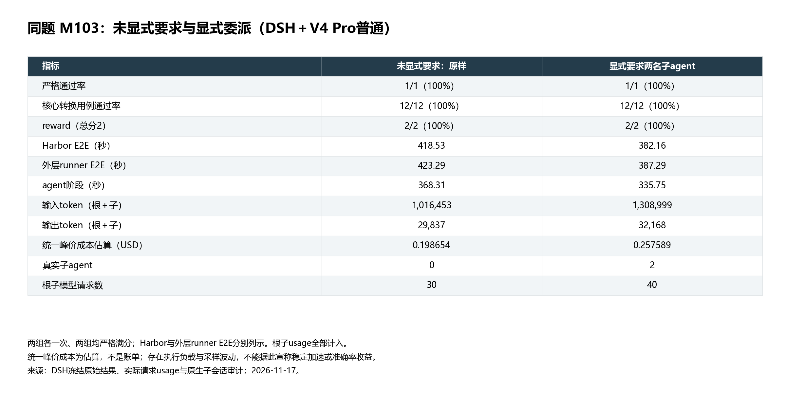
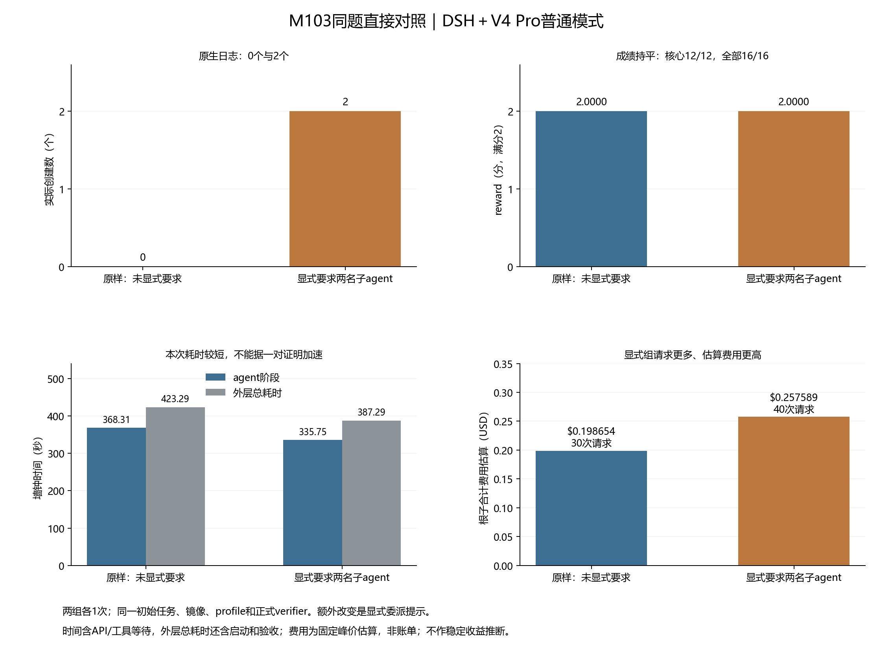
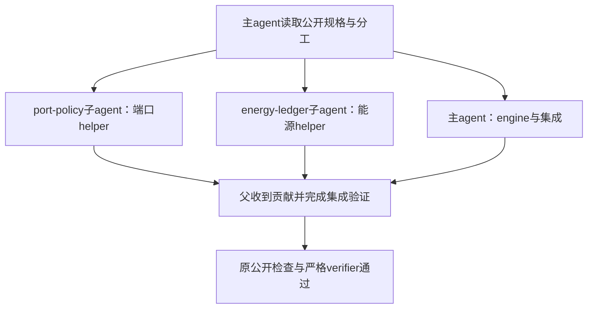
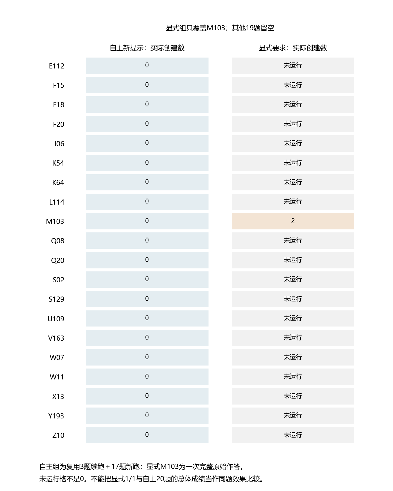

# 显式委派与未显式要求：M103完整指标对照

> 本专题保留原比较范围、统计时点和分数。[最新20题High补跑对比](普通模式_vs_补跑后High_20题完整对比.md)与[未委派原因分析](未委派原因分析.md)另列；本专题中的早期运行状态属于历史记录。

更新：2026-11-17T14:43:44+08:00。仅一题、每条件一次；并非20题配对实验。

## 1. 比较范围与分组定义

当前同事模块化20题的来源ZIP SHA-256：`8bf8b60ffdf722b9bcd54c920629554809703a0a9ddb22db396cdeae704e61af`。DSH固定0.2.1-rc.2＋V4 Pro普通模式，实际thinking.disabled已审计。

- **DSH原样、未显式要求委派**：Team工具可用，由模型选择；M103实际0子。不能称为工具被禁用的“严格单agent”。
- **DSH显式委派**：同一M103追加明确要求两名队友分别实现helper的提示；原生日志实际2子。有完整显式对照的仅M103，其他19题未运行显式条件。
- **DSH自主新提示**：要求模型自行决定分解与委派并给理由，最低子0；20题均未创建，6题认可分解。与“无任何提示”是不同条件。
- **自研普通ON/OFF**：同事语义并行功能开关。ON截图报告10题共20子分支，OFF开关关闭、无并行；其控制机制与DSH提示条件不等价。
- **自研Thinking High·OFF**：同事明确开启思考、关闭语义并行。0并行是控制条件，不能推断思考模型不愿委派。

自研截图称模型为V4 Pro、High回执有351940个推理token且10题均冷启动；High尚未独立核对其原始请求、预算、冻结版本或子分支轨迹。DSH有native审计；自研普通ON/OFF已有GitHub公开汇总与20份trace归档，本次核对其汇总和SHA-256清单一致，尚未逐轨迹复核或重评分；自研High仍为截图证据。证据层级分列。此前原版任务、reference-validator和checkpoint等其他显式实验使用不同题面或协议，不混入本次模块化题包。

## 2. M103：显式要求与未显式要求的同题直接对照

两次均正常结束；初始seed哈希、profile哈希和verifier registry哈希一致，均有原生Team工具、相同1200秒上限/3USD估算准入及同版本镜像；差别是追加显式委派提示。各一次，执行时的外部负载和采样不同。

| 指标（同题M103，各一次） | 未显式要求：原样 | 显式要求两名子agent |
|---|---:|---:|
| 严格通过率 | 1/1（100%） | 1/1（100%） |
| 核心转换用例通过率 | 12/12（100%） | 12/12（100%） |
| reward（总分2） | 2/2（100%） | 2/2（100%） |
| Harbor E2E（秒） | 418.53 | 382.16 |
| 外层runner E2E（秒） | 423.29 | 387.29 |
| agent阶段（秒） | 368.31 | 335.75 |
| 输入token（根＋子） | 1,016,453 | 1,308,999 |
| 输出token（根＋子） | 29,837 | 32,168 |
| 统一峰价成本估算（USD） | 0.198654 | 0.257589 |
| 真实子agent | 0 | 2 |
| 根子模型请求数 | 30 | 40 |

显式组多出10次模型请求，费用估算更高；本次agent阶段由368.31秒变为335.75秒，外层总耗时由423.29秒变为387.29秒。**只记录本次差异，不称为稳定加速或总体成本收益。** 两组均满分，未观察到准确率增益。

### 真实贡献证据

- port-policy子会话有8个原生模型步骤、10次成功完成工具调用，显式写入`port_policy.py`；energy-ledger有9个步骤、12次成功工具调用，显式写入`energy_ledger.py`。
- 父会话各收到2条回传，并在之后继续模型步骤。主agent显式写工具修改`engine.py`；最终公开输入实际调用端口函数16次、能源函数30次，原正式verifier16/16。
- 两子原生模型步骤墙钟区间重叠54.306秒，包含调度/等待，不能当作供应商计算并行或净加速。
- 这些证据支持真实分工、回传和模块接入；没有据此宣称已经证明父模型理解每条消息，或穷尽证明所有Bash操作都无写冲突。

图是观察到的分工关系，不表示每条边的精确发生时刻。

## 3. 显式组覆盖限制与不委派理由

不能拿显式M103的1/1成功率，和自主组20题的14/20直接比较来证明多agent提高或降低准确率。自主组有3题复用原会话续跑、另17题从stub新跑；未运行显式格不是0。

自主组认可分解的6题是E112、F18、K64、L114、W07、Z10；全部20题均无原生创建调用尝试。其可见理由主要为：实现规模较小；共享状态/目标语义导致集成风险；一个全局求解器承担大部分工作；把运行时依赖视作实现时的协调负担。接口已知时仍可并行编码，因此这些自述不是不存在并行机会的证明。部分说明只出现在结尾，也可能包含事后合理化。

M103认为短helper与全时域主搜索耦合；E112担心联合疏散约束一致性；W07认可两函数独立，却认为两段实现短、协调收益低。单次零委派不能给任务直接定为简单，也不能判断创建时机或排除模型波动。逐题完整理由见[原20题详细报告](appendix/ordinary20/20题结果与委派原因分析.md)。

[返回综合报告](README.md)
