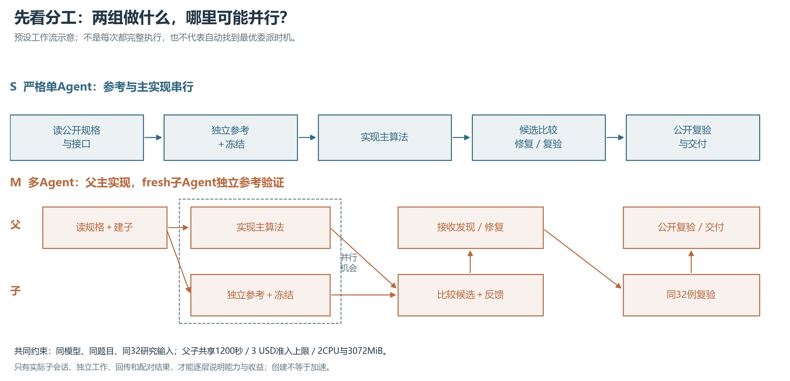
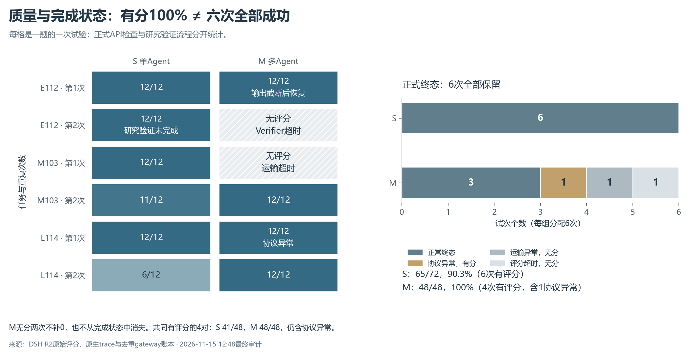
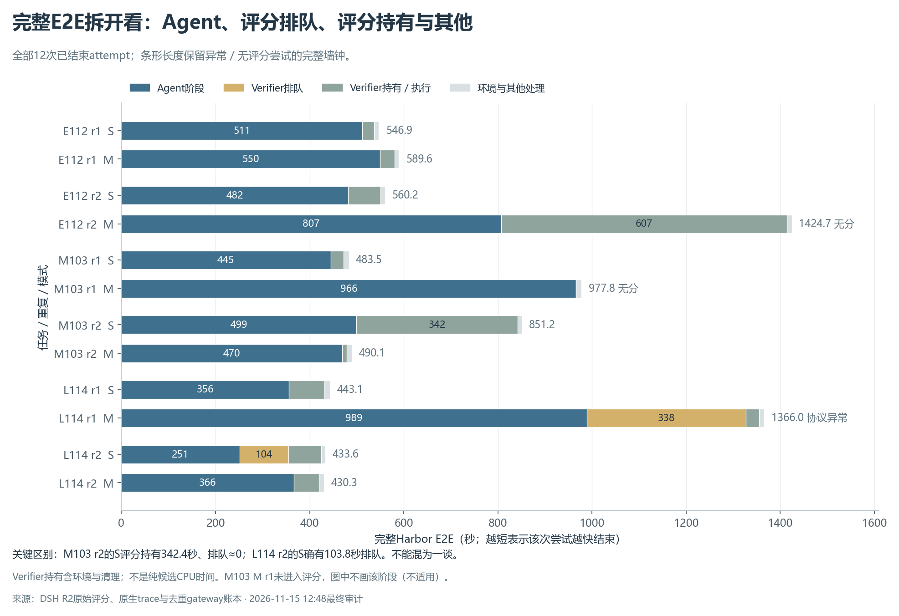
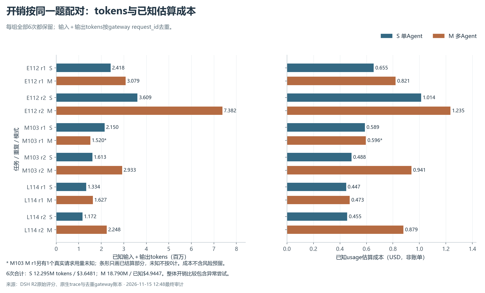
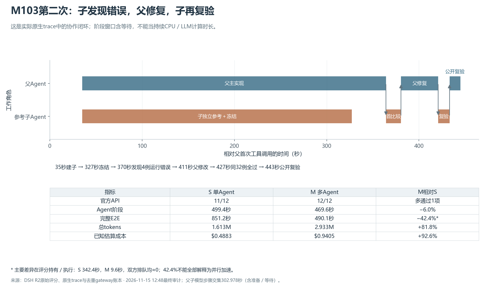

后续独立批次：[R3准确率、完整E2E与tokens配对报告](../dsh-reference-decomposition-v4pro-20261115-r3/README.md)。R2原分数、异常和unknown1继续保留，不被R3替换。

# DSH单／多Agent参考分工对照：修复版结果与R1修订说明

**用户审阅确认后的图表发布版。** 审计时间：2026-11-15T12:48:09.380841+08:00。R2已结束 12/12；本稿覆盖全部12个已登记attempt，全部原结果保留。

本次共有10次原始API评分（其中1次协议异常仍保留分数），另有2次无评分。**多Agent全部6次实际创建子Agent；有分100%不等于6次全部成功。**

**主要结论：** 修复版确实实现了父Agent主算法与fresh子Agent独立参考验证的并行工作，并出现M103的“子发现错误—父修复—子复验—父公开复验”成功案例。部分配对结果质量更好，但没有证据支持稳定的整体时间／成本双收益。E2E、Agent阶段、评分计算和排队必须拆开解释；正式评分成功也不等于研究验证流程完整。

## 图表阅读顺序

### 图表下载

- 图1｜单Agent与多Agent的分工差异：[PNG](figures/00_workflow.png) · [SVG](figures/00_workflow.svg)
- 图2｜逐次API结果与正式终态：[PNG](figures/01_quality_status.png) · [SVG](figures/01_quality_status.svg)
- 图3｜逐次完整E2E及阶段拆分：[PNG](figures/02_e2e_breakdown.png) · [SVG](figures/02_e2e_breakdown.svg)
- 图4｜逐次tokens与已知估算成本：[PNG](figures/03_tokens_cost.png) · [SVG](figures/03_tokens_cost.svg)
- 图5｜M103成功协作的实际时序与代价：[PNG](figures/04_m103_case.png) · [SVG](figures/04_m103_case.svg)

先看图1理解分工，再看图2核对有分／无分与API分母；图3拆开完整E2E，图4比较tokens／成本，图5展示M103的实际闭环。流程图和开销图采用S蓝色、M橙色；API图按通过比例着色，E2E图按阶段着色。所有异常仍保留，图中没有把无分补成0。

**图1｜单Agent与多Agent的分工差异**

S先参考后主实现；M将主实现与独立参考并行，之后仍需比较、反馈、修复和复验。示意图不表示所有试次均完整执行。

## 1. 范围与控制变量

- 任务：parallel20-calibrated-medium-v1中的E112（多主体疏散与避难所联动）、M103（端口、能量与驻留约束联合优化）、L114（GF(2)子空间与全局下传调度）。每题每组两次，共12次。不是先前Medium20矩阵或修订Core6实验。
- 模型：DeepSeek V4 Pro普通模式；实际出口thinking.type=disabled。DSH及Team profile固定0.2.1-rc.2；固定同一镜像、任务及原正式评分器，来源commit `88e8ddabe8c38e2df976c78f148e76b2242617e6`。
- S：严格单Agent，禁用子Agent工具；同一Agent先建立独立参考及检查器，再实现主算法。M：读完公开规格／接口后、主算法开始前，由父创建且仅创建一名fresh reference-validator；父主实现，子独立参考与验证。属于**指定时机与角色的参考分工**，不宣称自主找到最优委派点。
- 两组每题共享同样1200秒Agent墙钟、估算3 USD准入上限、2CPU／3072MiB；M不另给子预算。最多4个Harbor、共享HTTP4、单题HTTP2；独立Verifier槽1，评分超时600秒。单请求输出上限32768，无80请求数上限。
- 每题固定32个研究输入（原公开样例1＋边界7＋固定种子生成24），最多初次比较与一次修复复验。参考由模型自编；真值仅离线审计，未提供给执行中的Agent。共同预算上限不等于实际花费相等，参考代码本身也可能出错。

**图2｜逐次API结果与正式终态**

M的100%仅来自4个有评分试次，其中1次协议异常；另2次无评分。灰色斜线格表示没有分数，不是0分。

## 2. R2汇总：质量与开销分开

| 指标 | S：严格单Agent | M：父主实现＋参考子Agent |
|---|---:|---:|
| 分配／已结束／有评分 | 6 / 6 / 6 | 6 / 6 / 4 |
| 有评分试次官方API检查 | 65/72（90.3%） | 48/48（100.0%） |
| 已结束试次实际创建子Agent | 0/6 | 6/6 |
| 正式正常终态／协议异常有分／无评分 | 6 / 0 / 0 | 3 / 1 / 2 |
| 全部已结束试次完整E2E均值，秒 | 553.1 | 879.7 |
| 全部已结束试次E2E中位数，秒 | 515.2 | 783.7 |
| Agent阶段均值，秒 | 424.0 | 691.3 |
| 已知输入tokens | 12,099,839 | 18,378,220 |
| 已知输出tokens | 195,509 | 411,579 |
| 已知总tokens | 12,295,348 | 18,789,799 |
| 输入缓存命中率，按token加权 | 84.83% | 89.31% |
| 已结算usage估算成本，USD | 3.648077 | 4.944737 |

**统计口径：** API准确率直接核对原始score-v2.json的A类12项检查，排除B构建、D交付与P公开检查；当前评分修订为delivery-bonus-50-v1，API通过率不等于reward。无分不补0，协议异常有原分则同时保留分数与异常标签。E2E从Harbor试次开始到结束，包含环境、Agent、评分执行与等待；开销表包含异常已结束attempt，不是筛除失败后的成功样本均值。未知响应的tokens／费用不计作0，表中相应总额只是已知部分。

两组评分分母不同。仅看双方共同有评分的4对，S为41/48，M为48/48；仍含L114 r1的协议异常，缺失的两对不能被此子集代表。这是描述性配对统计，不是事后筛选出的全范围成功率。

## 3. 逐次结果

**图3｜逐次完整E2E及阶段拆分**

蓝色为Agent墙钟，黄色为真实排队，灰绿为评分槽持有／执行。M103的差异主要是评分执行，L114才存在明显排队差异。

**图4｜逐次tokens与已知估算成本**

蓝色为S、橙色为M；同题同重复相邻。M103 M r1带*的值仅含已结算usage，未知请求未计入，不是完整账单。

### 逐次原始数值

| 任务 | 次数 | 组 | API | 完整E2E秒 | Agent秒 | Verifier排队秒 | Verifier持有秒 | 总tokens | 估算USD | 终态／研究标记 |
|---|---:|---|---:|---:|---:|---:|---:|---:|---:|---|
| E112 | 1 | S | 12/12 | 546.9 | 511.3 | 0.0 | 26.1 | 2,417,856 | 0.655045 | 正式正常终态 |
| E112 | 1 | M | 12/12 | 589.6 | 549.8 | 0.0 | 30.3 | 3,078,999 | 0.820560 | 正式正常终态；1次单请求输出上限 |
| E112 | 2 | S | 12/12 | 560.2 | 481.9 | 0.0 | 68.8 | 3,608,668 | 1.013640 | 正式正常终态；研究验证未完成 |
| E112 | 2 | M | 无评分 | 1,424.7 | 807.1 | 0.0 | 607.1 | 7,382,063 | 1.235085 | Verifier超时，无评分 |
| M103 | 1 | S | 12/12 | 483.5 | 444.8 | 0.0 | 27.1 | 2,150,261 | 0.589156 | 正式正常终态 |
| M103 | 1 | M | 无评分 | 977.8 | 966.1 | — | — | 1,520,319 | 0.596322 | 运输异常隔离，无评分；研究验证未完成 |
| M103 | 2 | S | 11/12 | 851.2 | 499.4 | 0.0 | 342.4 | 1,612,644 | 0.488292 | 正式正常终态 |
| M103 | 2 | M | 12/12 | 490.1 | 469.6 | 0.0 | 9.6 | 2,932,566 | 0.940522 | 正式正常终态 |
| L114 | 1 | S | 12/12 | 443.1 | 355.6 | 0.0 | 76.2 | 1,333,588 | 0.446711 | 正式正常终态 |
| L114 | 1 | M | 12/12 | 1,366.0 | 989.0 | 338.2 | 27.4 | 1,627,419 | 0.473406 | 协议未完成，有评分；研究验证未完成 |
| L114 | 2 | S | 6/12 | 433.6 | 250.9 | 103.8 | 69.5 | 1,172,331 | 0.455234 | 正式正常终态 |
| L114 | 2 | M | 12/12 | 430.3 | 366.5 | 0.0 | 53.1 | 2,248,433 | 0.878843 | 正式正常终态 |

Verifier“持有”含环境建立、评分执行与清理，不等于纯候选CPU时间；排队单独由slot-acquired事件计时。模型跨度使用原生时间，不用接收日志的时间代替执行时间。

## 4. 配对结果与实际收益

**图5｜M103成功协作的实际时序与代价**

子独立参考发现候选运行错误，父修复后子在同32例复验全过。Agent阶段短6%，但tokens和成本明显增加；完整E2E优势还包含评分执行差异。

**M103第二次：有实质贡献的协作案例。** 单／多API为11/12与12/12；完整E2E851.157／490.066秒（短42.4%），Agent阶段499.377／469.568秒（短6.0%）。tokens为1,612,644／2,932,566（多81.8%），估算成本0.488292／0.940522 USD（多92.6%）。父子模型步骤跨度重叠302.978秒；子22个模型响应、29个完成工具，父收到三条实质消息。

原生时序（相对父首次工具）：约327秒子冻结独立参考32例；364秒父发布候选；370秒子比较发现四例运行错误（对外展示三例TypeError: NoneType subscript）；381秒父收到报告；411秒父修改optimizer.py；421秒发布修复快照；427秒子同32例复验全部通过；433秒父收到结果；443秒父运行run_all.py及公开check。参考保持同一哈希，最后比较快照与最终交付匹配。它证明了结果被实际用于修复，不能仅凭“创建子Agent”替代这个闭环。

**更正上一版阶段解释：** M103单Agent的原始A/analysis/11失败原因是timeout。其Verifier排队仅0.00018秒，持有342.374秒；多Agent排队约0.00008秒、持有9.599秒。因此，完整E2E差距主要发生在评分执行／持有阶段，**不是评分排队**，也不能把42.4%全称作并行加速。候选实现与最终程序性能不同也是解释的一部分。Agent阶段的6%改善是单次观察；官方失败项与子发现的四个研究错误尚未逐一映射，不声称API提升全部由该修复导致。

**L114第二次：质量更高，开发阶段更慢。** 单／多API为6/12与12/12；完整E2E433.627／430.344秒近似持平；Agent阶段250.936／366.471秒（多46.0%）。S排队103.803秒，M约0；所以相近E2E掩盖了不同的Agent与排队耗时。M tokens多91.8%，成本多93.1%。子独立参考与比较均32/32，父收件并公开复验；M初始候选已通过，不是子找错后修好。因此该配对是组间质量改善样本，不能直接归因为子反馈造成的提升。

**E112第一次：有真实并行，但没有时间／成本净收益。** 两组API均12/12。单／多E2E546.936／589.567秒（多7.8%），Agent511.322／549.838秒（多7.5%）；tokens多27.3%，成本多25.3%。M子有24模型响应／25工具，父子模型步骤重叠198.416秒；父约191秒已发布候选，子约360秒才冻结参考、447秒返回实质结果，验证成为关键路径。子一次达到输出上限，父继续发消息后该子恢复工作；模型自编checker又误判合法等待动作，父额外排查与复验。

**这些结果能说明什么：** 已证实有真实子会话、独立工作、模型步骤并发、父收件及部分可追踪的修复—复验。尚没有稳定、低混杂、同时保持质量并降低完整时间和成本的总体结论。每题仅两次，不能据个别样本说“任务不需要拆解”或“多Agent普遍更好／更差”。

## 5. 原生并行与回传证据

| M试次 | 子模型响应／完成工具 | 父子模型步骤重叠秒 | 全部工具dispatch重叠秒 | 实质父收件 | 参考目标事后准确率 |
|---|---:|---:|---:|---:|---:|
| M103 r1 | 13 / 17 | 310.789 | 0.000 | 0 | 未完成 |
| L114 r1 | 24 / 25 | 244.778 | 0.000 | 1 | 32/32 |
| E112 r1 | 24 / 25 | 198.416 | 2.637 | 1 | 32/32 |
| M103 r2 | 22 / 29 | 302.978 | 3.546 | 3 | 32/32 |
| E112 r2 | 77 / 81 | 281.755 | 6.198 | 1 | 32/32 |
| L114 r2 | 12 / 15 | 313.337 | 1.617 | 1 | 32/32 |

模型步骤跨度含本地准备／HTTP等待，不是纯供应商计算时间。工具dispatch表还可能含控制与通信，不能把数秒交集自动叫作生产性工具并行；相应生产性业务工具交集检测单列在native-evidence.json。原生父收件已有证据，精确回传文本进入某次父模型请求的旧哈希归因仍unknown；不能把零个精确匹配说成没有送达。共享checkout下未发现成功的冻结前直接生产代码读取，但无法据此认证任意shell的完全独立性或无竞态。

## 6. 异常、无评分与控制层问题

- **M103 M r1：** 运输TimeoutError后隔离，原Harbor异常为CancelledError，无正式评分。失败墙钟977.770秒，已知1,520,319 tokens、估算0.596322 USD；一个真实已发送请求用量未知，0.81407304 USD风险预留保留，不计已花费。不是API零分，不自动重跑。
- **L114 M r1：** 正式API12/12，但study_protocol_incomplete非零终态；记录合规5/7、C3缺一条、C4收件决定未完成；参考目标32/32而候选比较0轮。E2E1366.047秒、Agent988.992秒、评分排队338.224秒。保留分数与协议异常，不能称完成了参考协作。
- **E112 M r1：** 正式正常终态，但有一次32768单请求输出截断。自编checker把合法等待误判为非相邻移动；子自报九个误报，可见三个详细反例为该签名，其余六个不当独立验真。冻结checker与之后磁盘修改也不能混为一份。
- **E112 S r2：** 正式API12/12，但研究参考冻结0/32，研究比较始终返回incomplete reference。另有M103 S r1参考目标事后仅31/32；研究执行完成或正式满分都不证明参考本身正确。
- **L114 S r2：** 自编参考目标32/32、在线自检32/32，却在独立公开32例见证回放只有28/32，正式API6/12。目标正确不代表见证检查器充分，也不代表覆盖正式全部输入。
- **实验门禁仍有误拦：** reference_plugin将不以cat/head等开头的shell归为写操作，整段命令出现worker/frozen路径便可能拒绝。真实只读`cd /app && cat research_checks/reference-report.json 2>&1 | head -200`被当作Lead写worker文件；copy/read cases的命令也受过宽匹配影响。属于本地实验控制层混杂，不能归为DSH不会委派。另有模型错误证据ID／漏必填字段，不能把全部协议错误都归给基础设施。正在运行期间没有改冻结配置。

- **E112 M r2最终终态：** Verifier超时，无评分，API无评分，完整E2E1,424.7秒、Agent807.1秒。原始VerifierTimeoutError说明评分未在600秒内完成，不补API零分；评分期间观察到python进程持续计算，不能无证据归为纯Docker／网络故障，也不据此恢复重跑。

### 协议异常及重测建议（发布补充）

唯一协议异常为L114 M第一次：本地只读误拦后，模型先抄错证据ID，重试又缺必填字段，触发两次未验收即中止的研究门禁；正式API仍12/12，研究比较0轮。它不是DSH原生Team协议错误。已有能力与有用协作证据不需要为消除异常重跑全部结果；若要严格性能结论，应修正实验层后另做新的配对重测。详见[原因、影响与是否重测](protocol-notes.md)及[机器可读旁注](protocol-diagnostics.json)。本次没有新增付费试次。

## 7. 修复前R1与本次R2如何对应

R1原报告、逐格原始结果、失败及无分记录保留，不用R2覆盖。R1为12次／10次有评分，S API35/60、M23/60，M真实建子4/6；667/667结算、unknown0，估算5.061379 USD。其候选打包漏带公开runtime.py、错误回传漏stdout及过窄记录交互污染了研究反馈，所以R1不能用于干净的多Agent优劣归因。

R2以新attempt独立重测：补齐原公共runtime、保留stdout结构化错误；记录工具schema枚举当时合法checkpoint／evidence ID，模型仍自行提交决定与引用；pilot额外要求记录协议合规，不以高分筛选。两组角色提示原字节、32研究输入、模型／模式、题与正式评分器保持不变。41项断网准入通过、准备期provider_requests=0。R2仍存在上述门禁误判及模型参考错误，不能称已排除全部控制层影响，也不能把R1→R2分数变化全部归因这几项修复。

旧报告中“没有新增付费重测授权”等句子只代表R1归档时点；其后用户授权的独立R2已经执行。R1首页增加了本次修订入口；本文独立发布为R2目录，不改旧表或旧证书。

## 8. 审计、费用与可复现状态

- 本地原始账本：645实际发送／644结算／0在途／1未知；已知估算合计8.592814648 USD，非账单。风险预留0.81407304 USD单列，不能当费用，未知不伪造为零。
- token按gateway request_id去重结算；输入缓存命中率=sum(cache tokens)/sum(input tokens)，不是芯片KV缓存利用率。价格沿用本批网关账本约定，不把原生重复usage再累加。
- 160个冻结输入漂移0；已结束试次实际出口均V4Pro disabled，工具／提示／资源／原生会话证据见本地审计。监控门禁整体失败的异常试次保留，不将其未知字段写成观测零。
- 正式A类检查已逐项核对score-v2，原文件SHA256归档。事后32例回放使用独立预冻结目标及公开见证检查器，无网络，不进入模型上下文、不改官方成绩、不拼入原E2E。
- 不新增模型请求，不重启或重复任何trial，不改正式题／verifier，不覆盖R1/R2原attempt。原始trace与实现留本地；公开候选包只包含脱敏指标、证据摘要及哈希。

## 9. 发布与历史保留

本报告经用户审阅后发布于本目录，仓库首页及[修复前R1报告](../dsh-reference-decomposition-v4pro-20261115-r1/README.md)均提供入口。R1旧数据与原README正文保留，R2使用独立attempt与指标文件；未将无评分补成0，也不合并R1/R2通过率。没有为本次发布新开模型请求或付费重测。
