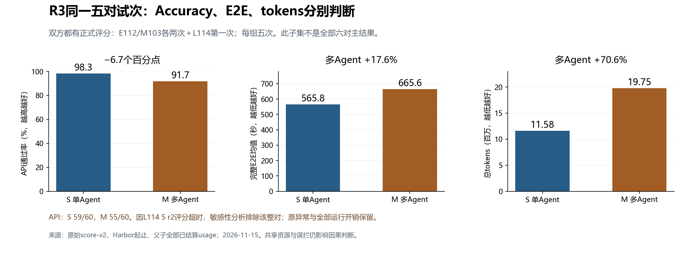
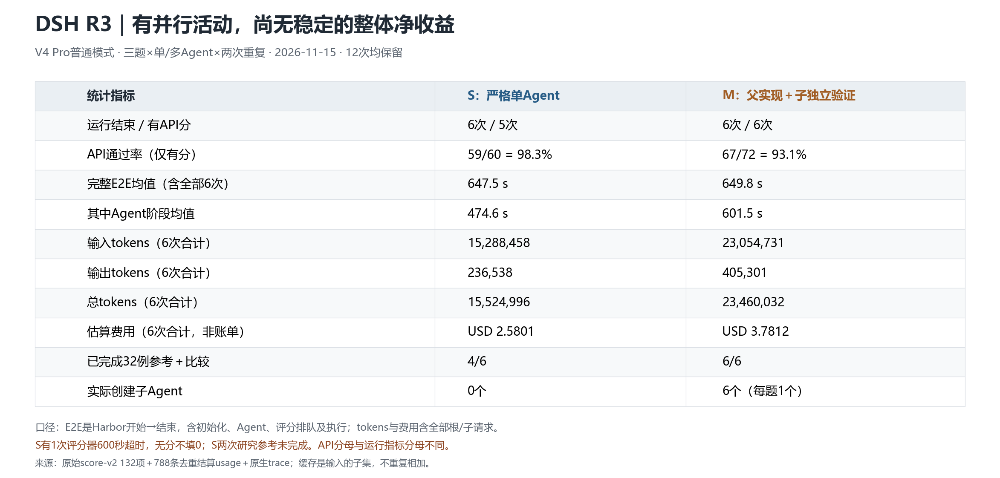
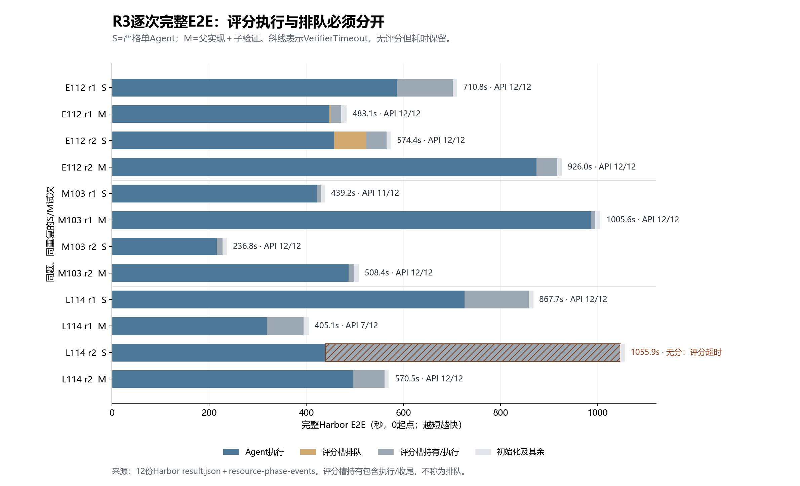

# DSH R3 单Agent与多Agent在准确率耗时和tokens上的配对对照

三题各S/M两次，12次执行已于2026-11-15 15:27（北京时间）结束；11次有正式评分，1次评分器超时无分。R3是在R2后离线修复协议记录与部分只读误拦的新注册批次，**不替换R1、R2或任一旧异常结果**。

**结论：收益必须分别报告Accuracy、完整E2E和tokens，不合成一个总分。** R3证明了真实父子并行和局部有用协作，但未显示稳定的整体净收益。双方都有正式评分的同一5对中，多Agent的API通过率更低、完整E2E更长、tokens更多；局部样本可以表现为质量收益或效率收益。控制层残留误拦、自编验证错误与共享资源竞争限制了纯并行因果判断。

- [原R2报告](../dsh-reference-decomposition-v4pro-20261115-r2/README.md) · [原R1历史报告](../dsh-reference-decomposition-v4pro-20261115-r1/README.md)
- [逐次指标JSON](cells.json) · [CSV](cells.csv) · [三种统计集合](summary.json) · [逐项API检查与未知位](api-checks.json)
- [逐对变化](paired-comparison.json) · [原生trace摘要](trace-summary.json) · [协议与权限旁注](protocol-notes.json) · [完成审计](completion-audit.json) · [控制变量](study-design.json) · [来源哈希](provenance.json)

## 三种收益如何分别判断

Accuracy指原始score-v2的A类业务转换检查通过率，不是模型HTTP请求成功率，也不等于reward。越高越好；完整E2E与tokens越低越好。相同准确率下更快或更省tokens属于效率收益；准确率提高但更慢、更贵属于有成本的质量收益，不能笼统说全维度获益。

下表统一使用**双方有正式评分的同一5对**：E112、M103各两次，加L114第一次。因L114 S第二次无分，敏感性分析排除该整对，而不是只删单方失败。原异常和全部开销仍保留在全量表。

| 维度 | 更好方向 | S 单Agent | M 多Agent | M相对S |
|---|---|---:|---:|---:|
| Accuracy | 越高越好 | 59/60，98.3% | 55/60，91.7% | −6.7个百分点 |
| 完整E2E均值 | 越短越好 | 565.8秒 | 665.6秒 | +17.6% |
| 总tokens，五次合计 | 越少越好 | 11,580,293 | 19,750,197 | +70.6% |
| 估算费用，五次合计 | 越少越好 | USD 2.065962 | USD 3.253769 | +57.5% |

**这5对的三个主要维度总体均未改善，但不表示每个任务都没有收益。** E112第一次同为12/12而更快、更省tokens；M103第一次从11/12提高到12/12，却增加时间和tokens。每题仅两次重复，不宣称显著性或普遍效应。

只看双方研究流程完整且有分的4对，Accuracy由47/48（97.9%）提高到48/48（100%），同时E2E增加49.0%、tokens增加97.6%、费用增加77.2%，展示了质量与开销取舍。**这同样是事后子集，不替换全量结果；流程完成也不保证自编参考或checker正确。**

## 全量结果与统计分母

| 统计集合 | S API | M API | E2E均值秒 S→M | 总tokens S→M | 估算USD S→M |
| --- | --- | --- | --- | --- | --- |
| 全部尝试，每组6次 | 59/60 (98.3%) | 67/72 (93.1%) | 647.5 → 649.8 | 15,524,996 → 23,460,032 | 2.580054 → 3.781166 |
| 双方有正式分的5对 | 59/60 (98.3%) | 55/60 (91.7%) | 565.8 → 665.6 | 11,580,293 → 19,750,197 | 2.065962 → 3.253769 |
| 双方研究流程完成且有分的4对 | 47/48 (97.9%) | 48/48 (100.0%) | 490.3 → 730.8 | 8,493,216 → 16,780,978 | 1.556335 → 2.757846 |

全量S输入15,288,458、输出236,538、总15,524,996 tokens；M输入23,054,731、输出405,301、总23,460,032。缓存是输入token的子集，不能再次相加；按输入token加权，缓存命中率S95.02%、M96.05%。全量M总tokens多51.1%、费用多46.6%；E2E均值近乎持平（+0.35%），但Agent阶段均值474.6→601.5秒（+26.7%），不能据全量E2E认为调度开销相同。

API全量表仅包括有分格，S分母60、M72，不能直接当相同构成的配对效果。L114 S第二次保留未知，不补12个失败或0分。运行时间、tokens和费用则包含每组全部6次尝试，包括无分和研究流程未完成。

## 范围控制与计量

- 任务：parallel20-calibrated-medium-v1的E112（全局撤离）、M103（端口驻留与储能恢复）、L114（编码子空间与全局下传）；来源commit `88e8ddabe8c38e2df976c78f148e76b2242617e6`。不与旧Medium20、Core6矩阵混写。
- 模型实际出口DeepSeek V4 Pro `thinking.type=disabled`；DSH及Team profile固定0.2.1-rc.2。正式题、原scorer、分工提示和研究输入保持原版本。
- S禁用委派，由同一Agent先写独立参考，再做主实现；M读完公开SPEC与contract后、主实现前，恰好创建一名fresh reference-validator，父做主算法、子独立参考和验证。属于预设角色/时机干预，不是自由原生策略或最优时机发现实验。
- 每题父子共享1200秒Agent墙钟、USD3估算准入、2CPU/3072MiB；单次输出32768，无请求次数封顶。相同预算上限不等于实际花费相等。
- 实际峰值四Harbor、全父子HTTP4、单题HTTP2，共享Verifier槽1；评分超时600秒。同批试次仍可能竞争共享资源，不能宣称每一对都完全隔离。
- 完整E2E取Harbor `started_at→finished_at`，含环境和Agent初始化、Agent执行、评分排队与持有/执行，不含事后trace审计。评分槽持有包含执行和收尾，不称为排队。
- tokens和费用来自788条唯一请求结算，包含根/子、记录纠正与失败过程；估算费用使用冻结费率，并非供应商账单。788/788结算、新unknown0；R2历史unknown1继续保留，不能被R3的unknown0覆盖。
- 同题S/M使用相同32个研究输入。独立真值仅在运行结束后的断网审计容器，未提供给Agent或反馈运行；小域32例不覆盖全部正式验收条件。

## 逐次与配对指标

| 任务 | 重复 | 组 | API | 完整E2E秒 | Agent秒 | 评分排队秒 | 评分持有秒 | 总tokens | 估算USD | 终态与研究标记 |
| --- | --- | --- | --- | --- | --- | --- | --- | --- | --- | --- |
| E112 | 1 | S | 12/12 | 710.8 | 587.4 | 0.0 | 114.1 | 2,842,521 | 0.538010 | 正式正常终态 |
| E112 | 1 | M | 12/12 | 483.1 | 447.3 | 3.0 | 21.7 | 2,122,672 | 0.535925 | 正式正常终态 |
| E112 | 2 | S | 12/12 | 574.4 | 457.2 | 66.1 | 41.7 | 2,793,762 | 0.464940 | 正式正常终态 |
| E112 | 2 | M | 12/12 | 926.0 | 874.2 | 0.0 | 42.3 | 7,122,165 | 1.045787 | 正式正常终态 |
| M103 | 1 | S | 11/12 | 439.2 | 421.7 | 0.0 | 8.1 | 1,755,593 | 0.325552 | 正式正常终态 |
| M103 | 1 | M | 12/12 | 1,005.6 | 985.9 | 0.0 | 9.1 | 4,910,681 | 0.700176 | 正式正常终态 |
| M103 | 2 | S | 12/12 | 236.8 | 216.0 | 0.0 | 11.3 | 1,101,340 | 0.227833 | 正式正常终态 |
| M103 | 2 | M | 12/12 | 508.4 | 487.2 | 0.0 | 10.4 | 2,625,460 | 0.475958 | 正式正常终态 |
| L114 | 1 | S | 12/12 | 867.7 | 726.1 | 0.0 | 132.1 | 3,087,077 | 0.509627 | 正式正常终态；研究流程未完成 |
| L114 | 1 | M | 7/12 | 405.1 | 318.8 | 0.0 | 75.6 | 2,969,219 | 0.495923 | 正式正常终态 |
| L114 | 2 | S | 无评分 | 1,055.9 | 439.4 | 0.0 | 607.0 | 3,944,703 | 0.514092 | 评分器超时600秒；原Agent超时标签保留旁注；研究流程未完成 |
| L114 | 2 | M | 12/12 | 570.5 | 495.8 | 0.0 | 65.0 | 3,709,835 | 0.527397 | 正式正常终态 |

| 任务 | 重复 | API S→M | M E2E变化 | M tokens变化 | M费用变化 | 限定 |
| --- | --- | --- | --- | --- | --- | --- |
| E112 | 1 | 12/12 → 12/12 | -32.0% | -25.3% | -0.4% | 双方研究流程完整，但参考正确性另查 |
| E112 | 2 | 12/12 → 12/12 | +61.2% | +154.9% | +124.9% | 双方研究流程完整，但参考正确性另查 |
| M103 | 1 | 11/12 → 12/12 | +128.9% | +179.7% | +115.1% | 双方研究流程完整，但参考正确性另查 |
| M103 | 2 | 12/12 → 12/12 | +114.7% | +138.4% | +108.9% | 双方研究流程完整，但参考正确性另查 |
| L114 | 1 | 12/12 → 7/12 | -53.3% | -3.8% | -2.7% | S研究未完成 |
| L114 | 2 | 无分 → 12/12 | -46.0% | -6.0% | +2.6% | S研究未完成且评分超时 |

变化为M/S−1。E2E、tokens、费用的负值表示更省；Accuracy差异使用通过数或百分点。L114第二次只能比较实际耗时/开销，不能比较准确率；S超时和研究失败使较短M耗时不构成同质量加速证明。

## 原生trace显示的并行与实际收益

M的6/6次各创建1名真实fresh子，共6子、187个子模型响应、197个完成的工具dispatch，父收件记录13条。S为0子。父子模型步骤重叠205.256—484.062秒，包含准备/排队/生成；实际工具dispatch重叠0.034—4.041秒，不能互换。13条收件证明父已收到，旧自动审计没有完成精确后续模型输入哈希/根归属匹配，保持未知；具体采用依据后续edit、发布新候选及复验链说明。

### E112第一次 效率收益的观察样本

父约15秒spawn，子约382秒冻结参考；父在352—382秒写入生产实现。原生模型步骤重叠403.159秒，并有328.487秒HTTP交叠佐证；工具dispatch重叠仅0.034秒。父并非等子完成后才实现。

两组正式API均12/12。M Agent447.3秒对S587.4秒（−23.9%），完整E2E483.1对710.8秒（−32.0%），tokens少25.3%，费用基本持平（−0.4%）。这是较好的净收益观察样本。**但不是纯并行因果证明：** S有残留误拦，且其自编参考目标仅28/32正确、研究比较只报5/32；评分执行/持有也为114.1对21.7秒，这部分时间差不能归给父子并行。

### M103 子反馈有用但验证分支和等待增加成本

第二次子发现零端口/容量场景的`NoneType`崩溃并发回实质反馈；父约440/444秒edit solver、发布新候选；子在同32例上由28通过/4错误复验到32通过，随后父公开复验。该闭环证明协作实际帮助修复，不只是创建子ID或发送消息。

两组最终均12/12，但M E2E508.4秒对S236.8秒、tokens多138.4%、费用多108.9%。第一次M把API11/12提高到12/12，却慢128.9%、tokens多179.7%；子直到742秒才冻结参考，父`wait_agent`累计402.4秒。请求槽排队也影响该分支，不把等待全归成子算法慢；较早委派不保证负载平衡或净收益。

### E112第二次 错误的独立检查器造成负收益

子途中触及单请求输出上限，父恢复其工作。子后来在原生消息中明确承认，冻结`check_witness`把合法WAIT步错误要求为单格移动。32例两次比较均22通过；目标值与独立事后真值32/32一致，并不意味着witness checker正确。

子修的是工作副本，后续compare仍使用原冻结checker与相同candidate_id，因此仍22/32。正式API却12/12。两组最终同分，M Agent慢91.2%、E2E慢61.2%、tokens多154.9%、费用多124.9%。不能将该次开销解释为所有反馈都在修复真实候选错误。

### L114 质量下降与参考失败使速度比较失真

第一次M API7/12对S12/12，研究32例却全部通过。交付solver以`set.update`合并新旧GF(2)基，可能保留相关向量并用集合长度当秩；离线微例中旧基`{3}`加入1，正确新基应为`{1,2}`，实际累积`{1,2,3}`并得到长度3。该代码缺陷已用原交付辅助函数复现，但未逐项断言它解释全部5个正式`result_mismatch`。小域验证通过不能证明算法正式全过。

S两次参考冻结快照分别全报`NameError: completion`未定义及`TypeError: unhashable dict`，没有完成相同32例比较。第二次S还评分超时。因此L114的M较短E2E不能直接视为同质量、同验证完成度下的并行收益。

## 单列残留误拦评分超时与共享资源影响

### 协议记录已闭合 权限误拦仍有残留

105/105检查点有原生模型实参/接受回包匹配，无记录拒绝或`protocol-incomplete`。R3将opaque checkpoint/evidence ID归为运行时上下文绑定，决策与理由仍由模型真实产生；两次无合格语义响应的安全规则不变，不伪造记录。

59次权限拒绝均关联到真实原生调用，其中确认9次纯`find | sort`只读列表误拦（S4、M5），4次`todo_write`仅因计划文字提及生产文件误拦（全部S）。另有34次复杂多行脚本保守拒绝尚未逐项语义裁决；生产代码预读及文件所有权的真实限制另列，不能把59次全部当误拦。误拦会增加纠正请求、时间和tokens，影响不对称，不能假设共同规则自动抵消，也不能按常数从E2E扣除。

### 评分器超时不是Agent超时或质量零分

L114 S第二次原始异常为`VerifierTimeoutError`，600秒上限。Agent在439.4秒结束；评分槽排队约0、持有607.0秒，完整E2E1055.9秒。原通用`unscored_agent_timeout`标签保留并旁注为`unscored_verifier_timeout`，不改原attempt，不填API零分。评分执行慢的根因仍需程序规模/算法性能证据，不能仅凭超时称为纯基础设施故障。

该超时拉高S的全量平均E2E，使647.5与649.8秒看似持平；排除该整对的5对敏感性中M慢17.6%。不能以M在这一个无分配对中更短，证明并行加速。

### 四并发下仍存在HTTP4及Verifier竞争

788次真实槽位acquire事件中，每请求平均等待S1.164秒、M3.044秒；请求等待总和S359.576秒、M1457.940秒。父子等待可以重叠，总和不能直接从完整E2E扣除。M103 M第一次单次最长等待116.45秒，L114 S第一次为117.10秒。两组运行时点和负载不同，同一个并发上限不是排除了所有资源竞争。

### 自编参考正确性也是控制之外的变量

| 任务 | 重复 | S目标正确 | M目标正确 | S最后研究比较通过 | M最后研究比较通过 |
| --- | --- | --- | --- | --- | --- |
| E112 | 1 | 28/32 | 32/32 | 5/32 | 32/32 |
| E112 | 2 | 5/32 | 32/32 | 27/32 | 22/32 |
| M103 | 1 | 32/32 | 32/32 | 32/32 | 32/32 |
| M103 | 2 | 21/32 | 32/32 | 32/32 | 32/32 |
| L114 | 1 | 0/32 | 32/32 | 未完成 | 32/32 |
| L114 | 2 | 0/32 | 32/32 | 未完成 | 32/32 |

事后目标真值未回灌运行。S E112与M103第二次的参考本身也错误，故“研究流程完整4对”不是没有干扰的子集。M六次参考目标32/32正确仍不保证checker正确，E112第二次是明确反例。

## 结论与后续解释边界

R3支持三点：父实现/子独立参考验证可以真实运行；子反馈能形成发现—修复—复验闭环；个别样本在正式准确率相同的情况下更快、更省tokens。R3未证明多Agent稳定提高准确率、完整E2E或token效率，更不能将局部结果推广成harness能力的普遍优劣。

任务不一定无需拆解。更直接的机制是验证分支质量、负载平衡、错误反馈、冻结checker生命周期及共享资源共同决定净收益。Accuracy、E2E和tokens应分别报告，允许“质量提高但开销上升”的取舍；没有统一综合收益分数。保留小样本、事后筛选、误拦和评分超时限定。

## 图表与审计文件

- 总览：[PNG](figures/01-overview.png) · [SVG](figures/01-overview.svg)
- 完整E2E阶段：[PNG](figures/02-e2e-phases.png) · [SVG](figures/02-e2e-phases.svg)
- 同一五对的三维收益：[PNG](figures/03-benefit-dimensions.png) · [SVG](figures/03-benefit-dimensions.svg)

全部报告数字来自原始评分、去重usage、Harbor阶段和原生trace，附来源SHA。R3及R1/R2冻结输入无变化；不改题/评分器，不重测或覆盖异常，发布不调用模型API。只发布脱敏摘要，不上传原始会话、凭据、私有MLP-PPT24或LATTE源码。校验见[SHA256SUMS.json](SHA256SUMS.json)。

在本目录运行 `python validate_report.py` 可断网核对12格、6对、132个已观察API检查及12个未知位、788条结算计数、三种统计集合、tokens/费用合计和全部文件哈希。该脚本校验公开包的内部一致性，不调用Agent、模型API或正式评分器，也不代替原始trace逐项审计。
