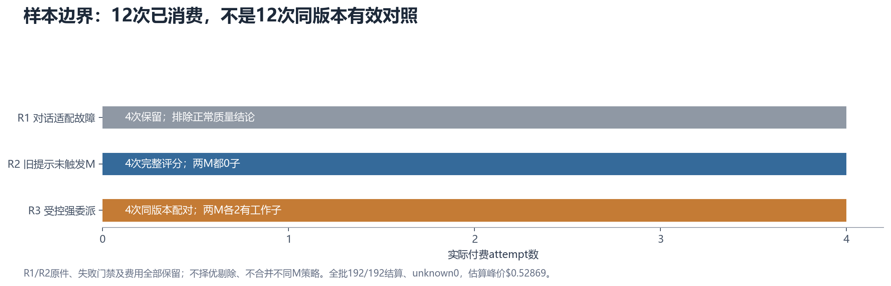
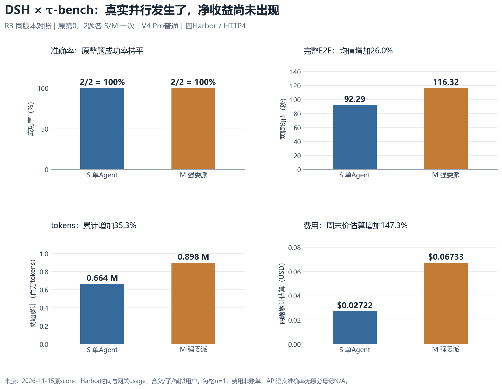
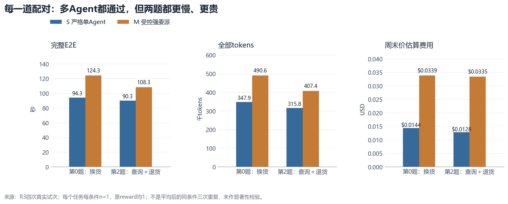
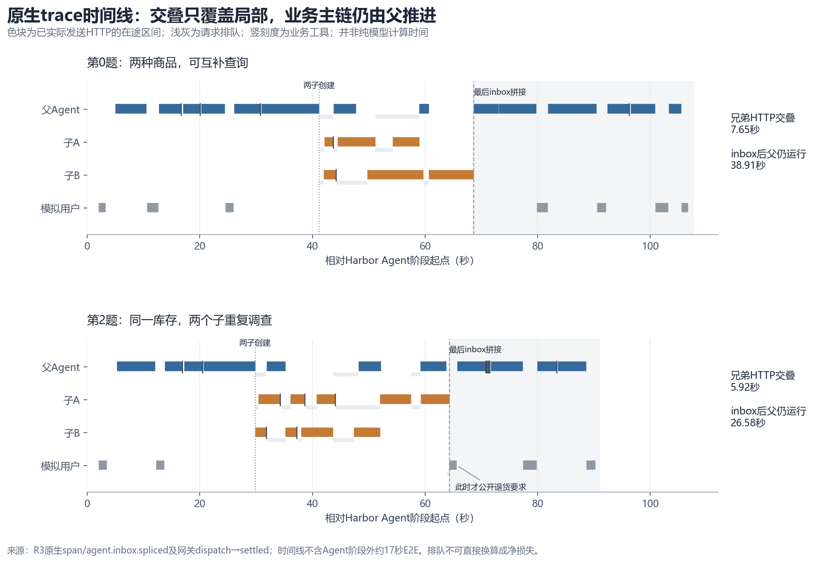
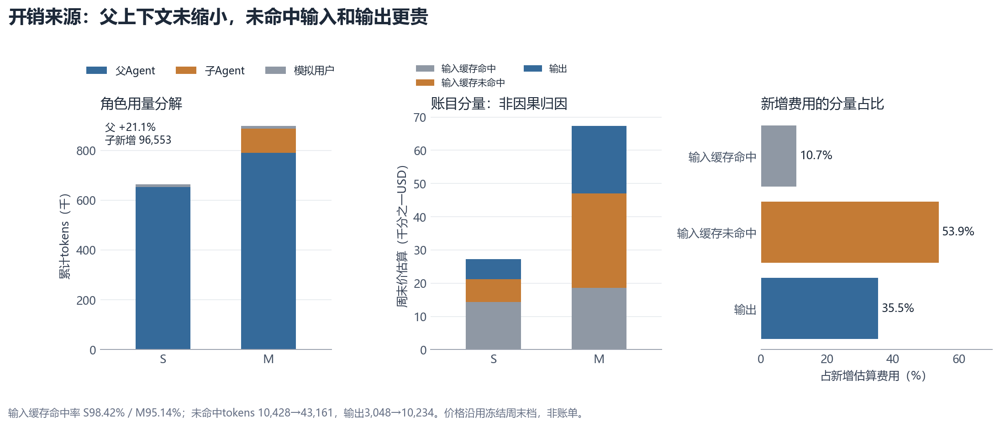

# DSH × τ-bench：子Agent确实并行，为什么没有净收益？

**[逐次指标](cells.csv)** · [分阶段汇总](groups.csv) · [全部12次与角色用量](metrics.json) · [192条脱敏usage](request-usage.csv) · [历史执行及异常](execution-notes.md) · [原生证据摘要](native-evidence-summary.json) · [完整阶段门禁](stage-audits.json)

**[五张PNG/SVG](figures/)** · [可交互图表源码](tau-results-analysis.canvas.tsx) · [原生时间线数据](native-timeline-data.json) · [费用分量](cost-components.csv) · [离线复核](validate.py) · [重画图表](render_figures.py)

本发布包只含本研究脱敏指标、原创分析/策略与元数据；没有Mabench源码、任务数据库、原测试/参考操作、完整会话、凭据或主机路径。原评分采用上游终态/输出口径，不是本仓库其他数据包的统一50%交付奖励；没有事后重评。

2026-11-15｜V4 Pro普通模式｜四Harbor并发／HTTP4、每题HTTP2｜纯离线复核，无新模型请求。

本次最直接的观察是：**最后两对有效对照中，单Agent和受控多Agent都完成任务；多Agent有真实子工作和请求并行，但两题都更慢、tokens和估算费用都更高。** 这反映当前分工粒度、任务公开顺序和协调路径的成本，不足以否定其他任务上的多Agent价值。

## 1. 先明确可以比较哪些结果

原授权12次全部处理，但不是12次相同条件的有效重复：

- R1四次因自然客服回复转发缺口而提前结束，保留原reward和费用，排除正常质量结论。
- R2四次对话和评分完整，但两个多Agent提示条件都0子。不能把这两次高分当作并行收益。
- R3最后四次是用户确认的独立加强条件：两道任务各S/M一次。两个M都创建2名子，四名子都有独立模型请求、原业务API工作及父回传。

后文的S/M数值对比仅使用R3。每题每组n=1，没有显著性检验；不合并R2的不同处理条件，不声称三次重复已复现稳定效果。

## 2. Accuracy、完整E2E、tokens与成本分别怎样

- **Accuracy：持平。** 原整题成功率两组都是2/2=100%，未观察到准确率增益；当前S已达到这两个任务的原评分上限。
- **完整E2E：增加26.05%。** 两题均值92.29→116.32秒；第0题94.30→124.32秒，第2题90.27→108.33秒。
- **tokens：增加35.31%。** 两题累计663,716→898,067，含父、子和真实模拟用户，缓存输入也计tokens。
- **估算费用：增加147.34%。** 两题周末价估算0.027222800→0.067332364美元。对应峰价估算0.054445600→0.134664728美元，均非账单。

原Mabench没有逐API语义检查的总分母，所以**API语义准确率为N/A**。工具成功执行率、数据库终态匹配、required-output规则必须区分，不能把“API没报错”当语义正确。第2题的原输出检查较宽松，原样保留，没有为本次另设更严评分。

## 3. 并行证据成立，但只覆盖了部分执行

第0题两个子分别调查键盘和恒温器；第2题两个子都调查T恤库存。兄弟实际HTTP在途区间交叠分别为7.65秒、5.92秒。父与子也有请求交叠。这是实际发送后的交叠，能证明存在并行模型请求，不能直接当作节省了相同秒数的E2E。

时间线以Harbor Agent阶段开始为0，色块为网关dispatch到settled，包含供应商服务和网络；不是纯模型计算。浅灰为等待HTTP槽，不能直接累加成净损失。完整E2E还包括图外约17秒的其他阶段。

子完成后父仍有较长主链：从最后一条原生`agent/inbox/spliced`拼接事件到Agent结束，第0题还有38.91秒，第2题还有26.58秒，涉及客户沟通、确认和最终交易。原生`user/message`落盘是另一个事件点，可能更晚；本报告明确使用inbox拼接时间，不用日志复制到Windows的时间推断执行时间。

每题有2条显式Team消息和2条结束报告，分别来自2名子，不是4名子。子创建、子实际工作、父收件、HTTP交叠和净收益是不同层次。

## 4. 第0题：分工互补，但粒度太细，协调成本超过局部机会

这次两名子调查不同商品，分工在语义上互补，也都有真实查询。问题在于被拆出的原业务查询很快：S两次产品查询的原生工具span合计约0.44秒；M两子对应查询约0.33秒。工具span包含框架／RPC开销，并不是原函数的纯运行时间。

为了做这两个查询，M另付出两个子上下文、多轮模型响应、两次wait、一次list、显式汇报及结束汇报，父之后还要与顾客确认和提交换货。请求并行7.65秒也没有取消这些依赖。该配对里M的E2E增加约30.02秒。

因此这题支持“当前拆分粒度的净收益不足”，不支持“完全没有可分支需求”。工具函数本身的成本与子Agent的调度／推理／汇报成本并不匹配。

## 5. 第2题：两名子重复调查，真正的新业务需求后来才出现

原生父会话显示：

1. 客户最初只问T恤有多少可用选项。
2. 父获取身份后，约29.8秒创建两名子。两个brief分别称目录调查和库存检查，但都要求列产品类型、读取同一个T恤产品详情、统计选项。
3. 两个子确实重复调用相同名称、相同参数的`list_all_product_types`和`get_product_details`。这是实际重叠工作，不能将两个不同角色名当成两个独立业务分支。
4. 两个子结束后，客户才进一步提出退清洁器、耳机和手表；原生user消息顺序明确先结束汇报、再新退货要求。
5. 父随后自己查五张订单、确认并办理退货，没有在新需求阶段再创建互补的订单调查分支。

这暴露了本轮设计限制：原方案预想“T恤查询”和“订单／商品匹配”可并行，但它们并未同时向Agent公开。不能为了实现预想分工，提前把私有的未来退货要求告诉父或子。加强版又要求在产品查询前先创建两个子，实际促成了同一查询的重复复核。

因此该题既有模型选择重复分工的问题，也有**固定两子检查点与任务公开顺序不匹配**的问题。不能将全部增耗归咎于模型不懂合作，更不能把这轮强制分支当成自然发现新问题后动态展开的成功案例。

## 6. 为什么费用涨147%，tokens只涨35%

两题角色tokens：S父653,129；M父790,952（父自身增加21.10%）；M子新增96,553；模拟用户S10,587、M10,562，基本持平。

新增234,351 tokens中，父增量137,823占约58.81%，子新增96,553占约41.20%，模拟用户减少25。说明子分担了查询，但父上下文、协调和整合没有相应缩小。请求数从36增至52，其中新增15个子请求、父多2个、模拟用户少1个。

价格分量还受到缓存和输出的影响：

- 输入缓存加权命中率98.42%→95.14%；未命中输入10,428→43,161，约4.14倍。
- 输出3,048→10,234，约3.36倍。两子报告包含完整变体表，显式消息和结束报告有内容重叠。
- 新增费用约0.04011美元，其中**53.86%来自未命中输入，35.47%来自输出，10.66%来自新增缓存命中输入**。

这是按原冻结周末价格重算的账目分量，三项严格守恒；不是“浪费”的因果比例。高缓存命中率也不意味着新增上下文免费，不能只看命中率百分比忽略绝对未命中量和输出量。

## 7. 是不是基础设施或资源争用造成的

R3四次均无Agent异常、原生业务工具错误和委派检查点拒绝，所有请求结算；未见本轮预算／输出／时间截断。容器平均CPU约0.075–0.099核，配额2核；内存峰约297–309MiB，限额3072MiB，没有本地CPU或内存饱和证据。

共享HTTP4／每题2确实造成排队，观测排队墙钟并集均值S约10.46秒、M约18.17秒。但多角色的等待会与另一角色工作重叠，不能将约7.71秒差值直接当净损失，也不能在没有无争用反事实时给出资源竞争的因果占比。

此外业务环境适配层为保证原状态及ContextVar一致性，对原状态访问做了串行保护。图中证实的是模型HTTP并行，不能进一步宣称业务API在同一状态上并行提交。本轮主导观察更接近：**拆分过细／重复分工、父主链保留、新增上下文与长汇报**；资源门禁是混杂因素，尚未证明其为主因。

## 8. 委派触发成功，不等于已经识别到合适时机

R2的工具、提示及会话证据完整，但两个M都没有委派；R3采用明确英语指令、在政策末尾重复，并增加本地检查点后，两M都委派。正式R3没有真的命中拦截，说明它们在被拒绝前已遵循加强指令；不能从组合干预单独判断英语、位置或检查点哪个因素起效。

后续如果专门测净并行收益，合理的准入应是“当时已经公开至少两条互补、足够重的可执行分支”，允许没有这类机会时不拆；子交付应简短且互补，父在子工作期间推进不依赖子结果的工作。不能仅以“两子创建”验收分工合理性。新对照应另行预注册和授权，本报告没有启动后续付费试次。

全批12个attempt的192/192请求结算、unknown0；总峰价估算0.528690096美元、周末估算0.264345048美元，含失败attempt和模拟用户，均非账单。原题、评分器、旧文件与冻结证书均保留。

复核数据：`analysis-data.json`、`native-timeline-data.json`、`cost-components.csv`；五幅图均提供PNG及可编辑SVG，`render_figures.py`可离线重画。各图源自2026-11-15本批原始score、网关及原生会话，没有额外付费取证。

## 下载与离线复核

在本目录运行`python validate.py`，仅用Python标准库核对12个唯一题位、192条usage、角色用量/费用守恒、阶段标签、原生工作、文件SHA及本地文档链接，不联网、不调用模型。安装Matplotlib和NumPy后可运行`python render_figures.py`重画5组图；中文字体在Windows使用Microsoft YaHei，其他系统需可用CJK字体。

重画会产生新的图像文件元数据；原发布SHA用于核验发布字节，不保证不同Matplotlib版本位级相同。交互源码依赖Codex/Canvas SDK，GitHub以静态PNG/SVG阅读为主。

来源：[Mabench作者仓库](https://github.com/hinthornw/mabench)、[LangGraph原研究](https://www.langchain.com/blog/benchmarking-multi-agent-architectures)。固定提交、源文件SHA、实际处理条件和许可边界见[study-design.json](study-design.json)。
