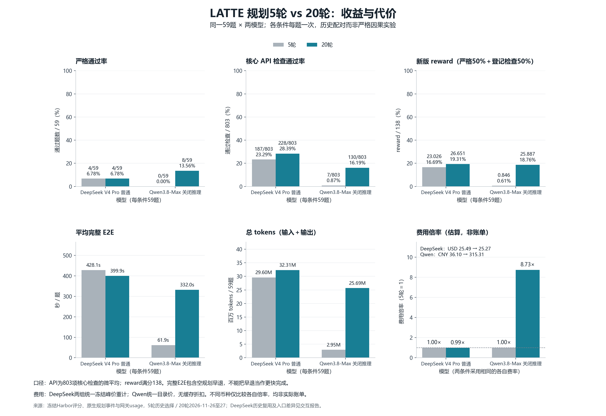
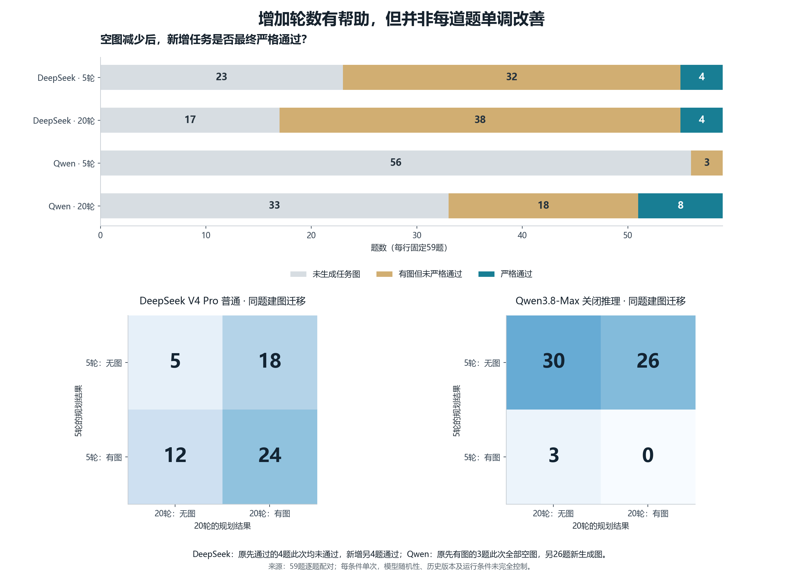
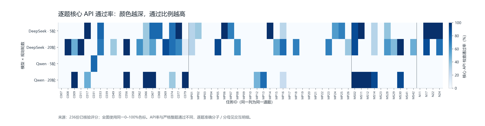

# LATTE规划5轮与20轮对比

本报告比较同一59道任务上，LATTE规划上限为5轮与20轮时的结果。包含DeepSeek V4 Pro普通模式、Qwen3.8-Max关闭推理两个模型，各模型每种条件59题，共236份评分、118个同题配对。这里只离线汇总已有结果，没有新模型调用；不包含其他会话的GLM实验。

补充：[为什么20轮有些任务反而变差：原生trace机制分析](TRACE-ANALYSIS.md)。该补充另取GLM-5.3 low的59组配对作退化案例，与本报告236条主数据分开，包含协议解析与循环保护的断网回放。

**Qwen在20轮下减少空规划、增加了整题通过，但tokens和估算成本大幅增加。DeepSeek的API通过率上升，严格通过题数仍是4题，前后通过的题目却完全不同。** 本结果是历史同题配对，不是严格单因素消融，尤其不能把DeepSeek的所有变化归因于规划轮数。

## 主要结果

| 指标 | DeepSeek 5轮 | DeepSeek 20轮 | Qwen 5轮 | Qwen 20轮 |
|---|---:|---:|---:|---:|
| 严格通过 | 4/59（6.78%） | 4/59（6.78%） | 0/59（0%） | 8/59（13.56%） |
| 核心API检查通过 | 187/803（23.29%） | 228/803（28.39%） | 7/803（0.87%） | 130/803（16.19%） |
| 新版reward／138 | 23.025515 | 26.650797 | 0.846154 | 25.886725 |
| 未生成任务图 | 23/59 | 17/59 | 56/59 | 33/59 |
| 已生成任务图 | 36/59 | 42/59 | 3/59 | 26/59 |
| 平均完整E2E（秒） | 428.14 | 399.90 | 61.85 | 332.01 |
| E2E中位数（秒） | 367.73 | 350.08 | 41.01 | 103.94 |
| 平均Agent阶段（秒） | 403.55 | 359.66 | 37.26 | 300.60 |
| 输入tokens | 28,839,366 | 31,525,458 | 2,920,429 | 25,402,617 |
| 输出tokens | 762,611 | 784,544 | 29,252 | 290,995 |
| 总tokens | 29,601,977 | 32,310,002 | 2,949,681 | 25,693,612 |
| 输入缓存命中率 | 42.40% | 48.36% | 60.97% | 42.29% |
| 同价费用估算，非账单 | USD25.485832 | USD25.268197 | CNY36.098220 | CNY315.307224 |
| 评分完整性未通过，保留0分 | 11 | 4 | 0 | 0 |



Qwen的平均E2E变为约5.37倍、总tokens变为约8.71倍、估算费用变为约8.73倍。5轮时56题空规划早退，因此原来的短耗时不能解释为更快完成任务。20轮仍有33题未生成任务图，不能据此认为规划问题已经解决。

DeepSeek的严格通过总数没有增加；API提高约5.11个百分点、reward增加3.625282分。统一费率估算费用基本持平，但历史入口、结果复用、网络版本与资源条件不同，不作为已证明的效率收益。

## 建图与逐题迁移



图的每一行、每一列都对应同一模型的相同任务集合。DeepSeek有18题从无图变有图，12题从有图变无图；原先严格通过的4题全部未过，另4题新增通过。API逐题19题改善、15题回退、25题不变。因此，聚合严格通过数相同不等于逐题稳定。

Qwen有26题从无图变有图；原5轮能生成任务图的3题在20轮中全部空图，两种条件均有图的同题子集为0。API逐题15题改善、1题回退、43题不变。不能表述为“增加规划轮数让原来每个任务都继续改进”。



四行使用相同0—100%色标，每列同一道题。精确分子、冻结分母、reward、E2E和费用见[118组配对CSV](paired118.csv)；全部条件的逐题原始指标见[236条CSV](trials236.csv)与[完整JSON](comparison.json)。

## 运行条件与比较边界

- Harness均为LATTE规划适配版，不能与早期frozen/seeded或纯native结果混合。上游固定提交为`8647e3b9cead575512c1476e8acad73bf2c5a495`。5与20是规划阶段最多模型回合，不是后续执行回合；执行阶段另有100轮设置，团队为3个预创建worker。`seed_tasks`字段表示实际规划结束时发现的任务数，不是人为预种图。
- DeepSeek实际为普通模式`thinking.type=disabled`；Qwen为`enable_thinking=false`。20轮所选请求输出申请上限8192，规划提示、解析机制和20条消息的历史窗口未因20轮而延长。规划结束无任务仍保留失败，不自动造图或种图。
- DeepSeek5轮由30个v2.1新跑C/MS结果、25个历史MP离线复算结果、4个沿用N结果组成。历史执行的任务名、入口、原结果SHA和评分依据均保留。部分旧入口使用`/app/check.py`及`README.md`，20轮使用修正后的`TASK.md`及`public_check.py`。新版评分复算不能把旧执行追溯变成同一题面执行。
- Qwen5轮使用工作区入口修复后的最终权威选择，不使用原始未修复失败或中断结果。Qwen20轮为原59题；DeepSeek20轮按固定选择合并原技术完整32题与授权网络恢复27题，不按最高分选取。20轮运行日期为2026年11月26日至27日，5轮为此前历史结果。
- DeepSeek网络恢复有独立transport版本；中断后短路径修复接回原余题。两条件的历史预算、运行时间、共享机器负载和网络条件未重新控制，不宣称全机资源隔离，也不将各批并发上限混写为同一全局并发。该比较没有重新安排同预算、同负载的重复配对实验。
- 每条件每题仅一次，模型随机性未经重复估计。整题通过集合互换、同题建图回退都必须保留，不做挑选成功子集的结论。
- `worker_reply_count`统计有原生模型回复的Dev角色数。预创建队友工作、运行中新建子会话、工具并行是不同证据；本报告不把worker响应或区间重叠当作已经证明的净并行收益。

## 评分与耗时口径

默认reward版本为`delivery-bonus-50-v1`，逐题调用随包[workspace_reward.py](workspace_reward.py)，规则原件为[reward-policy-v1.0.json](reward-policy-v1.0.json)，SHA-256为`7cf383ca7b92cdc0cbfc555e8193391fa0da198b21cdda5a915fea34f02483b8`。

`reward = I × W × (0.5 × K/N + 0.5 × S)`。I为评分完整性，W为登记的难度权重（E/M/H=1/2/3），K/N包括冻结的A、B、D和一次P，S为严格通过。逐题ROUND_HALF_UP到6位小数后求和。完整性确认失败记0；缺整份评分应记未知，不能填0。236条所选记录都有评分。冻结权重不是事后实测难度标签。

每个59题条件的登记检查共1217项、reward满分138。API通过率单列，仅统计A组核心转换用例：总通过数／803；既不是API请求成功率，也不是reward公式中全部K/N。主表为微平均；逐题等权宏平均另存JSON，不混为同一指标。超时、异常、缺单项均保留冻结分母；完整性失败不从样本中删除。

完整E2E为Harbor `finished_at - started_at`，包括环境准备、Agent与评分阶段及trial内部等待，不含trial开始前的排队。Agent阶段另列。所有早退、评分失败、完整性失败都保留真实耗时。`execution_rounds>=100`只表示观测到至少100个round_start事件，不自动推断其唯一终止原因。

## 成本估算与未知用量

这是按实际已结算tokens乘冻结比较费率得到的估算，不是服务商账单。完整机器口径见[pricing.json](pricing.json)。

1. DeepSeek两条件统一冻结峰价：每百万未缓存输入USD1.32、缓存输入USD0.044、输出USD3.96。费用为`((input-cache)×1.32 + cache×0.044 + output×3.96)/1e6`。旧5轮报告使用谷价，本报告重新按峰价重计为USD25.485832；不将谷价旧数直接与20轮峰价比较，也不声称实际在峰时扣了这些钱。
2. Qwen两条件统一目录估算：每百万输入CNY12、输出CNY36；计算`(input×12 + output×36)/1e6`，不应用缓存折扣。尽管命中tokens可观测，也不能据此套用DeepSeek的缓存价格。Qwen使用Token Plan；目录估算不等于套餐实际扣费、额外消费或按量账单。
3. 主表只包含选定59题记录的已知用量；原失败、中断及未选attempt不混入质量主表，也不当作没有花费。所有旧结果保留。所选236格的usage完整，不代表整个历史无未知。
4. DeepSeek20轮生命周期含旧中断时6552发送、6550结算、2条未知；已知用量估算USD27.073265208，未知部分费用不计入且仍未知。Qwen20轮5762/5762结算、未知0。旧Qwen5轮MS02的429未知记录也保留，详见旧报告。完整20轮旧中断旁表见[lifecycle20-old-interruptions.json](lifecycle20-old-interruptions.json)。
5. USD与CNY分别呈现，不跨币种相加，不比较跨模型费用倍率。成本倍率均为同一模型20轮／5轮，采用相同费率。

## 查看与复核

- [交互HTML](comparison.html)：下载整个目录或[报告包](report-bundle.zip)后在浏览器打开，可按模型、数据集、任务ID及改善／回退筛选。GitHub文件预览不执行HTML脚本。
- [Canvas源文件](latte-planning-5-vs20.canvas.tsx)：内嵌数据，需支持`cursor/canvas`的宿主；普通浏览器请使用HTML。无外部数据请求。
- 高清图与矢量图：[总览PNG](overview.png)／[SVG](overview.svg)、[迁移PNG](flow-and-transitions.png)／[SVG](flow-and-transitions.svg)、[热图PNG](task-api-heatmap.png)／[SVG](task-api-heatmap.svg)。
- [四组汇总CSV](summary4.csv)、[236条记录CSV](trials236.csv)、[118组配对CSV](paired118.csv)、[完整JSON](comparison.json)、[原评分核验回执](reward-verification.json)、[发布清单](publication-manifest.json)、[文件哈希](SHA256SUMS)。

离线复核只需Python标准库，在本目录执行：

```sh
python verify_report.py
```

可复核236条reward、tokens、费率、四组分母、118组唯一配对与迁移统计，以及所有清单文件哈希；不会调用模型或网络。重画PNG/SVG另需Matplotlib、NumPy和中文字体：`LATTE_CHINESE_FONT`指向本机中文字体后执行`python plot_comparison.py`。

本包包含派生指标、图表及原件身份哈希，不重复上传所有历史原生trace和评分原件。`<project>`和`<run-root>`是本机证据定位占位符，不是可下载网址。完整JSON中的原件SHA用于回溯原字节，与本次脱敏导出文件的SHA不是一回事。独立读者可复核本包统计；要重演原始执行或逐项重新评分仍需对应原trace／score原件。

本地原件离线核验已逐格检查正式评分、冻结检查和任务身份；236条reward复算通过。页面另经类型检查、4汇总与118逐题记录的筛选测试、3幅SVG加载及无外部HTTP验证。原验收回执保留；发布目录另有独立统计／文件复核，不将旧本机路径回执冒称为全部远端文件下载验证。

## 保留的历史结果

本目录是新增版本，未替换旧结果或改写原attempt。已有[Qwen六Harness×59题报告及全部旧trace](../upstream59-v21-qwen38-max-off-20261126/README.md)和[DeepSeek六Harness×59题旧报告](../upstream59-v21-deepseek-v4pro-20261121/upstream59-v2.1.0-deepseek-v4-pro-matrix.docx)继续保留。本次不改题目、评分器、模型配置或运行队列。
