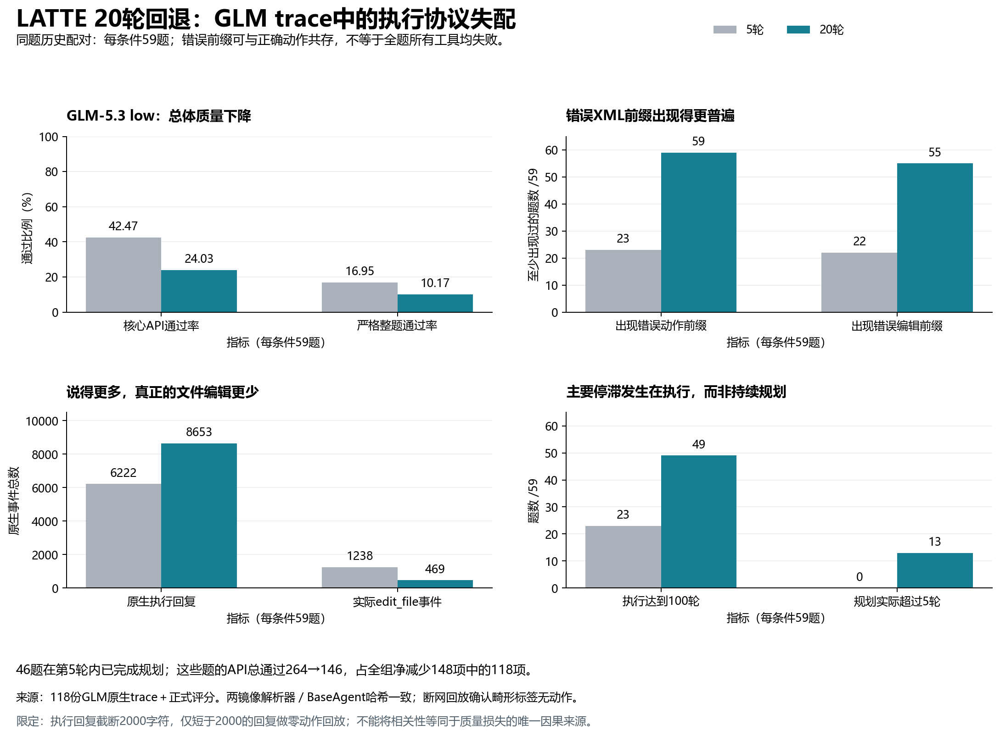

# LATTE规划20轮回退的trace机制分析

主对比报告中的DeepSeek与Qwen，20轮的总体API通过率均高于5轮；DeepSeek严格通过仍4题，但有4题新增、4题回退。**真正出现总体明显下降的是另一个GLM-5.3 low批次**：API341/803→193/803，严格10/59→6/59，reward39.375864→24.638277。不能把三个模型说成同一种退化。

本补充只读分析三模型各59题、各两条件，共354份原生trace。主报告236条DeepSeek／Qwen数据保持不变；GLM另给出59组配对补充，不混入主表。不重跑、不改变运行配置、权限、正式题或评分器。

## 最强的直接证据是执行协议失配

GLM两条件均59/59生成了任务图。问题主要不是“20轮还没有想出分解”，而是建图后，模型生成的部分工具文本不符合LATTE解析器的格式，动作没有执行，随后又继续消耗模型回合。



- 原生执行回复中，出现过`<tool_call>动作名...`这一错误前缀的题数为23/59→59/59；此类回复数为2371→5875。
- 出现错误`edit_file`前缀的题数22/59→55/59，实际记录的`edit_file`事件总数反而1238→469。执行回复数从6222增至8653。
- 执行达到100轮的任务23→49。两组实际平均规划只用4.03→4.32轮，平均规划阶段33.26→22.27秒；主要增加的无效工作不能解释为“规划多用了15轮”。

“出现过错误前缀”不是该题所有工具都失败；一条回复也可能同时包含错误前缀与其他合法动作。20轮中仍有6题严格通过。上述数字是可见前缀统计，不是全部工具调用的失败率。

### 用冻结解析器回放

例如，实际短回复为：

```text
<tool_call>claim_task id="task-1" />
```

LATTE要求的是：

```text
<claim_task id="task-1" />
```

在两个登记镜像的断网、只读容器中，前者都解析出0个动作，后者都解析出1个ClaimTaskAction。5轮镜像与20轮镜像的`token_parser.py` SHA完全一致：`084ca33bd5c21cb45b0f278b72fc2d14bc7e47675d10b8bf79ae91d9e0b92c7a`；BaseAgent SHA也一致。镜像身份与回放结果在[offline-protocol-replay.json](offline-protocol-replay.json)。

实际GLM请求快照中，LATTE的协议是Chat正文中的XML文本，`tools=[]`、`tools_status=omitted-by-client`；模型仍是`glm-5.3`、`thinking=enabled`、`reasoning_effort=low`，样例`max_tokens=8192`。因此，`<tool_call>`并不是已经注册并执行的原生function call，不能看见“tool_call”就统计为调用成功。

源码中的执行链是：模型正文→`parse_actions(reply)`→仅处理解析出的动作→保存任务。没有统一的“非空文本但零合法动作”错误回执。若动作未解析，又没有其他反馈，worker下一轮得到的可能只是“Continue working on task ...”。这让文本上反复尝试与实际状态不变之间缺少明确的纠错闭环。

以上确认的是**模型输出与LATTE文本工具接口不匹配，以及运行时未及时纠正**。尚未证明GLM在本批更频繁生成错误标签的最初原因。不能从这些trace断言服务商模型版本变化、模型防御性、推理能力不足，或网关改写了标签；这些解释仍需另行证据。

## 循环保护对LATTE消息形式有盲区

本地`loop_guard.py`从API消息历史识别连续完成回合。遇到普通`role=user`且不是原生tool_result时，它把消息当作新用户干预，清空候选回合。

LATTE的`receive()`恰好把状态和工具反馈包装为普通user字符串，例如`[From System]: ...`。请求快照可见反复交替的assistant／user消息。因此，该保护不能稳定把LATTE反馈还原成连续工具执行回合。

离线fixture用同一冻结guard验证：连续6次相同助手动作、每次后接LATTE式user反馈，识别出的连续完成回合为0，未触发；同样内容采用原生tool结果消息，能够触发。这里没有向模型发请求，也没有修改guard。证据在[offline-protocol-replay.json](offline-protocol-replay.json)。

这说明原有“重复会话保护”不能等同于检测实际文件／任务状态的停滞。加上错误标签可能带有不同代码或措辞，单纯比较文本也不足以识别无进展循环。它是**本地适配与监控的保护盲区**，不应全部归咎为LATTE原生或模型本身。

## 下降并不集中在真正用到额外规划轮的任务

| GLM20轮组实际规划 | 任务数 | API通过数，5→20 | 固定API分母 | 严格通过，5→20 |
|---|---:|---:|---:|---:|
| 第5轮内结束 | 46 | 264→146 | 626 | 7→6 |
| 实际超过5轮 | 13 | 77→47 | 177 | 3→0 |

46题没有使用第6—20个规划回合，仍贡献118项API净减少；全组净减少148项。这个分解不能作为因果贡献率，却足以说明“多消耗15轮规划，挤占执行预算”不是全部下降的解释。允许20轮的预算提醒本身仍可能改变早期决策，不能因为早于5轮结束就称两组上下文完全相同。

## 具体案例中的故障链

**GLM C007：分解结构合理，但集成没有写进去。** 20轮组实际只规划3轮，图为两个独立组件加依赖它们的integration任务。两组件有真实写入，Dev2另写了check.py；全程没有`edit_file(path=integration.py)`，第79轮等公开测试仍报该文件`NotImplementedError`，第100轮仍在生成带错误前缀的编辑文本。这不是只有模型自述“写层坏了”，而是文件编辑事件与实际报错共同证明集成未交付。两组本题API都0/8，因此它是机制案例，不计作新增的准确率下降题。

**GLM C055：规划更早完成，质量却回退。** 规划5→2轮，API9/9→0/9；实际编辑25→7次，错误动作前缀回复0→61，执行47→100轮。这里额外15轮没有被使用，阻塞发生在建图后的执行阶段。

**GLM MP04：任务图已经覆盖模块，执行动作却不足。** 规划4→5轮，API18/25→0/25；实际编辑27→3次，错误动作前缀回复0→144，执行34→100轮。不能把0分解释成没有做出任务拆分。

**DeepSeek C017：没有同类错误前缀，主要卡在集成收尾。** 20轮组第3轮就建图，执行100轮。30次实际编辑中，2次为业务组件，28次是辅助探索／检查脚本，`integration.py`没有写入；最后公开测试仍因该文件stub失败。旧5轮组写过integration.py两次，API8/8。它体现探索与集成失衡，不是GLM标签机制。

**DeepSeek C077：有交付、公开测试通过，隐藏语义未覆盖。** 20轮组第47执行轮`all_tasks_done`且`tests_passed=true`，正式API为6/9；A/C077-06、07、09未通过，B/solution和一个D产物检查也未通过。旧5轮组API9/9。该例是公开验收与完整语义覆盖的差距，不能说“没创建图”或“所有工具未执行”。

**DeepSeek MP14、MS11及Qwen C031：建图行为不单调。** 旧组有图，新组用满20轮仍无图，完全没有进入执行。更宽松的上限及更弱的临近截止压力，没有强制保证模型更早提交任务图。新一轮轨迹有随机性，不能视作旧5轮轨迹的确定性延续。

**Qwen C008：有限历史会放大重复取证。** 已有同一冻结版本的离线诊断证明，20次正常stop回复中19次读文件，12个不同路径、7次重复；7次重复时旧读取反馈均已滑出历史窗口。读取反馈确实进入过下一次请求，不是工具反馈全部丢失。该证据支持有限历史导致重新取证的机制，但不能外推为所有59题的唯一原因。20条是消息数，不是20个完整工具回合；执行时Lead另用更短的10条窗口。

## 异常与条件差异必须分开

GLM C031的20轮trial在`run_script(run_all.py)`时跨度未闭合、Harbor退出129；25/25请求已结算、没有网关失效，退出根因仍未知。主表保留API0/9和原attempt，并单列敏感性：剔除该对后API333/794→193/794，仍明显下降。因此C031影响结论幅度，但不是整批回退的唯一原因。

DeepSeek旧组含历史MP复算及N复用。GLM与DeepSeek的20轮组另有30题新版公开工作区入口、运行时段与共享资源差异。任务说明／评分registry相同不能替代执行入口和运行条件完全一致。不能用这些历史结果断言“20轮本身导致性能下降”。GLM原选范围请求已结算，但历史7笔真实未知等仍保留；不因分析成功清零未知用量。

GLM补充的费用采用原批冻结估算：每百万输入未命中CNY8、命中CNY2、输出CNY28，旧组CNY182.530344、新组CNY230.708240；这不是供应商账单，也不与DeepSeek的USD费用相加。原始逐题指标见[glm59-paired-supplement.json](glm59-paired-supplement.json)，与DeepSeek／Qwen主报告各自费率分开。

## 下一步应先修什么

优先级最高的是工具协议闭环：对非空回复但无合法动作，显式回传格式错误；区分合法动作、解析失败、权限拒绝、执行错误和实际产物改变，保留原文本，不默默把畸形标签当成功。修订协议或自动正规化都应独立标记版本，不偷偷改这次结果。

其次为LATTE消息包装增加专用的停滞检测，比较实际文件哈希、任务状态和已闭合工具结果，不能只依赖通用Chat消息角色或表面文本重复。再处理长文件分页、历史摘要及集成任务的交付检查。最后才用同入口、同预算与资源条件的重复配对验证收益。

本次只做了取证、离线回放和报告，没有实施这些运行时修复，也没有启动重测。现有证据不支持直接把LATTE换基座就一定提高准确率，或把规划上限继续增加就能解决协议问题。

## 取证口径与文件

- [trace-mechanisms.json](trace-mechanisms.json)：354条trace的结构统计、各模型分组与GLM实际规划曝光分解。
- [trace-case-evidence.json](trace-case-evidence.json)：病例事件哈希、实际任务图与编辑路径、有限短回复前缀；不包含整份历史trace或全部代码生成文本。
- [offline-protocol-replay.json](offline-protocol-replay.json)：两个镜像的固定身份、解析器／BaseAgent哈希和循环保护fixture回执。
- [机制图PNG](glm-trace-mechanisms.png)／[SVG](glm-trace-mechanisms.svg)及[Canvas源](latte-planning-trace-mechanisms.canvas.tsx)。

原生执行回复仅记录前2000字符，规划回复前4000字符。只有严格短于2000字符的执行回复用于零动作回放；截断文本不能被当作完整格式错误。错误前缀只是可见签名统计，也可能与合法动作共存；不能用“零解析动作回复”把正常叙述或空闲回复都记成错误。实际操作以独立工具事件、候选文件与评分为准。

统计器保存原生trace的SHA；这些是原件身份，不是发布文件SHA。发布包提供派生证据与可独立复核的统计，不把本机占位路径当成远程下载链接。所有旧结果、异常和未知用量继续保留。
