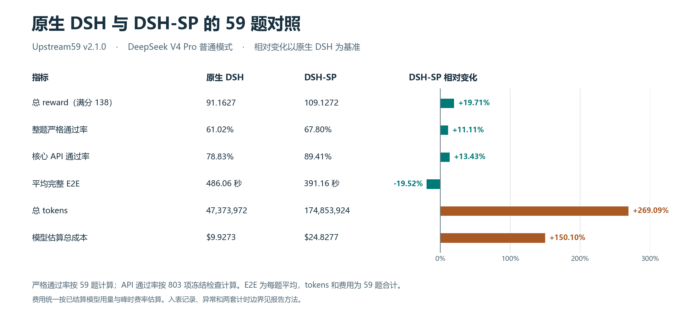

# 原生 DSH 与 DSH-SP 的 59 题对照

两套系统在 Upstream59 v2.1.0 的同一批 59 题上使用 DeepSeek V4 Pro 普通模式。DSH-SP 是将 SP 分工机制移植到 DSH 的实验版本。DSH-SP 多严格通过 4 题，多通过 85 项核心 API 检查，总 reward 高 19.71%。每题平均快 94.90 秒，所用 tokens 为原生 DSH 的 3.69 倍，估算模型成本为 2.50 倍。

| 指标 | 原生 DSH | DSH-SP | 绝对变化 | 相对变化 |
|---|---:|---:|---:|---:|
| 总 reward（满分 138） | 91.1627 | 109.1272 | +17.9644 | +19.71% |
| 整题严格通过率 | 61.02%（36/59） | 67.80%（40/59） | +6.78 个百分点 | +11.11% |
| 核心 API 通过率 | 78.83%（633/803） | 89.41%（718/803） | +10.59 个百分点 | +13.43% |
| 平均完整 E2E | 486.06 秒 | 391.16 秒 | −94.90 秒 | -19.52% |
| 输入 tokens | 45,772,561 | 172,495,689 | +126,723,128 | +276.85% |
| 输出 tokens | 1,601,411 | 2,358,235 | +756,824 | +47.26% |
| 总 tokens | 47,373,972 | 174,853,924 | +127,479,952 | +269.09% |
| 模型估算总成本 | $9.9273 | $24.8277 | +$14.9004 | +150.10% |

## 逐题表现

两套系统都严格通过 27 题，只有 DSH-SP 通过 13 题，只有原生 DSH 通过 9 题，两者都未严格通过 10 题。DSH-SP 的完整 E2E 在 39 题上更短。新增的 127,479,952 个 tokens 中，126,723,128 个来自输入端（99.4%）。

[逐题可读表](tasks.md) · [下载配对 CSV](paired.csv) · [完整数据与取值来源 JSON](paired.json) · [矢量图 SVG](comparison.svg)

## 统计方法

- 原生 DSH 取仓库发布的[官方 Supervisor 与原六套 Harness 对照矩阵](../upstream59-v4pro-supervisor-baseline-restored-20261128/seven-configuration-matrix.json)中的 DSH 列。该版本有 7 题因串入别题契约而未执行业务检查，沿用正式完整性判定与零分，并保留冻结分母。这部分差异也体现在质量对比中。
- DSH-SP 每题计一条完整记录。55 题各有一条候选，C049、C062、C067、MS14 按正式 reward 取高，同分取首次。C049 使用 JSON 恢复修复，另三题沿用同一冻结配置。评分、耗时、tokens 和成本均来自入选的同一次运行。JSON 中保留各次标识、终态和评分摘要。两侧采用各自的实验记录选取规则。
- 严格通过率是正式严格通过题数除以 59。核心 API 通过率是核心转换检查通过数之和除以 803。reward 使用 `delivery-bonus-50-v1`，按冻结难度权重逐题计算。严格通过占一半，登记核心检查通过比例占一半，完整性失败记零。登记核心检查共 1,217 项，59 题权重总和为 138。
- 原生完整 E2E 取 Harbor 试次开始到结束的墙钟时间；DSH-SP 从公开工作区准备计至正式评分返回，含网关启动。表中列 59 次单题耗时的算术平均，跨题并发会影响实际整批用时。两套计时的起止事件不同，结果不用于归因某一环节的加速。
- tokens 汇总已结算模型请求的输入与输出，DSH-SP 覆盖父、子会话。估算统一按每百万 tokens 的美元费率计，未缓存输入 1.32、缓存输入 0.044、输出 3.96。费用为模型用量估算，账单及宿主资源费用另计。两侧均有 59/59 份计时和用量记录，所选记录未知用量为 0。DSH-SP 全部 63 条有费用记录的尝试合计估算 $25.4282，表中统计入选的 59 条。
- 相对变化为（DSH-SP − 原生 DSH）÷ 原生 DSH。通过率的绝对变化以百分点表示。逐题基准为零时，相对变化在 CSV 中留空，在 JSON 中记 null。
