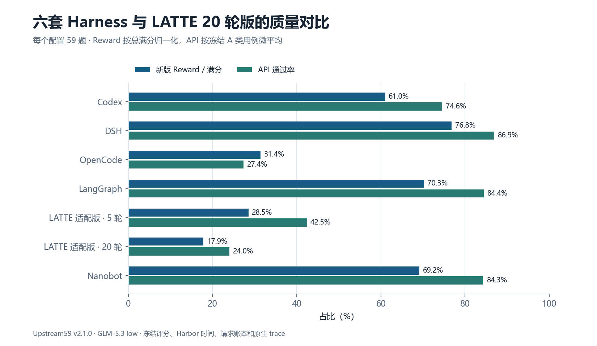
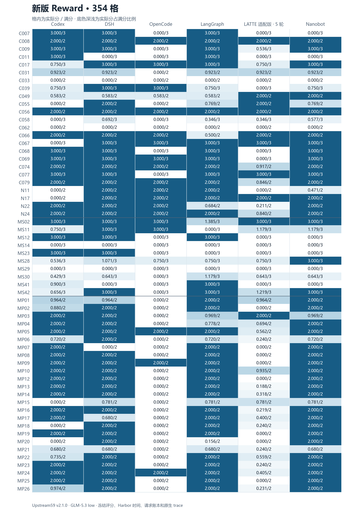
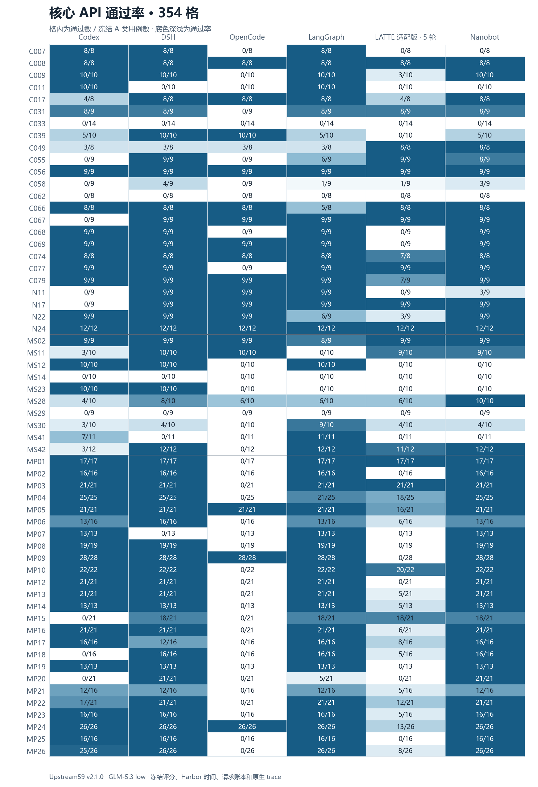
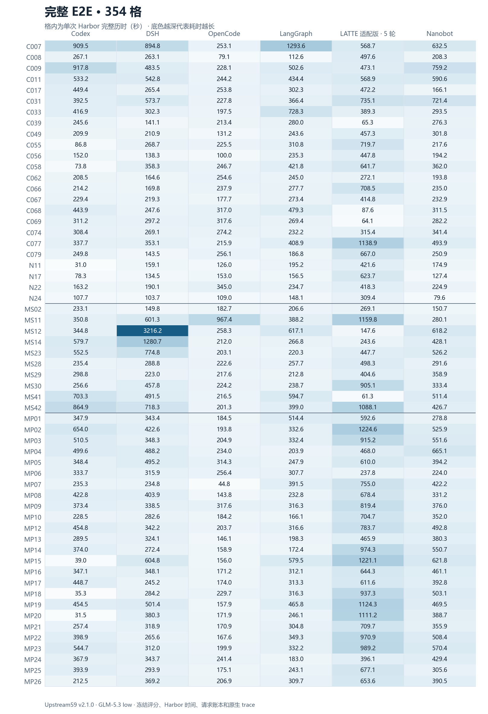
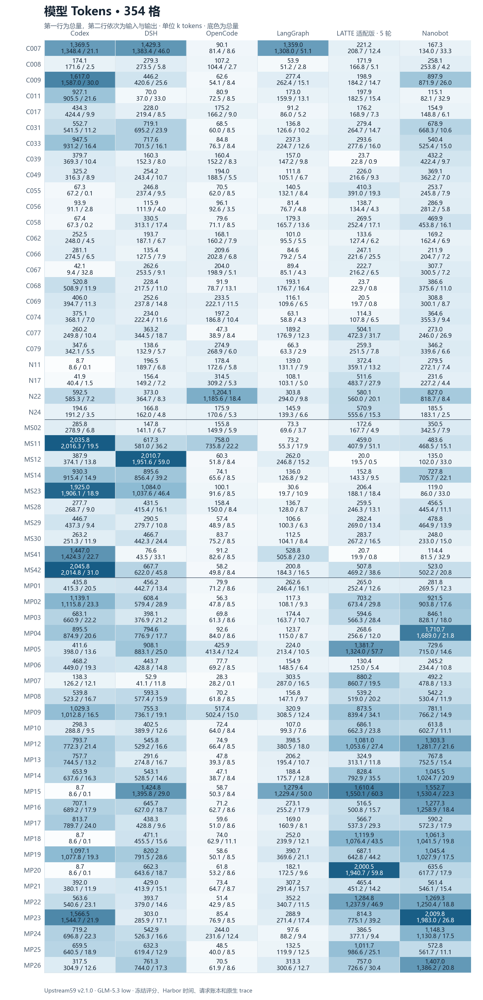
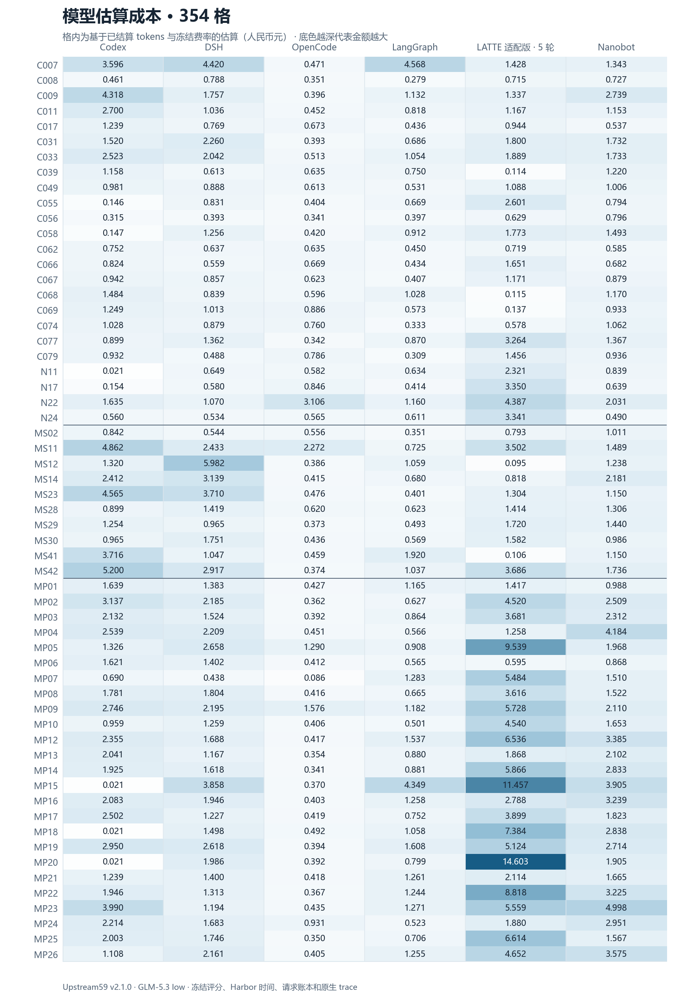
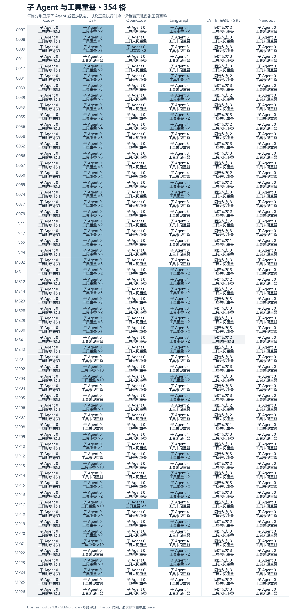
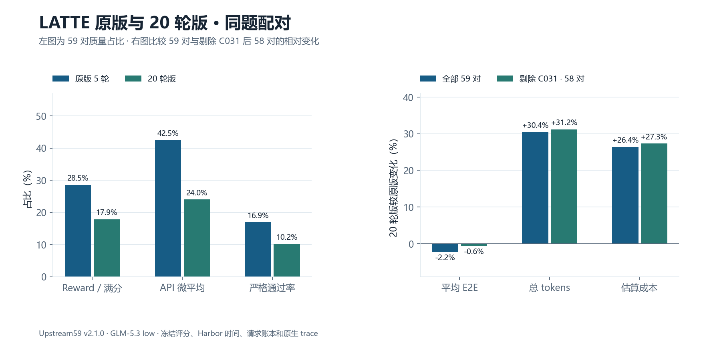
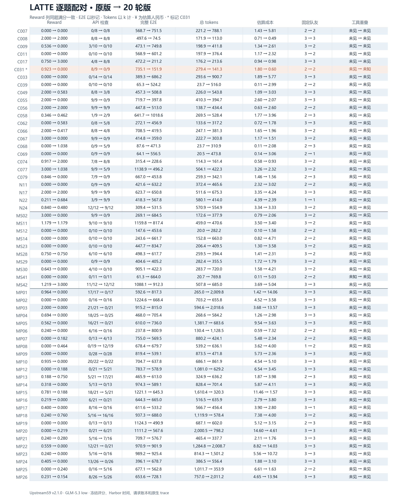

# GLM-5.3 low 的 Upstream59 矩阵与 LATTE 对照

补跑前存档 · 2026 年 11 月 27 日 · Upstream59 v2.1.0 · GLM-5.3 `thinking=enabled`、`reasoning_effort=low`

本页的结果对比并列展示 LATTE 5 轮和 20 轮，也提供 354 格原矩阵和 LATTE 配对图。逐题运行证据见[已脱敏的 trace 目录](TRACE.md)。

## 结论

- 原矩阵 **354/354 格通过技术验收**。合计 reward **465.373088/828**，严格通过 **179/354**，核心 API 微平均 **3213/4818（66.69%）**。DSH 的 reward、严格通过数和 API 微平均在六套中最高。
- LATTE 20 轮版的 API 微平均从 **42.47%** 降到 **24.03%**，严格通过从 **10** 题降到 **6** 题，tokens 和估算成本分别增加 **30.4%** 和 **26.4%**。
- 全样本平均 E2E 从 609.8 降到 596.6 秒，但新版 31 题更慢。排除 C031 后，平均 E2E 差距缩至 3.4 秒，逐题 E2E 差值的中位数为 +11.0 秒。现有样本未显示稳定的端到端提速。
- 六套中，LangGraph 有明确的子 Agent 创建证据。LATTE 的原生 trace 证明固定队友实际参与。DSH 则主要呈现没有子会话的工具调用重叠。

## 结果对比

每个配置各 59 题。LATTE 5 轮属于 354 格原矩阵，20 轮是独立对照，59 题汇总包含异常带分的 C031。API 使用冻结 A 类核心转换用例。E2E 依次列出均值和中位数。

- **Codex**　reward 84.230884/138，严格通过 32/59，API 599/803（74.60%），E2E 345.1 / 337.7 秒，输入/输出/总 tokens 34,638,325 / 792,380 / 35,430,705，估算成本 ¥100.6090。
- **DSH**　reward 106.018540/138，严格通过 43/59，API 698/803（86.92%），E2E 406.4 / 315.9 秒，输入/输出/总 tokens 27,624,041 / 1,081,201 / 28,705,242，估算成本 ¥94.5863。
- **OpenCode**　reward 43.333333/138，严格通过 18/59，API 220/803（27.40%），E2E 218.6 / 206.9 秒，输入/输出/总 tokens 8,273,476 / 510,290 / 8,783,766，估算成本 ¥34.7304。
- **LangGraph**　reward 96.953220/138，严格通过 37/59，API 678/803（84.43%），E2E 329.3 / 302.3 秒，输入/输出/总 tokens 12,327,381 / 707,483 / 13,034,864，估算成本 ¥55.0187。
- **LATTE 适配版 · 5 轮**　reward 39.375864/138，严格通过 10/59，API 341/803（42.47%），E2E 609.8 / 610.0 秒，输入/输出/总 tokens 27,107,971 / 1,201,660 / 28,309,631，估算成本 ¥182.5303。
- **LATTE 适配版 · 20 轮**　reward 24.638277/138，严格通过 6/59，API 193/803（24.03%），E2E 596.6 / 601.2 秒，输入/输出/总 tokens 35,552,495 / 1,361,578 / 36,914,073，估算成本 ¥230.7082。
- **Nanobot**　reward 95.461247/138，严格通过 39/59，API 677/803（84.31%），E2E 382.0 / 362.0 秒，输入/输出/总 tokens 34,650,145 / 914,419 / 35,564,564，估算成本 ¥102.9214。

## 354 格完整矩阵

行是 59 个题号，列是六套 Harness。Reward 格内为实际分和满分。展开其余视图可以逐格查看对应指标。

核心 API 通过率矩阵

完整 E2E 矩阵

输入、输出与总 Tokens 矩阵

模型估算成本矩阵

子 Agent、固定队友与工具重叠矩阵

## 子 Agent 和工具调用

- **LangGraph**　59/59 题有原生父子 ID，187 个子 ID 都有独立模型响应或工具证据。25 题工具调用窗口重叠，34 题未见重叠。
- **DSH**　0/59 题有原生子 Agent，47 题工具调用窗口重叠，12 题未见重叠。节点可用与运行时创建分别取证。
- **OpenCode**　0/59 题创建子 Agent，2 题工具调用重叠，57 题未见重叠。工具区间来自原生 SQLite 工具记录和 CLI 事件。
- **Nanobot**　0/59 题创建子 Agent，59 题有闭合工具跨度且未见重叠。
- **Codex**　0/59 题创建子线程。55 题可读到调用至返回的原生封装窗口，均未见窗口重叠。执行起止是另一个字段，59 题均缺少可比较的实际工具执行跨度，因此执行重叠记未知。
- **LATTE**　原版和 20 轮版都是 59/59 题有实际完成回合的固定队友，逐题去重后分别合计 156 和 145 个队友角色。两版各有 56/59 题出现 Agent 回合重叠，各有 58 题工具跨度未见重叠、1 题工具时序未知。固定队友的父子会话数没有可靠观测。

## LATTE 的 59 题同题配对

- **原版 → 20 轮版**　reward 39.375864/138 → 24.638277/138，API 341/803（42.47%） → 193/803（24.03%），严格通过 10/59 → 6/59。
- **运行开销**　E2E（均值/中位数）609.8 / 610.0 秒 → 596.6 / 601.2 秒，输入/输出/总 tokens 27,107,971 / 1,201,660 / 28,309,631 → 35,552,495 / 1,361,578 / 36,914,073，估算成本 ¥182.5303 → ¥230.7082。
- **逐题方向**　新版 reward 上升、持平、下降分别为 15 / 19 / 25 题。实际规划均值 4.03 → 4.32 轮，新版 13/59 题超过 5 轮。达到执行 100 轮的题数为 23 → 49。
- **排除 C031 的敏感性对照**　reward 38.452787/136 → 24.638277/136，API 333/794（41.94%） → 193/794（24.31%），平均 E2E 607.7 → 604.3 秒，总 tokens 28,030,243 → 36,772,784，估算成本 ¥180.7303 → ¥230.1124。
- **配对边界**　逐题验证了题面和评分 registry 哈希完全相同。20 轮版在 30 题上也绑定了新版公开工作区入口，两批运行时段不同。这里对比实际发布配置，对差异的因果归因需要单独控制这些变化。

展开 59 题配对明细，C031 已标记

## C031 退出异常

- 20 轮版在北京时间 **03:21:42.769** 完成编辑后，由 `Dev1` 在第 11 执行轮启动 `run_script(run_all.py)`。这一工具跨度没有结束事件。原生 trace 缺少 `run_end`，Harbor 记录 `NonZeroAgentExitCodeError` 和退出码 **129**，stdout/stderr 未保留。
- 129 与 shell 的 `128 + SIGHUP` 编码相符，现有日志无法确定信号、发送方或最初触发原因。Docker 历史窗口未返回此容器的信号事件。25 个 GLM 请求全部结算，网关未记录失败事件。Harbor 与离线复核均留下评分，原始候选和异常单独保留。
- 原版 API **8/9**、reward **0.923077/2**、E2E **735.1 秒**。20 轮版 API **0/9**、reward **0/2**、E2E **151.9 秒**，这段较短时间是提前终止的记录。59 对主结果纳入该正式评分，另给出剔除这一对的 58 对结果。
- 证据索引 `latte20-glm-c031-20261127-r1-segment-01`。原生 trace SHA-256 `f0cf9aa1115130c25ad4f3f18035d0a8ecaa12ecbe29e4ac9e3166e663c14f1a`。完整原件位置与未闭合 span ID 见审计 JSON。

## 计量口径与审计范围

- **新版 reward**　使用 `scoring/workspace_reward.py` 复算每格。完整性通过时，`E/M/H` 满分为 `1/2/3`，严格通过占 50%，冻结核心检查 A、B、D、P 的通过率占 50%。API 单列 A 类，并同时提供按检查微平均和按题宏平均。
- **完成状态**　原矩阵 113 格有 Agent 非零退出且通过技术验收并留有评分。同一格仅选一个已验收 attempt。20 轮版有 49 格达到执行 100 轮、4 格触发循环或 token 保护、5 格正常评分和 1 格 C031 异常带分。
- **完整 E2E**　取 Harbor `finished_at − started_at`，包含环境初始化、Agent、归档及 Harbor verifier。队列等待和另一次离线评分复核在此计时边界之外。
- **tokens 和成本**　按账本请求 ID 去重，包含同题父子模型调用。原矩阵选定试次共 13,069 次结算，20 轮版共 8,909 次结算，两个选定范围内未知请求均为 0。冻结估算费率为每百万输入未命中 ¥8、命中 ¥2、输出 ¥28。缺缓存字段的请求按未命中计价。金额为清单估算。
- **历史开销**　主表之外有 141 个已结算请求，估算 ¥3.664028。原始账本 8 条未知标记仍保留，其中 1 条有确认在发送前失败的证据，7 条实际用量仍未知。
- **并行工具**　同一时钟范围内不同工具执行区间发生正时长重叠后才记为命中。调用窗口、工具实际执行跨度和 Agent 回合是不同证据。时序缺失或未闭合时保留未知。

## 逐题数据

- [354 格完整矩阵 CSV](matrix-354.csv) · [矩阵 JSON](matrix-354.json)
- [LATTE 59 对 CSV](latte-59-paired.csv) · [配对 JSON](latte-59-paired.json)
- [逐 Harness 汇总、敏感性分析与 C031 证据 JSON](summary-audit.json)
