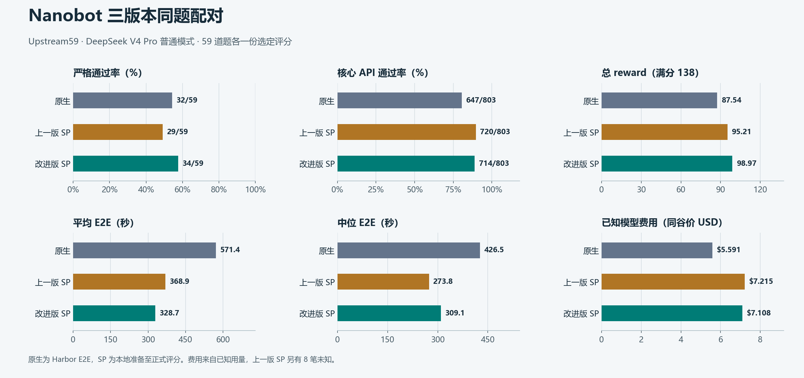
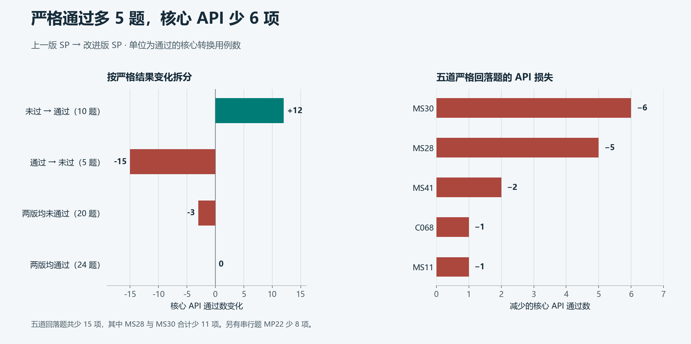

# Nanobot 与两版 Nanobot＋SP · 59 题对照

2026 年 11 月 28 日 · Upstream59 · DeepSeek V4 Pro 普通模式 · 现有试次离线复核

## 最新版 SP＋Nanobot 与原生 Nanobot

59 道同题配对。相对变化以原生 Nanobot 为基准，差值按未取整数据计算。

| 指标 | 原生 Nanobot | 最新版 SP＋Nanobot | 差值 | 相对变化 |
| --- | ---: | ---: | ---: | ---: |
| 严格通过率 | 32/59（54.24%） | 34/59（57.63%） | +2 题，+3.39 个百分点 | +6.25% |
| 核心 API 通过率 | 647/803（80.57%） | 714/803（88.92%） | +67 项，+8.34 个百分点 | +10.36% |
| 登记核心检查通过率 | 979/1,217（80.44%） | 1,084/1,217（89.07%） | +105 项，+8.63 个百分点 | +10.73% |
| 总 reward（满分 138） | 87.535218 | 98.973434 | +11.438216 | +13.1% |
| 平均 E2E | 571.4 秒 | 328.7 秒 | −242.8 秒 | −42.5% |
| 中位 E2E | 426.5 秒 | 309.1 秒 | −117.4 秒 | −27.5% |
| 总 tokens | 67.420M | 46.742M | −20.678M | −30.7% |
| 输入缓存命中率 | 98.31% | 89.65% | −8.66 个百分点 | −8.8% |
| 已结算模型请求 | 2,127 | 2,842 | +715 次 | +33.6% |
| 模型费用（统一谷价估算） | $5.591 | $7.108 | +$1.517 | +27.1% |

最新版提高了核心 API 通过率和 reward。未命中输入从 1.111M 增至 4.675M，模型费用随之上升。原生采用 Harbor E2E，SP 从试次准备计到正式评分落盘。仅看原生 v2.1 新跑的 30 道对照题，最新版的 API 和 reward 仍更高，严格通过从 17/30 降至 16/30。[原生归档][native] · [两版 SP 逐题数据][pairs]

[逐题 CSV](paired.csv) · [逐题 JSON](paired.json) · [回落题证据索引](trace-evidence.json)

## 1. 三版总表

| 指标 | 原生 Nanobot | 上一版 Nanobot＋SP | 改进版 Nanobot＋SP | 改进版相对原生 | 改进版相对上一版 |
| --- | ---: | ---: | ---: | ---: | ---: |
| 有正式评分 | 59/59 | 59/59 | 59/59 | 0 | 0 |
| 评分完整性通过 | 52/59 | 59/59 | 59/59 | +7 题 | 0 |
| 严格通过 | 32/59 · 54.24% | 29/59 · 49.15% | 34/59 · 57.63% | +2 题 · +3.39 pp | +5 题 · +8.47 pp |
| 核心 API 用例 | 647/803 · 80.57% | 720/803 · 89.66% | 714/803 · 88.92% | +67 项 · +8.34 pp | −6 项 · −0.75 pp |
| 登记核心检查 | 979/1,217 · 80.44% | 1,081/1,217 · 88.82% | 1,084/1,217 · 89.07% | +105 项 | +3 项 |
| 总 reward（满分 138） | 87.535218 | 95.207051 | 98.973434 | +11.438216 · +13.1% | +3.766383 · +4.0% |
| 平均完整 E2E | 571.4 s | 368.9 s | 328.7 s | −242.8 s · −42.5% | −40.3 s · −10.9% |
| 中位完整 E2E | 426.5 s | 273.8 s | 309.1 s | −117.4 s · −27.5% | +35.3 s · +12.9% |
| 选定试次已知模型费用，同谷价估算 | $5.591 | $7.215 | $7.108 | +$1.517 · +27.1% | −$0.106 · −1.5% |
| 结算请求／未知用量 | 2,127／0 | 3,708／8 | 2,842／0 | +715／0 | −866／−8 |
| 输入／输出 token | 65.684M／1.736M | 64.489M／1.647M | 45.160M／1.582M | −20.525M／−0.154M | −19.329M／−0.065M |
| 输入缓存命中率 | 98.31% | 93.84% | 89.65% | −8.66 pp | −4.19 pp |

59 组按题 ID 对齐，逐题核对冻结难度、API 分母和登记核心分母，并用 `workspace_reward.py` 将三版的 177 份评分按 `delivery-bonus-50-v1` 复算。登记核心含 A 转换、B 接口、D 产物、P 公开执行。单题 reward 为冻结难度权重乘以「50% × 登记核心通过率 + 50% × 严格通过标志」，完整性失败时归零。API 指标仅汇总 A 类转换用例。差值按未取整数据计算。[评分规则][policy] · [计算实现][calculator] · [原生归档][native] · [两版 SP 逐题数据][pairs]

原生完整 E2E 取 Harbor 记录，SP 从本地试次准备计到正式评分落盘。SP 两版采用同一计时边界。费用把选定试次的已结算缓存命中输入、未命中输入和输出按统一谷价换算，单位为美元，属估算。上一版仍有 8 笔未知用量。计入上一版被替换的两个原试次时，其整个批次历史估算为 $7.453，另 9 笔未知，本表使用最终选定的 59 次。改进版请求和输入 token 均减少，但未命中输入从上一版的 3.973M 增至 4.675M，费用只小降。和原生的 1.111M 未命中输入对比，也解释了为什么改进版在输入、输出 token 均较少时仍更贵。[上一版批次说明][previous] · [两版 SP 账本汇总][pairs] · [改进版配置][manifest]

改进版比原生在 **47/59** 题的记录 E2E 更短，比上一版在 **23/59** 题更短。SP 两版相较，P90 从 716.3 s 降到 551.8 s，超过 600 s 的试次从 7 个减到 4 个，因此均值下降与中位数上升可以同时发生。运行批次、环境和原生计时边界的差异限制了对 SP 并行加速的归因。[原生归档][native] · [两版 SP 逐题时间][pairs]

## 2. 改进版直接对比原生 Nanobot

| 原生 → 改进版严格结果 | 题数 | API 通过数变化 | 登记核心通过数变化 | reward 变化 |
| --- | ---: | ---: | ---: | ---: |
| 两版均通过 | 22 | 0 | 0 | 0 |
| 未通过 → 通过 | 12 | +60 | +97 | +23.705889 |
| 通过 → 未通过 | 10 | −26 | −38 | −16.529176 |
| 两版均未通过 | 15 | +33 | +46 | +4.261503 |
| 合计 | 59 | +67 | +105 | +11.438216 |

- **新增 12 题严格通过**为 C011、C017、C056、C077、MP04、MP07、MP08、MP25、MP26、MS12、MS14、MS23。
- **10 道反向回落**为 C007、C031、C033、C068、MP10、MS02、MS11、MS28、MS41、N22。下文的“五道”以上一版 SP 为基准，其中 C068、MS11、MS28、MS41 的原生结果也严格通过。MS30 则为原生未通过、上一版通过、改进版未通过。[原生归档][native] · [两版 SP 配对][pairs]

### 仅取原生 v2.1 新跑的 30 道题

| 指标 | 原生 Nanobot | 上一版 Nanobot＋SP | 改进版 Nanobot＋SP |
| --- | ---: | ---: | ---: |
| 严格通过 | 17/30 · 56.67% | 17/30 · 56.67% | 16/30 · 53.33% |
| 核心 API | 173/282 · 61.35% | 234/282 · 82.98% | 236/282 · 83.69% |
| 总 reward（满分 80） | 46.602564 | 56.986378 | 54.509210 |
| 平均／中位 E2E | 372.4／370.7 s | 305.3／247.0 s | 337.4／325.7 s |
| 已知模型费用 | $2.331 | $3.472 | $3.612 |

全量原生组由 30 次 v2.1 新跑、25 次历史 MP 提交复评分和 4 次保留的 v2.0 N 试次组成。30 题子集的原生结果仍包含 7 题完整性失败。全量里观察到严格通过净增 2，30 题里则净减 1。这个分层同时保留了 API、reward 改善与严格通过结果对题目构成的敏感性。每题每版只有一个选定试次。[原生归档与 cohort 字段][native] · [两版 SP 逐题原件索引][pairs]

## 3. 为什么严格通过增加，API 通过率却下降

| 上一版 → 改进版严格结果 | 题数 | API 通过数变化 | 登记核心通过数变化 | reward 变化 |
| --- | ---: | ---: | ---: | ---: |
| 两版均通过 | 24 | 0 | 0 | 0 |
| 未通过 → 通过 | 10 | +12 | +27 | +13.276135 |
| 通过 → 未通过 | 5 | −15 | −22 | −9.851100 |
| 两版均未通过 | 20 | −3 | −2 | +0.341348 |
| 合计 | 59 | −6 | +3 | +3.766383 |

1. **五道题在旧版 API 全过，改进版补齐交付才变成严格通过。** MP03、MP09、MP13、MP23、MP26 共 112 个 API 用例，前后都是 112/112。上一版缺最终报告或清单，导致正式产物检查及公开执行失败。改进版通过干净整题检查并发布，五道题各增加一个严格通过，API 增量为零。MP08 另恢复了三个非法顶层类型 API 和报告入口。[两版 SP 逐题评分][pairs] · [上一版逐题归因][previous]
2. **MS28、MS30 两题就少了 11 项 API。** 两题仍通过了改进版的公开门禁和局部验证，冻结变体暴露了输出结构和弱稳定匹配问题。五道严格回落题合计少 15 项 API。两版都未严格通过的题中，串行题 MP22 一题少 8 项。其 `names` 和 `subjects` 直接拼接 MARC 子字段 `$a/$b`，分别输出了 `Example :subtitle` 和 `Jesuits.Dept.`，吞掉应有的空格。只在内存中改成用空格连接，两个组件各自的 4 个失败用例全部与冻结期望一致。原试次 174–177 的模块检查和公开整题复验均通过。两版均未过组其他题有涨有跌，净减 3。[MP22 父轨迹][mp22t] · [正式原始检查][mp22g] · [名字实现][mp22n] · [主题实现][mp22s]
3. **Reward 的净增长主要来自严格通过的 50% 项。** 按冻结难度加权，这一项从 35.000000 增至 39.000000，增加 4.000000。登记核心检查的加权分从 60.207051 降至 59.973434，减少 0.233617。登记核心的总通过数虽多 3 项，每项权重仍取决于该题的冻结难度和分母。合计变化为 +3.766383。[评分政策][policy] · [两版 SP 逐题评分][pairs]

## 4. 五道严格回落题的判定依据

五题均有 SP 并行发布回执。每题两个分支的 `work.py` 都以原哈希进入最终交付，父端调用 `sp_verify_public` 得到通过结果，正式冻结变体随后暴露差异。为区分父端和子端，将归档的纯转换函数在内存中交叉组合，只调用组件计算和父端 `combine`，与既有冻结期望比对。这些定点复核没有调用模型、重跑试次、调用正式评分入口或改动任何归档。结果覆盖 **15 个失败的 A 用例**。接口、产物的扣分按正式评分原件引用。Trace 数字为归档 `parent-trace.json` 的零基序号。配套证据索引保留正式失败项、采纳状态、trace 位置和原件 SHA-256。[两版 SP 原件索引][pairs]

| 题目 | 原生／上一版／改进版 API | 改进版登记核心 | 归因及定点复核 |
| --- | --- | ---: | --- |
| **C068 · 可取消等待者的共享 TTL 缓存** | 9/9 · 9/9 · **8/9** | 12/13 | 父端 `integration.py` 缓存命中分支在已有错误时依然返回缓存里的原始 `value`。首次加载报错会返回 `null`，后续命中同一个错误时，`C068-07` 的第二个等待者得到 `value=1`，契约要求 `null`。只换旧父端整合即可恢复该例，只换旧子文件失败。父端 66 写整合、68 和 70 执行公开及延迟场景，72–73 宿主公开复验通过。[轨迹][c068t] · [实现][c068i] · [评分][c068g] |
| **MS11 · 成绩与匿名买家匹配** | 10/10 · 10/10 · **9/10** | 11/14 | 父端先在每个连通块内单独最大化置信度下限并据此限制局部最优，最后才取下限的最小值。应先得到全局下限，再用同一个下限求各块的最大总置信度。冻结例 `external-floor` 的全局下限都是 2，但总置信度返回 16，期望 19，连带改变强制配对。只换旧父端可恢复该 A 例。正式另有一项接口和一项 CLI 产物扣分。父端在 65–68 比对公开输出，69–70 还做了单块规模压力测试，73–74 公开复验通过。压力测试未覆盖多个块由不同下限约束的组合。[轨迹][ms11t] · [实现][ms11i] · [评分][ms11g] |
| **MS28 · 截止日辅导容量瓶颈** | 10/10 · 10/10 · **5/10** | 6/14 | 父端省略 `implies` 中“位于紧集内、但没有必然同现对象”的空列表行，影响 `identical-peaks`、`hidden-implication`、`shared-room`、`many-independent-calendars`。无截止日时又在进入情景循环前直接返回单个对象，`no-deadline` 要求每个撤回情景各有一个空对象。保留本轮两个子模块，只换旧父端，五个 A 例均恢复。正式还有一个登记 B 束和两个 D，原始日志里的两次 B 输入探测归并为一个冻结 B。父端 41 写整合，47–48 宿主公开检查通过，56–58 回看子模块文件。[轨迹][ms28t] · [实现][ms28i] · [原始检查][ms28g] · [登记评分][ms28s] |
| **MS30 · 金融工作坊弱稳定分班** | 0/10 · 10/10 · **4/10** | 6/14 | 父端只为当前未分配学生查阻挡对，跳过已分配但严格偏好另一个开放场次的学生。公开检查最初失败，父端 82 将比较层级从学生偏好索引改为房间对学生的优先级，86–87 公开样例恢复，但“已分配者会换班”仍未检查。冻结例 `daily-anchor` 的首个情景因此返回 30 个稳定映射，期望 7；`two-stabilities` 等也多计。六个 A 例全可通过只换旧父端恢复，替换旧子文件不能恢复。子分支虽使用浮点计算比例，本次归档中没有证据将六个扣分归到该处。正式另错一项 B 和一项 D。[轨迹][ms30t] · [实现][ms30i] · [评分][ms30g] |
| **MS41 · 自一致投票的条件成本** | 11/11 · 11/11 · **9/11** | 13/15 | **子端根因。** `answer_absorption/work.py` 用 `si` 保存起点索引，构造矩阵和成本方程时又把 `si` 用作遍历变量。返回时读取的是最后一个可达状态的概率与成本，父端按正常接口接收并聚合。例 `cost-follows-answer` 中，even 的正确条件成本为 `324/11`，交付为 `268/11`；`two-state-cycle` 的赢家分布也变化。只换旧子模块组可恢复两例，只换旧父端仍失败；变量和中间矩阵复核定位到吸收子模块。父端 37 采纳、41 写合并、43–50 运行分支及整题的公开测试，该公开图只有一个瞬态，未显露索引覆盖。[轨迹][ms41t] · [子实现][ms41i] · [评分][ms41g] |

## 5. 结论

- **父端整合是这轮回落的主要位置。** 四题的 13 个失败 API 用例可在保留本轮子文件时用旧父端恢复，剩余 MS41 的两个用例定位到子端。五题已有交付记录和公开通过，因此升级确认“文件去了哪里、是否能从干净目录发布”的同时，还需要用新例检查整合层的真实语义。MS30 已有父端发现、修复并复验的完整公开闭环，但只修到公开样例揭露的那一处。
- **严格通过的修复收益与 API 局部缺陷同时存在。** 改进版 59/59 走完发布，上一版仅 32/59 发布。干净入口和报告生成改善是已观测到的收益。用于提升下一轮验证的契约点包括错误缓存命中、多块共享下限、逐情景空输出、已分配者阻挡对、多状态图起点读取。这里的归因来自具体试次，整批 E2E、成本和严格通过率同时受运行批次、题型及抽样差异影响。[两版 SP 配对][pairs] · [改进版终态][status]

[native]: ../upstream59-v21-native-traces-dsh-codex-nanobot-20261123/README.md
[pairs]: paired.json
[manifest]: paired.json
[status]: paired.json
[previous]: paired.json
[policy]: ../../scoring/reward-policy-v1.0.json
[calculator]: ../../scoring/workspace_reward.py
[mp22g]: trace-evidence.json
[mp22t]: trace-evidence.json
[mp22n]: trace-evidence.json
[mp22s]: trace-evidence.json
[c068t]: trace-evidence.json
[c068i]: trace-evidence.json
[c068g]: trace-evidence.json
[ms11t]: trace-evidence.json
[ms11i]: trace-evidence.json
[ms11g]: trace-evidence.json
[ms28t]: trace-evidence.json
[ms28i]: trace-evidence.json
[ms28g]: trace-evidence.json
[ms28s]: trace-evidence.json
[ms30t]: trace-evidence.json
[ms30i]: trace-evidence.json
[ms30g]: trace-evidence.json
[ms41t]: trace-evidence.json
[ms41i]: trace-evidence.json
[ms41g]: trace-evidence.json
