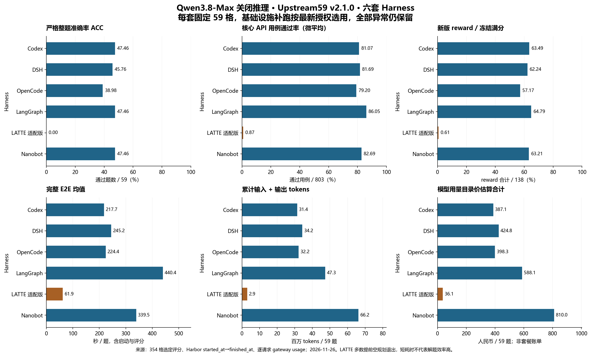
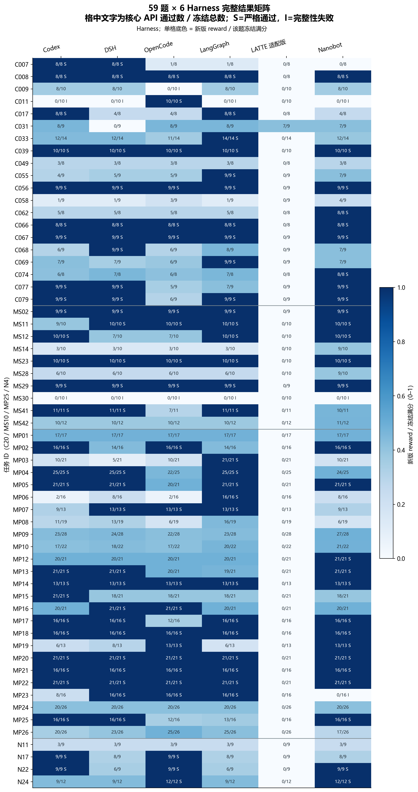

# Qwen3.8-Max 关闭推理：59 题 × 6 Harness 完整结果报告

本报告汇总 **Upstream59 v2.1.0 的 354 个逻辑题位**，包括本次已授权基础设施补跑后的最终选用结果。模型为 `qwen3.8-max`，实际请求 `enable_thinking=false`；LATTE 使用 **planning-adapted 适配版**。这里的“跑完”指每个题位都有可审计评分及用量，并不表示每题都正常交付或全部通过。

本轮登记 **`forced_delegation=false`，不额外强制创建子 Agent**；各 Harness 使用其登记的原生运行路径。表中的“原主批”指同一轮 Qwen 主批，未混入其他模型的历史成绩。

全部运行已结束，最早付费试次于北京时间 **11 月 26 日 11:58:57** 启动，最后补跑于 **17:08:21** 结束；两者之间约 **5 小时 9 分钟**，包含排队、排空、离线修复和补跑间隔。报告统计快照：2026-11-26T17:53:54.347231+08:00。本次离线汇总后经用户授权上传 GitHub，没有新模型请求或重跑。

## 先看结论

- **整题成功率**：Codex、LangGraph、Nanobot 并列 **28/59＝47.46%**，DSH **27/59＝45.76%**，OpenCode **23/59＝38.98%**；LATTE 为 **0/59**。
- **部分功能与 reward**：LangGraph 的 API 微平均 **86.05%**、reward **89.406568/138** 均为本轮最高。最高 API 通过率并不等于更多整题通过。
- **时间与消耗**：Codex 的完整 E2E 均值为 **217.7 秒**，LangGraph 为 **440.4 秒**。相对 Codex，LangGraph 的 API 通过率高 **4.98 个百分点**，E2E 约 **2.02 倍**、目录价约 **1.52 倍**；整题通过数相同。这是当前配置的描述性比较，不能单独归因为多 Agent。
- **LATTE 的短时间不能解释为高效率**：59 格中 **56 格五轮空规划、2 格 100 轮未完成**，只有 C031 正常退出并取得部分分；早退使平均 E2E 和 tokens 很低。它不是 59 道题都完成后零通过的对照。
- **费用不是账单**：选定 354 格的目录价估算为 **¥2,644.42**；包括所有旧付费 attempt 的已知用量目录价为 **¥2,746.41**。实际 Token Plan 扣费、剩余额度和一笔历史 429 的用量均未知。



## 一、质量指标：ACC、API 和新版 reward

| Harness | 严格 ACC | 核心 API 微平均 | API 任务宏平均 | reward 合计 / 138 | reward 达成率 | 完整性失败 |
| --- | --- | --- | --- | --- | --- | --- |
| Codex | 28/59 · 47.46% | 651/803 · 81.07% | 79.46% | 87.609746 / 138 | 63.49% | 2 |
| DSH | 27/59 · 45.76% | 656/803 · 81.69% | 78.98% | 85.891241 / 138 | 62.24% | 2 |
| OpenCode | 23/59 · 38.98% | 636/803 · 79.20% | 76.61% | 78.900686 / 138 | 57.17% | 2 |
| LangGraph | 28/59 · 47.46% | 691/803 · 86.05% | 82.98% | 89.406568 / 138 | 64.79% | 2 |
| LATTE 适配版 | 0/59 · 0.00% | 7/803 · 0.87% | 1.32% | 0.846154 / 138 | 0.61% | 0 |
| Nanobot | 28/59 · 47.46% | 664/803 · 82.69% | 81.41% | 87.225714 / 138 | 63.21% | 3 |

六套都固定按 **59 格**统计整题 ACC，没有删除零分、超限或完整性失败题。每套的核心 API 冻结总数均为 **803**，登记核心检查总数均为 **1217**。API 微平均按全部用例汇总，宏平均先算每题通过率再对 59 题等权平均，二者回答的问题不同。

本轮全部 354 格都有原始评分；其中 **11 格 integrity_ok=false**，reward 按规则为 0，保留在分母中。它们不因为进程正常退出就被称为有效交付。

**reward 使用工作区当前默认 `delivery-bonus-50-v1`，354 格均已调用 `scoring/workspace_reward.py` 复算，全部与原分一致：**

`reward = I × W × (0.5 × K/N + 0.5 × S)`

- `I`：提交完整性；失败为 0。
- `W`：本版冻结的 reward 难度权重，M=2、H=3。
- `K/N`：冻结登记 A/B/D/P 核心检查通过数 / 总数，含业务转换、接口独立运行、产物和公开检查；分母不会因失败减少。
- `S`：严格通过，完整性、公开检查及全部登记核心检查均通过才为 1。
- 每题 Decimal 四舍五入到六位后求和；**不能把 API 比率直接代入 K/N**，也不能使用旧线性 reward。

每套 59 题的冻结 reward 难度为 **39M＋20H**，满分 **138**；独立实测难度标签为 **20M＋39H**。两种标签用途不同，不能用实测难度反推 reward 权重。表中 reward 达成率是 `Σreward/ΣW`；逐题归一化后等权的宏平均也已导出。

### 为什么三套 ACC 恰好相同

47.46% 是 **28/59**，不是三套通过了相同的题。Codex 与 LangGraph 共同严格通过20题，双方各有8道独有通过题；Codex 与 Nanobot 共同通过22题，各有6道不同。比如 Codex 通过了 C007 而 LangGraph 没有，LangGraph 通过了 C033/C055 而 Codex 没有。Codex 与 DSH 共同通过22题，Codex另有6题、DSH另有5题通过。

本轮59题每多通过一道，ACC增加约 **1.69个百分点**；严格通过是整题0/1，接近满分与只过少量检查都计为未严格通过，部分功能差异需要看API和reward。三套API微平均分别为81.07%、86.05%、82.69%，并不相同。当前每格一次有效运行，不能把通过数量并列当作重复结果、能力相等或已证明统计等效。

## 二、完整 E2E、tokens、缓存和成本

| Harness | 完整 E2E 均值（秒） | E2E 中位数 / P95（秒） | Agent 均值（秒） | 评分均值（秒） | 输入 / 输出（M tokens） | 输入缓存命中率 | 目录价合计 / 均题（CNY） |
| --- | --- | --- | --- | --- | --- | --- | --- |
| Codex | 217.7 | 194.3 / 468.9 | 178.2 | 25.4 | 30.933 / 0.443 | 94.67% | 387.14 / 6.56 |
| DSH | 245.2 | 216.8 / 482.2 | 209.9 | 19.9 | 33.675 / 0.575 | 94.26% | 424.79 / 7.20 |
| OpenCode | 224.4 | 199.5 / 446.4 | 192.5 | 19.2 | 31.751 / 0.480 | 94.18% | 398.30 / 6.75 |
| LangGraph | 440.4 | 401.9 / 774.5 | 397.5 | 28.3 | 46.399 / 0.869 | 89.74% | 588.09 / 9.97 |
| LATTE 适配版 | 61.9 | 41.0 / 78.5 | 37.3 | 12.2 | 2.920 / 0.029 | 60.97% | 36.10 / 0.61 |
| Nanobot | 339.5 | 337.3 / 629.4 | 294.6 | 29.3 | 65.582 / 0.639 | 96.02% | 810.00 / 13.73 |

完整 E2E 统一取 **Harbor `finished_at − started_at`**，包含环境启动、Agent 安装/执行、阶段切换和正式 verifier 评分；不包含试次启动前的队列等待和事后审计。Agent 与评分各阶段取自己的实际起止时间。表中的 P95 采用排序后线性插值。所有 354 格都有完整时间，不以 Agent 时间替代 E2E，不将父子执行时长相加冒充墙钟。

选定结果合计：输入 **211,261,274**、输出 **3,035,556**，总计 **214,296,830 tokens**；输入缓存命中 **197,320,960 tokens**，token 加权命中率 **93.40%**。缓存是输入的一部分，不能再加一次。数据使用供应商返回的 gateway usage，避免 DSH 原生日志“未缓存输入”和其他 Harness“全部输入”口径不同导致错算。

**目录价口径固定为本批登记的输入 ¥12/百万、输出 ¥36/百万：**

`目录价比较额 = 总输入 tokens × 12/1e6 + 输出 tokens × 36/1e6`

该比较额**没有应用缓存折扣**，也没有取得 Token Plan 账单、额度兑换或实际扣费数据。因此，它只是本批冻结的目录价比较值，不是现金支出，不是按 DeepSeek 谷价估算；也不应拿它推算套餐还剩多少钱。可识别缓存命中，但不能据此编造实际缓存计费。

全矩阵平均 E2E 为 **254.9 秒/格**，试次 E2E 之和约 **25.06 trial-hours**；后者是串行等价工作量，**不是实际批次历时**。六 Harness 合计严格通过 **134/354**，API **3305/4818**，reward **429.880109/828**；这些跨 Harness 总数仅供完整性汇总，不替代各 Harness 比较。

## 三、四类任务分组

任务构成为 C20、MS10、MP25、N4；先跑修订 C/MS30，再跑 MP/N29。每格依次为“严格通过数 / 题数 · API 微平均 · reward 合计 / 该组满分”。

| Harness | C20 · ACC / API / reward | MS10 · ACC / API / reward | MP25 · ACC / API / reward | N4 · ACC / API / reward |
| --- | --- | --- | --- | --- |
| Codex | 9/20 · 76.24% · 31.0372/50 | 5/10 · 76.24% · 18.4821/30 | 12/25 · 84.23% · 32.7398/50 | 2/4 · 76.92% · 5.3506/8 |
| DSH | 9/20 · 72.38% · 29.8706/50 | 5/10 · 74.26% · 18.4821/30 | 13/25 · 87.97% · 34.8567/50 | 0/4 · 66.67% · 2.6819/8 |
| OpenCode | 6/20 · 67.96% · 24.7703/50 | 4/10 · 70.30% · 16.3821/30 | 10/25 · 84.85% · 31.2777/50 | 3/4 · 84.62% · 6.4706/8 |
| LangGraph | 10/20 · 77.90% · 31.4528/50 | 6/10 · 77.23% · 20.3036/30 | 12/25 · 92.53% · 34.9683/50 | 0/4 · 66.67% · 2.6819/8 |
| LATTE 适配版 | 0/20 · 3.87% · 0.8462/50 | 0/10 · 0.00% · 0.0000/30 | 0/25 · 0.00% · 0.0000/50 | 0/4 · 0.00% · 0.0000/8 |
| Nanobot | 9/20 · 75.69% · 29.1056/50 | 5/10 · 86.14% · 20.1634/30 | 12/25 · 84.65% · 32.8391/50 | 2/4 · 82.05% · 5.1176/8 |

分组 API 分母依次为 C20=181、MS10=101、MP25=482、N4=39；满分依次为 50、30、50、8。分母来自该组冻结用例数量，不能把不同任务组的百分比直接相加。

## 四、最终选用与全部历史消耗分开

最终每个任务×Harness 只选一个结果：**原主批 317 格＋OpenCode Git 修复 7 格＋LATTE 接口修复 27 格＋LATTE 服务恢复 3 格＝354 格**。选择按明确授权的最新基础设施恢复版本，**不取最高分**；原低分、旧异常和原账本均未覆盖。

例如 LATTE MS02 的旧 R2 产物曾获 **3/3**，但实际请求出现 429、用量未知；新 R3 是已授权恢复，五轮空规划获 **0/3**。主表使用 R3 的 0 分，旧高分只留在历史审计，不能择优放回主表。

| Harness | 实际发过请求的 attempt | 其中旧付费 attempt | 发送 / 结算 / 未知请求 | 全部已知用量目录价（CNY） |
| --- | --- | --- | --- | --- |
| Codex | 59 | 0 | 1660/1660/0 | 387.14 |
| DSH | 59 | 0 | 1785/1785/0 | 424.79 |
| OpenCode | 66 | 7 | 1926/1926/0 | 452.10 |
| LangGraph | 59 | 0 | 5777/5777/0 | 588.09 |
| LATTE 适配版 | 85 | 26 | 1667/1666/1 | 84.29 |
| Nanobot | 59 | 0 | 2815/2815/0 | 810.00 |

共 **394 条 attempt 身份**：**387 条实际发过模型请求**、7 条发送前隔离占位。最终选定 354 条，另有 **33 条旧付费 attempt** 保留。它们的已知额外目录价约 **¥101.99**；不能把这部分运行消耗从实际实验投入里抹去。

| 批次 | 登记题位 | 付费 attempt | 实际发送 / 结算 / 未知 | 已知用量目录价（CNY） |
| --- | --- | --- | --- | --- |
| original | 354 | 347 | 14395/14395/0 | 2641.561824 |
| opencode_git_repair | 7 | 7 | 182/182/0 | 52.682532 |
| latte_workspace_repair | 30 | 30 | 1038/1037/1 | 51.229488 |
| latte_ms02_rate_limit_retry | 1 | 1 | 5/5/0 | 0.308208 |
| latte_remaining_two_rate_limit_retry | 2 | 2 | 10/10/0 | 0.626664 |

最终选定请求 **14486/14486 结算、未知 0**；全部历史请求 **15630 发出 / 15629 结算 / 未知 1**。未知的是 LATTE R2 **MS02** 的真实 HTTP429 请求 `b1169973b6a9499a8f1fb4a347e5d5fe`。它实际发出但无 usage，**不是发送前拦截**，未知用量和未知费用不填 0，也不会因为新重跑结算而消失。所有历史已结算 **15629 请求**均核验模型和 `enable_thinking=false`。

## 五、异常与比较限制

| 终态 | 数量 | 任务 |
| --- | --- | --- |
| 累计 token 闸门 ≥2M | 15 | Codex C058；DSH C058；Nanobot C007、MP02、MP03、MP04、MP07、MP15、MP16、MP18、MP19、MP20、MP22、MP23、N22 |
| 原生上下文超限 | 1 | Nanobot C058（本地估计 190988 / 190784） |
| LATTE 五轮空规划 | 56 | 未产生有效 discover_task，原生退出及评分保留 |
| LATTE 100 轮仍未完成 | 2 | C068、C077 |
| LATTE 正常退出且有部分分 | 1 | C031：API 7/9、登记检查 11/13、reward 0.846154 / 2 |

以上终态在主表完整保留；达到累计 2M token 闸门的 15 格是登记资源限制，不能叫作供应商失败或已触发循环检测。循环保护本次没有可据以声明触发的事件。Nanobot C058 是独立的原生上下文限制。LATTE 56 个空规划及两个轮数上限同样不是已证明的供应商故障，不为提升分数继续补跑。

### LATTE 为什么几乎没有进入有效交付

原生trace显示，主要瓶颈在“探索代码→登记任务→进入协作执行”的入口。当前配置最多允许5次规划模型回复；56题到上限时没有被接受的 `discover_task` 任务记录，运行时遂退出。这些题没有获得与其他Harness类似的长时间实现/验证机会。

例如修复后的 **C007**：第1轮跑公开检查，第2至4轮读公开检查、组件框架、实现和样例；第5轮仍在说“再读预期输出，然后生成任务”，接着读取4个文件，随后 `planning_phase_end` 记录 `tasks_discovered=0`、`turns=5`、`reason=max_turns`。补跑 **MS02** 也把5轮全部用于跑检查和阅读13个文件，任务数仍为0。旧 **MP01** 则出现试图运行 `script.py/explore.py` 的探索动作，同样耗尽规划轮数。

对照 **C031**：前4轮探索，第5轮生成3个有效 `discover_task`，运行时实际接受并进入执行，最终API7/9。这证明本地协议并非对Qwen完全不可用，也不能把所有空规划归因于XML解析坏了。另一方面，C068/C077进入执行后100轮仍未完成，说明规划入口不是唯一质量问题。

因此，目前支持的机制解释是 **Qwen关闭推理下持续探索的行为与LATTE五轮规划上限相冲突**。它不能证明“多给几轮必然通过”，也不是随机供应商报错的证据。应将本轮解释为登记配置下的结果；若要判断LATTE充分执行后的能力，需要另做固定题面/模型的规划轮数或提示兼容性对照。统一累计token上限不意味着各Harness的原生阶段轮数上限相同。本次只离线核对，不新增付费试次或修改旧配置。

完整性失败单列如下；这是原评分器的检查结论，本文不在没有额外证据时归因为模型、适配器或评分器错误。

| Harness | 完整性失败的任务 |
| --- | --- |
| Codex | C011、MS30 |
| DSH | C011、MS30 |
| OpenCode | C009、MS30 |
| LangGraph | C011、MS30 |
| Nanobot | C011、MP23、MS30 |

原基础设施修复有两类，旧证据均保留：

1. **OpenCode 七格 EPIPE**：离线证实工作区没有 Git 元数据而运行时强制使用 Git，`git check-ignore` 先退出，造成管道关闭；以 `qwen-opencode-git-bootstrap/1.0.0` 初始化工作区 Git 元数据后七格独立补跑均完成，无 EPIPE。没有改题目、评分器、模型、CLI 权限或委派提示。
2. **LATTE 修订 30 题入口错配**：原适配器硬编码旧 `README.md/check.py`，新版提供 `TASK.md/public_check.py`；`qwen-latte-workspace-interface/1.0.0` 按实际布局绑定，旧 29 题保持等价。修复批随后 MS02 遇真实上游 429，并连带取消 C055/MS30；三格各自新 attempt 恢复后均完整结算。429 单凭现有记录不能进一步断定是现金余额不足还是具体限流配额。

**资源条件不是全部一致**：原主批及 LATTE R2 最多 6 Harbor 并发，共享 HTTP4；MS02 R3 单试次，C055/MS30 R4 双试次；OpenCode 的修复七格也另批调度。E2E 是各自实际测得值，环境存在共享资源竞争，不能把差异全归为 Harness 算法或修复收益。

本批没有总费用上限，但有统一的 **每试次累计观测输入＋输出 2M tokens** 门禁、通常每请求输出 32768（OpenCode 原生 8192）、六个相同轮保护；LATTE 保留规划 5 轮、执行 100 轮、3 队友配置。数据支持这些登记条件下的一次矩阵观察，不是无限预算能力排名，也不是单/多 Agent 因果消融。

## 六、原生子 Agent 身份观测补充

| Harness | 有原生子身份的题位 | 观测子 ID 合计 | 限定 |
| --- | --- | --- | --- |
| Codex | 0/59 | 0 | 会话身份审计；不能据此认定并行收益 |
| DSH | 1/59 | 2 | 会话身份审计；不能据此认定并行收益 |
| OpenCode | 2/59 | 2 | 会话身份审计；不能据此认定并行收益 |
| LangGraph | 59/59 | 227 | 会话身份审计；不能据此认定并行收益 |
| LATTE 适配版 | 统一子身份计数字段未知 | 未知 | 另有 LATTE 角色/任务事件，不能把缺失字段填成零 |
| Nanobot | 0/59 | 0 | 会话身份审计；不能据此认定并行收益 |

DSH 在 **MS29** 观测到 2 个子 ID；OpenCode 在 **C033、MP15** 各 1 个；LangGraph 沿用其工作流原生子身份定义。创建身份与有独立模型工作、结果回传、父接收和真实并行是不同证据层，本文没有把身份数量直接换算为并行收益。LATTE 的统一计数字段在最终选定证书中缺失，保留为未知，不按 0 解释。

## 七、完整逐题矩阵



下表每格为 **“API 通过数/总数 · 新版 reward”**，`S` 为严格通过，`I` 为完整性失败。逐格的 E2E、输入/输出/缓存、目录价、源批次、原结果路径和终态见 CSV 或交互视图，均覆盖 354 格。

| 任务 | Codex | DSH | OpenCode | LangGraph | LATTE 适配版 | Nanobot |
| --- | --- | --- | --- | --- | --- | --- |
| C007 | 8/8 · 3.000 S | 8/8 · 3.000 S | 1/8 · 0.375 | 1/8 · 0.375 | 0/8 · 0.000 | 0/8 · 0.000 |
| C008 | 8/8 · 2.000 S | 8/8 · 2.000 S | 8/8 · 2.000 S | 8/8 · 2.000 S | 0/8 · 0.000 | 8/8 · 2.000 S |
| C009 | 8/10 · 1.071 | 8/10 · 1.071 | 0/10 · 0.000 I | 8/10 · 1.071 | 0/10 · 0.000 | 8/10 · 1.071 |
| C011 | 0/10 · 0.000 I | 0/10 · 0.000 I | 10/10 · 3.000 S | 0/10 · 0.000 I | 0/10 · 0.000 | 0/10 · 0.000 I |
| C017 | 8/8 · 3.000 S | 4/8 · 0.750 | 4/8 · 0.750 | 8/8 · 3.000 S | 0/8 · 0.000 | 4/8 · 0.750 |
| C031 | 8/9 · 0.923 | 0/9 · 0.000 | 8/9 · 0.923 | 8/9 · 0.923 | 7/9 · 0.846 | 7/9 · 0.846 |
| C033 | 12/14 · 0.889 | 12/14 · 0.889 | 11/14 · 0.722 | 14/14 · 2.000 S | 0/14 · 0.000 | 12/14 · 0.778 |
| C039 | 10/10 · 3.000 S | 10/10 · 3.000 S | 10/10 · 3.000 S | 10/10 · 3.000 S | 0/10 · 0.000 | 10/10 · 3.000 S |
| C049 | 3/8 · 0.583 | 3/8 · 0.583 | 3/8 · 0.583 | 3/8 · 0.583 | 0/8 · 0.000 | 3/8 · 0.583 |
| C055 | 4/9 · 0.615 | 5/9 · 0.692 | 5/9 · 0.692 | 9/9 · 2.000 S | 0/9 · 0.000 | 7/9 · 0.846 |
| C056 | 9/9 · 2.000 S | 9/9 · 2.000 S | 9/9 · 2.000 S | 9/9 · 2.000 S | 0/9 · 0.000 | 9/9 · 2.000 S |
| C058 | 1/9 · 0.346 | 1/9 · 0.346 | 3/9 · 0.577 | 1/9 · 0.346 | 0/9 · 0.000 | 4/9 · 0.692 |
| C062 | 5/8 · 0.583 | 5/8 · 0.583 | 5/8 · 0.583 | 5/8 · 0.583 | 0/8 · 0.000 | 8/8 · 2.000 S |
| C066 | 8/8 · 2.000 S | 8/8 · 2.000 S | 8/8 · 2.000 S | 8/8 · 2.000 S | 0/8 · 0.000 | 8/8 · 2.000 S |
| C067 | 9/9 · 3.000 S | 9/9 · 3.000 S | 9/9 · 3.000 S | 9/9 · 3.000 S | 0/9 · 0.000 | 9/9 · 3.000 S |
| C068 | 6/9 · 0.923 | 9/9 · 3.000 S | 6/9 · 0.923 | 8/9 · 1.385 | 0/9 · 0.000 | 7/9 · 1.269 |
| C069 | 7/9 · 1.269 | 7/9 · 1.038 | 6/9 · 1.154 | 9/9 · 3.000 S | 0/9 · 0.000 | 7/9 · 1.269 |
| C074 | 6/8 · 0.833 | 7/8 · 0.917 | 6/8 · 0.833 | 7/8 · 0.917 | 0/8 · 0.000 | 8/8 · 2.000 S |
| C077 | 9/9 · 3.000 S | 9/9 · 3.000 S | 5/9 · 1.038 | 7/9 · 1.269 | 0/9 · 0.000 | 9/9 · 3.000 S |
| C079 | 9/9 · 2.000 S | 9/9 · 2.000 S | 6/9 · 0.615 | 9/9 · 2.000 S | 0/9 · 0.000 | 9/9 · 2.000 S |
| MS02 | 9/9 · 3.000 S | 9/9 · 3.000 S | 9/9 · 3.000 S | 9/9 · 3.000 S | 0/9 · 0.000 | 9/9 · 3.000 S |
| MS11 | 9/10 · 1.179 | 10/10 · 3.000 S | 10/10 · 3.000 S | 10/10 · 3.000 S | 0/10 · 0.000 | 10/10 · 3.000 S |
| MS12 | 10/10 · 3.000 S | 7/10 · 1.179 | 7/10 · 1.179 | 10/10 · 3.000 S | 0/10 · 0.000 | 10/10 · 3.000 S |
| MS14 | 3/10 · 0.429 | 3/10 · 0.429 | 3/10 · 0.429 | 3/10 · 0.429 | 0/10 · 0.000 | 9/10 · 1.179 |
| MS23 | 10/10 · 3.000 S | 10/10 · 3.000 S | 10/10 · 3.000 S | 10/10 · 3.000 S | 0/10 · 0.000 | 10/10 · 3.000 S |
| MS28 | 6/10 · 0.750 | 6/10 · 0.750 | 6/10 · 0.750 | 6/10 · 0.750 | 0/10 · 0.000 | 9/10 · 1.179 |
| MS29 | 9/9 · 3.000 S | 9/9 · 3.000 S | 9/9 · 3.000 S | 9/9 · 3.000 S | 0/9 · 0.000 | 9/9 · 3.000 S |
| MS30 | 0/10 · 0.000 I | 0/10 · 0.000 I | 0/10 · 0.000 I | 0/10 · 0.000 I | 0/10 · 0.000 | 0/10 · 0.000 I |
| MS41 | 11/11 · 3.000 S | 11/11 · 3.000 S | 7/11 · 0.900 | 11/11 · 3.000 S | 0/11 · 0.000 | 10/11 · 1.400 |
| MS42 | 10/12 · 1.125 | 10/12 · 1.125 | 10/12 · 1.125 | 10/12 · 1.125 | 0/12 · 0.000 | 11/12 · 1.406 |
| MP01 | 17/17 · 0.964 | 17/17 · 0.964 | 17/17 · 0.964 | 17/17 · 0.964 | 0/17 · 0.000 | 17/17 · 0.964 |
| MP02 | 16/16 · 2.000 S | 14/16 · 0.880 | 16/16 · 2.000 S | 14/16 · 0.880 | 0/16 · 0.000 | 16/16 · 2.000 S |
| MP03 | 10/21 · 0.375 | 5/21 · 0.188 | 10/21 · 0.375 | 21/21 · 2.000 S | 0/21 · 0.000 | 10/21 · 0.375 |
| MP04 | 25/25 · 2.000 S | 25/25 · 2.000 S | 22/25 · 0.917 | 25/25 · 2.000 S | 0/25 · 0.000 | 24/25 · 0.972 |
| MP05 | 21/21 · 2.000 S | 21/21 · 2.000 S | 20/21 · 0.969 | 21/21 · 2.000 S | 0/21 · 0.000 | 21/21 · 2.000 S |
| MP06 | 2/16 · 0.120 | 8/16 · 0.440 | 2/16 · 0.120 | 16/16 · 2.000 S | 0/16 · 0.000 | 8/16 · 0.440 |
| MP07 | 9/13 · 0.636 | 13/13 · 2.000 S | 13/13 · 2.000 S | 13/13 · 2.000 S | 0/13 · 0.000 | 9/13 · 0.636 |
| MP08 | 11/19 · 0.571 | 13/19 · 0.643 | 6/19 · 0.357 | 16/19 · 0.893 | 0/19 · 0.000 | 6/19 · 0.357 |
| MP09 | 23/28 · 0.872 | 24/28 · 0.897 | 22/28 · 0.846 | 23/28 · 0.872 | 0/28 · 0.000 | 27/28 · 0.974 |
| MP10 | 17/22 · 0.839 | 18/22 · 0.871 | 17/22 · 0.839 | 20/22 · 0.935 | 0/22 · 0.000 | 21/22 · 0.968 |
| MP12 | 20/21 · 0.969 | 20/21 · 0.969 | 20/21 · 0.969 | 20/21 · 0.969 | 0/21 · 0.000 | 21/21 · 2.000 S |
| MP13 | 21/21 · 2.000 S | 21/21 · 2.000 S | 20/21 · 0.969 | 19/21 · 0.938 | 0/21 · 0.000 | 21/21 · 2.000 S |
| MP14 | 13/13 · 2.000 S | 13/13 · 2.000 S | 13/13 · 2.000 S | 13/13 · 2.000 S | 0/13 · 0.000 | 13/13 · 2.000 S |
| MP15 | 21/21 · 2.000 S | 18/21 · 0.781 | 18/21 · 0.781 | 18/21 · 0.781 | 0/21 · 0.000 | 18/21 · 0.781 |
| MP16 | 20/21 · 0.969 | 21/21 · 2.000 S | 21/21 · 2.000 S | 20/21 · 0.969 | 0/21 · 0.000 | 20/21 · 0.969 |
| MP17 | 16/16 · 2.000 S | 16/16 · 2.000 S | 12/16 · 0.680 | 16/16 · 2.000 S | 0/16 · 0.000 | 16/16 · 2.000 S |
| MP18 | 16/16 · 2.000 S | 16/16 · 2.000 S | 16/16 · 2.000 S | 16/16 · 2.000 S | 0/16 · 0.000 | 16/16 · 2.000 S |
| MP19 | 6/13 · 0.455 | 8/13 · 0.591 | 13/13 · 2.000 S | 6/13 · 0.364 | 0/13 · 0.000 | 13/13 · 2.000 S |
| MP20 | 21/21 · 2.000 S | 21/21 · 2.000 S | 21/21 · 2.000 S | 21/21 · 2.000 S | 0/21 · 0.000 | 21/21 · 2.000 S |
| MP21 | 16/16 · 2.000 S | 16/16 · 2.000 S | 16/16 · 2.000 S | 16/16 · 2.000 S | 0/16 · 0.000 | 16/16 · 2.000 S |
| MP22 | 21/21 · 2.000 S | 21/21 · 2.000 S | 21/21 · 2.000 S | 21/21 · 2.000 S | 0/21 · 0.000 | 21/21 · 2.000 S |
| MP23 | 8/16 · 0.440 | 16/16 · 2.000 S | 16/16 · 2.000 S | 16/16 · 2.000 S | 0/16 · 0.000 | 0/16 · 0.000 I |
| MP24 | 20/26 · 0.838 | 20/26 · 0.838 | 20/26 · 0.838 | 20/26 · 0.838 | 0/26 · 0.000 | 20/26 · 0.838 |
| MP25 | 16/16 · 2.000 S | 16/16 · 2.000 S | 12/16 · 0.680 | 13/16 · 0.720 | 0/16 · 0.000 | 16/16 · 2.000 S |
| MP26 | 20/26 · 0.692 | 23/26 · 0.795 | 25/26 · 0.974 | 25/26 · 0.846 | 0/26 · 0.000 | 17/26 · 0.564 |
| N11 | 3/9 · 0.471 | 3/9 · 0.471 | 3/9 · 0.471 | 3/9 · 0.471 | 0/9 · 0.000 | 3/9 · 0.471 |
| N17 | 9/9 · 2.000 S | 8/9 · 0.647 | 9/9 · 2.000 S | 8/9 · 0.647 | 0/9 · 0.000 | 8/9 · 0.647 |
| N22 | 9/9 · 2.000 S | 6/9 · 0.684 | 9/9 · 2.000 S | 6/9 · 0.684 | 0/9 · 0.000 | 9/9 · 2.000 S |
| N24 | 9/12 · 0.880 | 9/12 · 0.880 | 12/12 · 2.000 S | 9/12 · 0.880 | 0/12 · 0.000 | 12/12 · 2.000 S |

## 八、交付物、来源与复算

- [可筛选交互报告](dashboard.html)：筛选 Harness、任务组、任务 ID，查看逐格 E2E、tokens、目录价与异常。
- [逐格 CSV](selected-cells.csv) / [逐格 JSON](selected-cells.json)：最终选定 354 格。
- [Harness 汇总 CSV](harness-summary.csv) / [分数据集 CSV](dataset-summary.csv) / [分阶段 CSV](stage-summary.csv)。
- [全部历史 attempt CSV](all-attempts.csv) / [历史消耗汇总 CSV](all-history-by-harness.csv) / [批次账本 CSV](batch-ledgers.csv)。
- [异常清单 CSV](selected-anomalies.csv) / [核验回执 audit.json](audit.json)。
- [总览 PNG](overview.png) / [总览 SVG](overview.svg) / [逐题矩阵 PNG](task-matrix.png) / [逐题矩阵 SVG](task-matrix.svg)。
- [离线聚合脚本](aggregate_results.py) / [图表和报告生成脚本](build_report.py)。脚本不含凭据，不发送模型请求。
- [软件版本记录](software-versions.json) / [报告与筛选验收回执](artifact-verification.json)。

复算命令（从项目根目录执行）：

```powershell
wsl.exe --exec local-artifacts://wsl-home/.local/share/uv/tools/harbor/bin/python -B local-artifacts://project/outputs/qwen59-final-report-20261126-v1/aggregate_results.py
python outputs/qwen59-final-report-20261126-v1/build_report.py
```

权威选定证书：`outputs/qwen-latte-workspace-audit-20261126/corrected-matrix-selection.json`，SHA256 **`2c1ceb1955b4ac8ad278869f3354e3589168d97a81f1a0f2501d5ae4b610c354`**。

数据集 v2.1.0 归档 SHA256 **`a57c75131a14b9860507f91c8d17da9e7a4b79c548ea9f8dfac90806d972f9fc`**；主登记 SHA256 **`a96735f4f49a5417938b7f7cd71ee74cf1b8264dd7a22f8a32fbb0c15e2ba42b`**；reward policy SHA256 **`7cf383ca7b92cdc0cbfc555e8193391fa0da198b21cdda5a915fea34f02483b8`**。59 题题面与 release-registry 哈希均匹配原冻结登记，354 份离线评分回执与其绑定的 Harbor 原结果哈希已核对；逐题 reward 与冻结分母复算一致，354 格均验证有实际资源采样。

原评分 JSON 内仍有 `benchmark_version=2.0.0` 的历史内部标签；本批题库版本依据 **v2.1.0 归档、题面和登记哈希**确定。报告保留原标签，没有改写评分器或原始文件来掩盖它。

完整原件位于 WSL `local-artifacts://wsl-runs/` 下的五个批次（路径与哈希见 `audit.json`）；本目录是可共享指标与报告包，不是完整原生 trace 复制。所有旧分数、旧用量未知和异常终态保留。本批试次已全部结束，也没有因本次汇总新增重跑；不对其他会话的实验运行状态作结论。


## GitHub 发布说明

完整六套原生 trace 与所有旧 attempt 见 [发布入口](../README.md)。发布副本中的凭据和本机绝对路径已脱敏，原件及原 SHA-256 保留在本地；离线复算需要把 `local-artifacts://` 路径映射到实际归档位置。报告包不提供可直接重启付费实验的凭据。
