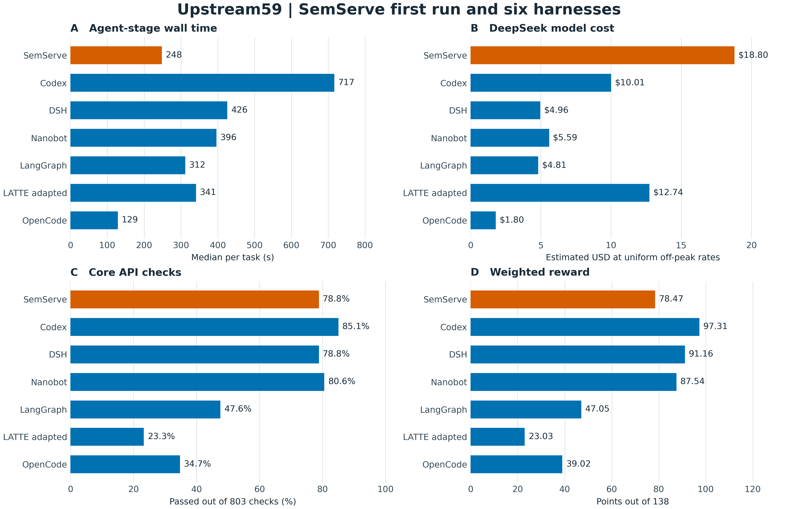
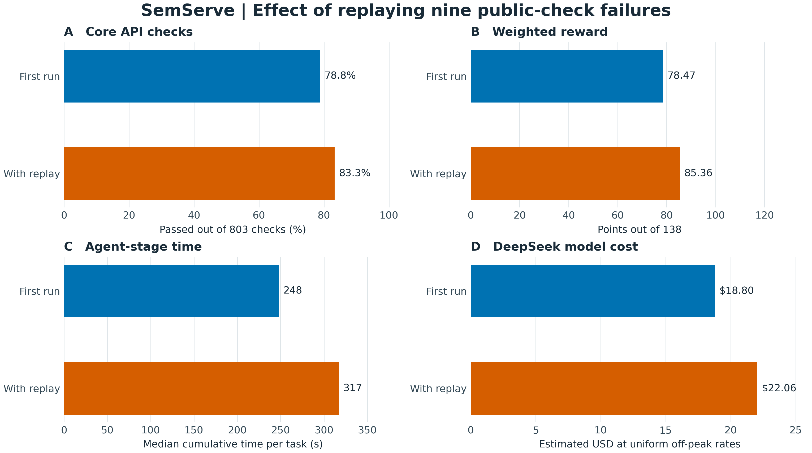

# Upstream59 v2.1.0 对照报告 · SemServe 与六套 Harness

2026 年 11 月 23 日 · DeepSeek V4 Pro 普通模式 · 59 道同题配对

[后续分析与汇报材料](../upstream59-sp-failure-analysis-20261124/README.md)逐题列出 SP 的失分项与修法，并对照 Codex、DSH 的工具调用、主动补测和原例复验，附实施方案、PPT 与复核数据。

## 摘要

SemServe 首轮在 59 题中有 **55 题出现实际工作的运行时分支，也有 55 题观测到不同分支的模型请求在时间上重叠**。执行阶段中位数为 **247.95 秒**，低于六个基线中的五个。按统一谷价计算，SemServe 已知的 DeepSeek 费用为 **$18.80**，高于六个基线。首轮核心 API 检查通过 **633/803（78.83%）**，与 DSH 持平。SemServe 严格通过 **25/59**，reward **78.469237/138**，低于 Codex、DSH 和 Nanobot。

按公开检查失败触发一次重放后，**9 题重放、6 题采用新成绩**。严格通过增至 **28/59**，核心 API 检查增至 **669/803（83.31%）**，reward 增至 **85.361619/138**。追加可计量 DeepSeek 费用 **$3.2631**，追加各题执行阶段合计 **2,703.37 秒**。重放结果单列，六个基线使用原发布矩阵选定的试次。

SemServe 归档仅支持执行阶段计时。**覆盖环境启动与独立验证器的完整 E2E 缺失**，因此跨系统的速度结论限于执行阶段。费用均为统一费率下的可计量估算。SemServe 另使用辅助模型，完整账单未知。

[59 题逐题数据（JSON）](task-metrics.json) · [首轮对照图（SVG）](figure-1-first-run.svg) · [重放质量与代价图（SVG）](figure-2-replay.svg)

## 1. 样本与指标

以任务 ID 匹配 59 题，每题一条 SemServe 首轮记录和六条发布矩阵记录，合计 **413 条评分回执**。另核验 9 条 SemServe 重放回执。SemServe 主账的 20 道 C 题和 10 道 MS 题采用 v2.1.0 模块化工作区。25 道 MP 与 4 道 N 的题包在 v2.1.0 中沿用 v2.0.0。基线各自的 30 道 C/MS 是 v2.1.0 的新运行，4 道 N 沿用原运行，25 道 MP 采用历史交付物离线复评，耗时与用量回连原付费试次。逐题 JSON 保留试次标识、批次来源和终态。原评分回执中的 `benchmark_version` 是归档字段，实际题包以发布树、冻结任务清单和 `aligned_task_package` 为准。[数据集冻结提交](https://github.com/xi474/benchmark/tree/669bc935d89b58350962efaf523be5884e7e8677) · [六套 Harness 发布矩阵](https://github.com/xi474/benchmark/tree/a82cdb3b0f14c0e1207f44c23ac4e2753cc30f28/results/upstream59-v21-deepseek-v4pro-20261121) · [SemServe 原始归档](https://github.com/xi474/benchmark/tree/39ffdc9f498e9150b30a07401d30276d8d6c25df/semserve)

主执行模型均为 DeepSeek V4 Pro，实际请求记录显示普通模式。SemServe 使用 `h3a-value-v2-branch-profiles-run-tests-v1`，并使用 Qwen3-32B 预测器和 Qwen3.5-Flash 摘要。基线使用各自的既定适配器、模型网关与运行环境。以下是同题的系统级观察对照。同一题的预算、资源竞争、提示、上下文、缓存命名空间和终态机制可能不同，耗时和质量差异只能归于整套运行条件。[SemServe 冻结方案](https://github.com/xi474/benchmark/blob/39ffdc9f498e9150b30a07401d30276d8d6c25df/semserve/20261121-v21-cms30-v1/experiment_plan.json)

| 指标 | 计算口径 |
| --- | --- |
| API acc | 核心转换用例 A 的通过数 ÷ 冻结总数。总表按用例做微平均，各组均为 803 项。 |
| 严格通过率 | 以题为单位，使用正式 verifier 的 `strict_pass`。公开通过单列。 |
| Reward | 使用 `delivery-bonus-50-v1` 逐题复算。完整性通过时按冻结题目权重乘以 $0.5K/N + 0.5S$，其中 `K/N` 是登记核心检查通过数与总数，覆盖 A、B、D 及计一次的 P，`S` 是严格通过指示量。完整性失败为零，缺整份回执为未知。每题六位小数后相加，满分 138。 |
| 执行阶段 | SemServe 取 `result.json` 的 `completion_inclusive_seconds`，覆盖执行及完成时的运行时收尾。基线取 Harbor `agent_execution` 起止，包括该阶段内的模型、工具及等待。两类边界可近似对齐，埋点来源不同。 |
| 完整 E2E | 六个基线使用 Harbor 试次根回执的 `started_at` 到 `finished_at`，覆盖环境与 Agent 准备、执行、验证和试次收尾。SemServe 有运行时自检，也有独立的正式评分，现有归档缺同边界外层计时。 |
| Token、缓存和成本 | 用实际 API 请求用量，每条请求按身份去重。缓存命中率为可计量命中输入 ÷ 可计量总输入。按统一历史谷价估算 DeepSeek 费用，缺用量的请求保留计数。 |

[评分政策](../../scoring/reward-policy-v1.0.json) · [逐题评分实现](../../scoring/workspace_reward.py)

## 2. 首轮对照

SemServe 列使用首轮。六个基线沿用发布矩阵每格选定的原始试次或离线复评所绑定的原试次。保留有有效评分的异常终态。时间为 59 题的中位数。

| 系统 | 执行阶段（秒） | 完整 Harbor E2E（秒） | DeepSeek 谷价估算 | 核心 API acc | 严格通过 | 公开通过 | Reward / 138 |
| --- | ---: | ---: | ---: | ---: | ---: | ---: | ---: |
| **SemServe 首轮** | **247.95** | 未知 | **$18.7951** | **633/803（78.83%）** | **25/59** | **50/59** | **78.469237** |
| Codex | 716.68 | 749.57 | $10.0147 | 683/803（85.06%） | 38/59 | 53/59 | 97.306571 |
| DSH | 426.04 | 458.67 | $4.9637 | 633/803（78.83%） | 36/59 | 49/59 | 91.162733 |
| Nanobot | 396.20 | 426.47 | $5.5911 | 647/803（80.57%） | 32/59 | 44/59 | 87.535218 |
| LangGraph | 311.72 | 339.73 | $4.8120 | 382/803（47.57%） | 18/59 | 27/59 | 47.048183 |
| LATTE 规划适配版 | 341.02 | 367.73 | $12.7429 | 187/803（23.29%） | 4/59 | 16/59 | 23.025515 |
| OpenCode | 128.57 | 158.30 | $1.7985 | 279/803（34.74%） | 14/59 | 24/59 | 39.017869 |

**逐题耗时。** 以下是 SemServe 执行阶段更短的题数。所有试次包含已留存的评分与异常。双方严格通过子集检验在相同成功标准下耗时方向是否仍然一致，样本随基线变化。

| 对比基线 | 全部 59 题 | 新版 C/MS 30 题 | 双方严格通过 |
| --- | ---: | ---: | ---: |
| Codex | 51/59 | 24/30 | 17/19 |
| DSH | 46/59 | 22/30 | 11/15 |
| Nanobot | 45/59 | 22/30 | 10/17 |
| LangGraph | 39/59 | 21/30 | 7/13 |
| LATTE 规划适配版 | 33/59 | 18/30 | 1/1 |
| OpenCode | 6/59 | 2/30 | 1/8 |

**API acc 与整题交付。** SemServe 与 DSH 都通过了 633 项 A 检查，但通过项在不同题中分布不同。两者的核心进度部分分别是 **49.969237** 和 **50.662733**，严格通过的加权部分分别是 **28.5** 和 **40.5**。约 **12.69** 分的 reward 差距中，**12** 分来自严格通过奖励。题型也有差异。SemServe 在 MS 题通过 **68/101** 项，高于 Codex 的 **54/101** 和 DSH 的 **58/101**，严格通过只有 **3/10**，而 Codex 为 **4/10**、DSH 为 **5/10**。逐题失败项表明，部分正确集中在单组件或局部语义，组合规则及完整交付仍可能失败。[逐题评分与题族汇总](task-metrics.json)

### 费用与用量

对所有系统使用同一历史谷价，输入缓存命中 **$0.022/M**、未命中 **$0.66/M**、输出 **$1.98/M**。该估算只包括对应试次中可计量的 DeepSeek 请求。基线未另加历史选优、补跑或离线复评的支出。SemServe 首轮 **4,361** 条 DeepSeek 请求中 **14** 条缺用量，重放另有 **755** 条请求、**1** 条缺用量。本表也未计入 Qwen 辅助模型、Docker、CPU 或独立评分费用，实际完整成本未知。[DeepSeek 费率文档](https://api-docs.deepseek.com/quick_start/pricing/) · [逐题请求用量](task-metrics.json)

| 系统 | 输入 token（百万） | 缓存未命中输入（百万） | 输入缓存命中率 | 输出 token（百万） | DeepSeek 请求 / 缺用量 |
| --- | ---: | ---: | ---: | ---: | ---: |
| SemServe 首轮 | 179.929 | 17.776 | 90.12% | 1.765 | 4,361 / 14 |
| Codex | 102.672 | 1.831 | 98.22% | 3.327 | 2,137 / 0 |
| DSH | 45.773 | 1.232 | 97.31% | 1.601 | 1,450 / 0 |
| Nanobot | 65.684 | 1.111 | 98.31% | 1.736 | 2,127 / 0 |
| LangGraph | 20.945 | 2.412 | 88.48% | 1.420 | 2,590 / 0 |
| LATTE 规划适配版 | 28.839 | 16.612 | 42.40% | 0.763 | 5,985 / 0 |
| OpenCode | 13.438 | 0.669 | 95.02% | 0.544 | 799 / 0 |

首轮 SemServe 的 DeepSeek 计量费用按请求作用域分为根执行 **$12.8081**、分支 **$3.2661** 和握手投机 **$2.7209**。SemServe 的输出 token 少于 Codex，但未命中输入约为其 **9.7 倍**，仅这项费用就约 **$11.73**。分支及投机也增加请求量。辅助模型首轮另有 **178** 条 API 记录，其中 **17** 条缺用量，已知约 **2.726M** 输入和 **63,851** 输出 token。重放增加 **33** 条辅助 API 记录。预测器事件首轮 **161** 条、重放 **24** 条。预测器事件与 API 记录是不同观察点，不能相加为调用数。[角色用量及辅助调用](task-metrics.json)

## 3. 公开失败重放

首轮 9 题未通过正式公开检查。归档策略以干净工作区的公开检查触发，每题重新执行最多一次，采用公开检查通过的重放成绩。两个试次均失败时保留首轮分数。逐项比对原任务清单后，**9 题题面 SHA-256 与工作区文件哈希表均一致**。耗时和费用累计首轮与全部实际重放，包括仍失败的重放。耗时只计两个执行阶段，不含独立评分、额外容器调度或批次等待。[重放机制与选择规则](https://github.com/xi474/benchmark/blob/39ffdc9f498e9150b30a07401d30276d8d6c25df/semserve/20261121-replay-mechanism-design.md) · [9 题原始重放报告](https://github.com/xi474/benchmark/blob/39ffdc9f498e9150b30a07401d30276d8d6c25df/semserve/20261121-pubfail9-rerun-v1/report.md)

| 指标 | 首轮 | 应用重放策略后 | 变化 |
| --- | ---: | ---: | ---: |
| 公开通过 | 50/59 | 56/59 | +6 题 |
| 严格通过 | 25/59 | 28/59 | +3 题 |
| API acc | 633/803（78.83%） | 669/803（83.31%） | +36 项 |
| Reward | 78.469237/138 | 85.361619/138 | +6.892382 |
| 各题累计执行阶段中位数 | 247.95 秒 | 317.12 秒 | +69.17 秒 |
| 各题执行阶段合计 | 18,479.86 秒 | 21,183.22 秒 | +2,703.37 秒 |
| DeepSeek 费用估算 | $18.7951 | $22.0582 | +$3.2631 |

| 题目 | 首轮 → 重放 API | 首轮 → 重放 reward | 重放公开 / 严格 | 采用重放评分 | 追加执行（秒） | 追加 DeepSeek |
| --- | ---: | ---: | --- | --- | ---: | ---: |
| C011 | 1/10 → 6/10 | 0.214286 → 0.750000 | 失败 / 失败 | 否 | 207.99 | $0.2443 |
| C033 | 0/14 → 1/14 | 0 → 0.166667 | 通过 / 失败 | 是 | 345.16 | $0.5037 |
| C039 | 0/10 → 0/10 | 0 → 0 | 失败 / 失败 | 否 | 202.93 | $0.2379 |
| C069 | 0/9 → 9/9 | 0 → 3.000000 | 通过 / 通过 | 是 | 193.30 | $0.2021 |
| MP01 | 9/17 → 13/17 | 0.428571 → 0.714286 | 通过 / 失败 | 是 | 510.42 | $0.8461 |
| MP14 | 9/13 → 13/13 | 0.500000 → 2.000000 | 通过 / 通过 | 是 | 276.35 | $0.3165 |
| MP20 | 0/21 → 14/21 | 0.156250 → 0.656250 | 通过 / 失败 | 是 | 496.47 | $0.3613 |
| MP25 | 12/16 → 16/16 | 0.560000 → 2.000000 | 通过 / 通过 | 是 | 277.90 | $0.2861 |
| MS11 | 1/10 → 1/10 | 0.107143 → 0.107143 | 失败 / 失败 | 否 | 192.84 | $0.2651 |

重放策略使 SemServe 的 API acc 高于 DSH 和 Nanobot，严格通过数和 reward 仍低于两者。这 9 题按首轮公开失败选入，仅能估计该触发与选择规则在本批的表现。六个基线未执行同一重放策略，重放后成绩保留为独立系统条件。

## 4. Trace 分析

**运行时确实执行了分支。** 从 `task_started` 中取非根作用域，并用该作用域随后可见的模型或工具事件确认工作。首轮 55 题共有 **166 个**这样的分支作用域，记录 **66** 次 Offer 接纳。用已结束的物理 DeepSeek 请求起止时间求并集，要求同一时点至少有两个不同分支的请求在途，共 **55/59** 题出现重叠，有重叠的题中位 **21.98 秒**。Trace 中的 Offer、分支作用域和物理请求是不同层次。六基线的原生创建计数使用各自的身份、会话及工具事件，部分历史题缺对应证据，不能用 SemServe 作用域数直接排名。[分支与审计字段](task-metrics.json) · [六基线原生遥测汇报](https://github.com/xi474/benchmark/tree/a82cdb3b0f14c0e1207f44c23ac4e2753cc30f28/results/upstream59-v21-deepseek-v4pro-20261121)

**分支有机会缩短局部关键路径。** MS29 中，SemServe 两个分支的模型请求实际重叠 **13.74 秒**。SemServe 和 DSH 都严格通过并取得 **3/3**，执行阶段分别为 **145.42 秒**和 **321.14 秒**，可计量 DeepSeek 费用分别为 **$0.16779** 和 **$0.07098**。这一案例同时显示实际并行、执行较快和费用较高。由于两套系统的工具策略和调用顺序也不同，无法从这一个同题对照分离并行本身的加速贡献。[MS29 原始 Trace 与评分](https://github.com/xi474/benchmark/tree/39ffdc9f498e9150b30a07401d30276d8d6c25df/semserve/20261121-v21-cms30-v1/online/on/cases/context8/MS29/dynamic_v7)

**投机会消耗用量，运行时自检覆盖有限。** 首轮可观测到 **676** 条投机作用域内的物理 DeepSeek 请求、**407** 条投机丢弃标记和 **102** 条公开自检完成事件。C069 首轮无工作分支，记录 **91** 条投机丢弃事件，耗时 **646.83 秒**，正式 API 检查 **0/9**。归档记录运行时自检接受了现存产物，正式评分从干净副本重算后失败。其重放耗时 **193.30 秒**，有两个工作分支并取得 **9/9**。首轮加重放 **840.13 秒**，DSH 同题一次严格通过耗时 **254.42 秒**。这个案例支持任务路径和验证边界会改变结果，也展示了将失败首轮计入部署成本的重要性。[C069 首轮档案](https://github.com/xi474/benchmark/tree/39ffdc9f498e9150b30a07401d30276d8d6c25df/semserve/20261121-v21-cms30-v1/online/on/cases/context8/C069/dynamic_v7) · [C069 重放档案](https://github.com/xi474/benchmark/tree/39ffdc9f498e9150b30a07401d30276d8d6c25df/semserve/20261121-pubfail9-rerun-v1/online/on/cases/context8/C069/dynamic_v7)

**分支局部完成后仍需验证组合行为。** C039 两轮各有两个工作分支，分支 HTTP 重叠约 **9.9** 和 **9.6 秒**，两轮均为 **0/10**，Codex 同题 **10/10**。MS11 两轮也各有两个工作分支，仍均为 **1/10**。MS11 的失败项包括 `component-coupling`、`conflicting-registers` 和 `merge-and-split`，支持优先检查跨组件约束与集成验证。公开的原始评分可证失败范围。内部决策及分支合并导致具体错误的因果链仍需更细的产物与消息证据。[C039、MS11 评分和执行分析](https://github.com/xi474/benchmark/blob/39ffdc9f498e9150b30a07401d30276d8d6c25df/semserve/20261121-v21-cms30-v1/acc_gap_analysis.md) · [两轮逐题失败项](task-metrics.json)

## 5. 数据与复核

[task-metrics.json](task-metrics.json) 的 `tasks` 按任务 ID 索引。每题的 `systems` 包含 SemServe 首轮、应用重放策略后的合计及六个基线。仅实际跑过重放的九题含 `semserve_replay_attempt`，内含独立评分、耗时、用量、输入指纹和 trace 路径。`score_selected_from` 表示策略采用哪轮评分，`agent_seconds` 和 `api` 始终累计该策略下发生的全部执行。API 检查准确率来自 `score.core_transform_cases_*`。字段 `api` 记录**模型 API 用量**，包括缓存、请求与估算费。基线的 `native` 为 `null` 时表示无对应原生证据。`harbor_e2e_seconds` 为 `null` 时表示完整 E2E 未知。

`summary` 提供全量和四个题族的汇总。`paired_agent_time` 记录逐题时长对照覆盖数、SemServe 更快的题数和逐题时长比的中位数。逐题 reward 按仓库政策复核，59 题身份、评分分母、满分及 9 次重放的题面与工作区哈希均已校验。历史终态、缺用量计数和重放未采用的评分在数据中保留。
