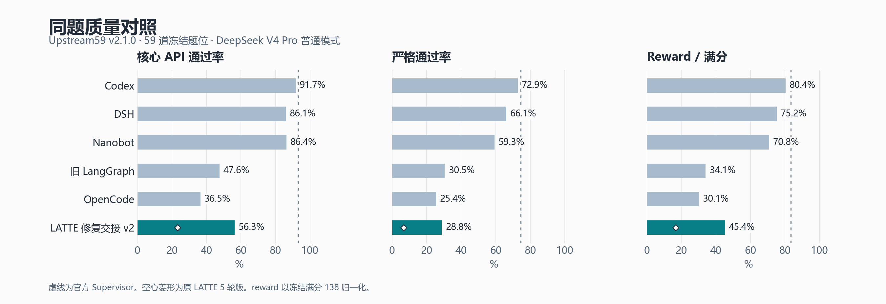

# Upstream59 · 六套 Harness 对照（LATTE 修复交接 v2）

Upstream59 v2.1.0 · DeepSeek V4 Pro 普通模式 · 每套 59 个冻结题位

本报告的 LATTE 对照使用**修复交接 v2**，包含 **5** 个余额中断题的独立补跑。相对原主表的 5 轮版，核心 API 从 **187/803** 升至 **452/803**（**+33.00 个百分点**），严格通过从 **4/59** 升至 **17/59**，reward 从 **23.0255** 升至 **62.5840 / 138**。完整 E2E 中位数 **368 → 1061 秒**，统一峰时模型费用 **$25.49 → $39.56**。

仓库的正式主表采用恢复后的补跑前基线。本页保留修复交接 v2 的历史六套对照，并追加 XML 修复的逐题证据。

[59 题逐格矩阵](seven-configuration-matrix.json) · [新版全部 attempt、旧评分与用量](latte-attempts.json) · [原六套与 Supervisor 对照](https://github.com/xi474/benchmark/blob/7d5b59deab63b0314c0ec6ab9bac42820ee0a3dc/results/upstream59-v4pro-supervisor-nanobot-opencode-rerun-20261128/README.md) · [LATTE 5／20 轮历史结果](../latte-plan5-vs20-comparison-20261127/README.md)

## 六套 Harness 的质量、耗时和成本

- **Codex**　API 736/803（91.7%），严格 43/59（72.9%），reward 110.95/138，E2E 中位 749.6 秒，费用估算 $19.73。
- **DSH**　API 691/803（86.1%），严格 39/59（66.1%），reward 103.72/138，E2E 中位 458.7 秒，费用估算 $10.28。
- **Nanobot**　API 694/803（86.4%），严格 35/59（59.3%），reward 97.74/138，E2E 中位 414.9 秒，费用估算 $11.24。
- **旧 LangGraph**　API 382/803（47.6%），严格 18/59（30.5%），reward 47.05/138，E2E 中位 339.7 秒，费用估算 $9.62。
- **OpenCode**　API 293/803（36.5%），严格 15/59（25.4%），reward 41.60/138，E2E 中位 144.9 秒，费用估算 $3.59。
- **LATTE 修复交接 v2**　API 452/803（56.3%），严格 17/59（28.8%），reward 62.58/138，E2E 中位 1060.8 秒，费用估算 $39.56。

图中虚线为官方 LangGraph Supervisor 的独立参照。其 API 747/803，严格 44/59，reward 115.08/138。六套主对照中的 LangGraph 仍使用历史的旧 LangGraph 版本。

API 只计 A 组核心转换用例。Reward 按 `delivery-bonus-50-v1` 逐题复算，严格通过与登记核心检查各占 50%，乘冻结难度满分及完整性门禁。完整 E2E 从 Harbor 开始到评分并收尾，异常保留原耗时。全表使用同一峰时费率，按每百万输入未命中／命中／输出 token 的 1.32／0.044／3.96 美元估算各格选定试次。

## 为什么新版 LATTE 变慢

这段分析以旧 **20 轮规划**作同题参照，使用原始 Harbor、LATTE 和请求队列的时间戳。主对照历史列保留原发布的 **5 轮规划**数据。
新版沿用 3 名固定 Worker，规划和执行上限分别是 30 与 100 轮。同一版本的 59 个选定试次经历不同的 Harbor 并发负载，包含首批、六并发恢复段和余额题补跑。

1. **更多题进入了真实执行。** 进入执行的题数从 **42/59 增至 59/59**，新版有 **18** 题通过空图降级进入执行。规划阶段平均 **48 → 156 秒**，执行阶段平均 **307 → 1086 秒**。每题实际发出的请求中位数 **86 → 154**。
2. **每题在发请求前等待了更久。** 旧版网关 HTTP 上限为 4，新版为 2，且发请求间隔至少 2 秒。按同题配对，每题只处于发请求前等待的时间平均 **116 → 899 秒**，约占平均 E2E 增量的 **88%**。等待包含排队和拿到槽位后等待发出。已结算的单次请求上游处理均值 **2.50 → 2.08 秒**。
3. **评分时间只增加了几秒。** 原 verifier 阶段平均 **27.1 → 31.0 秒**。新版有 **24** 题观测到停滞交回，**16** 题在修复节点观测到既有实现源码变化。交回次数和实际修复需要分别读 trace。

- **N11** 的 E2E **76 → 1317 秒**，只在发请求前等待 **22 → 1145 秒**。新版观测到 1 次交回和 0 次修复节点源码变化。
- **MP23** 的 E2E **664 → 1083 秒**，只在发请求前等待 **210 → 508 秒**。新版观测到 14 次交回和 0 次修复节点源码变化。

两种时间分解各自覆盖同一段平均 E2E。网关区间按单题取并集，重叠时优先归到上游处理。这是观测时间归类。每题的工作量、规划上限、运行时和并发条件同时变化，其中的等待占比也不能直接解释为放宽网关后可节省的比例。

[逐题时间与槽位匹配口径、选定原生事件摘录](latte-timing-evidence.json)

## 原 59 题里的 9 个中断

下列记录保留原 verifier 评分和当时的终态。余额造成的中断补跑以技术和评分证据选入主表，选入规则与得分高低无关。本报告矩阵沿用 XML 协议停滞和 token 门禁试次的原评分，后续补跑见下一节。

- **C007** · HTTP 402 共享停发。原 API 0/8，reward 0.000000/3，E2E 149 秒。补跑 API 1/8，reward 0.375000/3，E2E 772 秒，终态 任务图收尾。
- **C033** · HTTP 402 共享停发。原 API 0/14，reward 0.000000/2，E2E 524 秒。补跑 API 0/14，reward 0.000000/2，E2E 750 秒，终态 执行轮数上限。
- **C055** · HTTP 402 共享停发。原 API 1/9，reward 0.076923/2，E2E 525 秒。补跑 API 9/9，reward 0.769231/2，E2E 633 秒，终态 执行轮数上限。
- **MP01** · HTTP 402 共享停发。原 API 0/17，reward 0.000000/2，E2E 270 秒。原 MP01 的一次 402 请求缺少用量回执，历史用量仍未知。补跑 API 17/17，reward 2.000000/2，E2E 482 秒，终态 原公开检查与收尾门禁通过。
- **MS41** · HTTP 402 共享停发。原 API 0/11，reward 0.000000/3，E2E 364 秒。补跑 API 4/11，reward 0.600000/3，E2E 684 秒，终态 执行轮数上限。
- **MP16** · LATTE XML 协议停滞。原 API 21/21，reward 0.656250/2，E2E 728 秒。
- **MP17** · 累计 200 万 token 门禁。原 API 0/16，reward 0.000000/2，E2E 3538 秒。
- **MP25** · LATTE XML 协议停滞。原 API 0/16，reward 0.000000/2，E2E 1960 秒。
- **MS23** · LATTE XML 协议停滞。原 API 10/10，reward 3.000000/3，E2E 953 秒。

修复交接 v2 原批与余额补跑的账本合计 **10,041 发出／10,040 已结算／1 未知**，估算 **$40.50**。主矩阵的 9,812 个已结算请求对应选定的 59 次试次，未知用量 0 笔。这部分包含被替换的原试次，历史未知用量单列。

[原中断及其补跑记录](interrupted-attempts.json) · [结果文件 SHA-256](SHA256SUMS)

## LATTE XML 协议修复与补跑

MP16、MP25、MS23 使用同一冻结题目、原 verifier 与 DeepSeek V4 Pro 普通模式各补跑一次。下面的箭头表示原试次到协议修复版补跑。E2E 含执行、评分与收尾，费用按上文的统一峰时费率估算。三组配对独立保留，原矩阵、历史分数和图表可继续复核。前后执行路径和共享负载可能不同，耗时与费用是逐次观测值。

- **MP16**　API **21/21（100.00%） → 0/21（0.00%）**，reward **0.656250/2 → 0.000000/2**，完整 E2E **727.80 → 928.43 秒**，费用估算 **$0.1279 → $1.4199**。补跑到第 100 轮，交付文件缺失，完整性未过。
- **MP25**　API **0/16（0.00%） → 5/16（31.25%）**，reward **0.000000/2 → 0.200000/2**，完整 E2E **1960.06 → 643.12 秒**，费用估算 **$0.7471 → $0.5972**。补跑到第 100 轮，取得部分分，严格检查未过。
- **MS23**　API **10/10（100.00%） → 10/10（100.00%）**，reward **3.000000/3 → 3.000000/3**，完整 E2E **953.08 → 489.59 秒**，费用估算 **$0.4657 → $0.4548**。补跑在第 38 轮正常收尾，前后均严格通过。

三题的原停滞均由同一个 Agent 连续五次返回无可解析动作触发。MP16 的 Lead 把建任务所需的标题、依赖和正文塞进 `assign_task`。修复版明确回传应先用 `discover_task` 建任务，再用 `assign_task` 派工，仍由原调度器校验依赖和角色。MP25 返回带 `start_line`／`end_line` 的读取，MS23 返回带 `offset` 的读取。原解析器只接受 `path`。修复版在原工具执行链支持两种分段读取，限制在仓库内、每次最多 200 行或 4,000 字符，并回传读取结果。

断网回放复现了 15 次原拒绝。修复后，MP25 和 MS23 的 10 条原始读文件回复均可解析并回传内容，MP16 的原失败回复获得精确纠正指引。真实补跑中，8 条新协议回执核验进入出站请求，三题都没有再因 XML 停滞退出。三次的结果有升、有降、有持平，任务完成质量仍取决于实际交付。

**MP17 保留原试次。** 第 100 轮最后一条请求使用 3,458 tokens，结算后累计从 1,996,854 升至 2,000,312，触发登记的 2,000,000 累计 token 上限。其后 3 条请求在发送前拦截，已发出的 390 条请求均结算。保护按配置生效，原公开检查此前仍失败，因此这次没有给 MP17 放宽预算或补跑。

本次 XML 修复补跑另计 **686 发出／686 已结算／0 未知**，费用估算 **$2.4720**。

[前后逐题分数、请求账本和断网验收数据](xml-protocol-replays.json)
