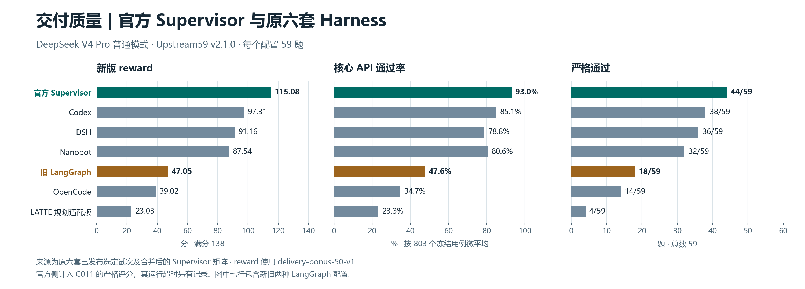
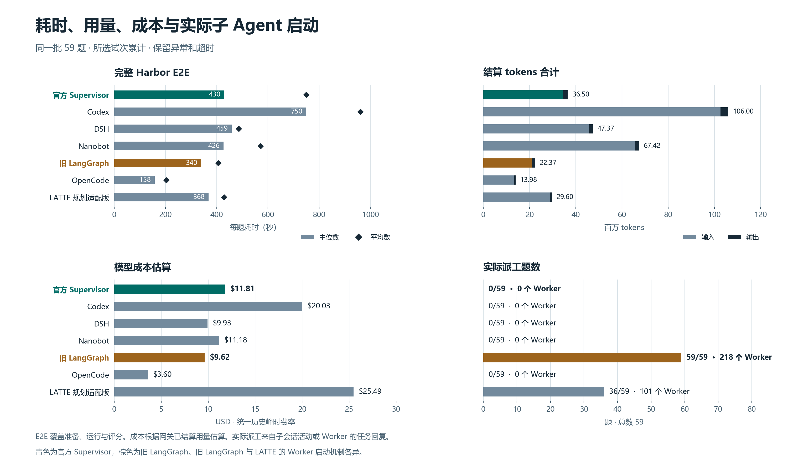

# 官方 LangGraph Supervisor 与原六套 Harness

**审阅稿 · Upstream59 v2.1.0 · DeepSeek V4 Pro 普通模式 · 59 道同题**

官方 Supervisor 的 **reward、核心 API、严格通过数均为七个配置第一**。得分 **115.08/138**，核心 API **747/803（93.03%）**，严格通过 **44/59**。原六套中三项最高均为 Codex，分别为 **97.31/138、683/803（85.06%）、38/59**。

## 质量和开销如何取舍

- **相比 Codex**，官方版多通过 **64 项核心 API** 和 **6 道整题**。完整 E2E 中位数 **429.9 对 749.6 秒**，总 tokens **36.50M 对 106.00M**，统一峰时估算成本 **$11.81 对 $20.03**。
- **相比旧 LangGraph**，官方版核心 API 由 **47.57% 提高至 93.03%**，严格通过由 **18 题增至 44 题**。平均完整 E2E **405.8 → 749.9 秒**，中位数 **339.7 → 429.9 秒**，总 tokens **22.37M → 36.50M**，成本 **$9.62 → $11.81**。
- **OpenCode** 的完整 E2E 中位数 **158.3 秒**、估算成本 **$3.60**，两项均为七个配置最低。核心 API 为 **34.74%**，严格通过 **14/59**。官方 Supervisor 的 E2E 中位数排第五、tokens 总量排第四、成本排第五，均按从低到高排序。

## 子 Agent 与运行异常

原生证据覆盖全部 413 个选定题位。**旧 LangGraph 59/59 题**有实际工作的 Worker，共 **218 个**。**LATTE 规划适配版 36/59 题**有接到任务且完成回合并回复的非 Lead Worker，共 **101 个**。其余 23 题的规划日志明确显示零任务。官方 Supervisor、Codex、DSH、Nanobot、OpenCode 各为 **0/59**。这里统计实际子会话活动或 Worker 的任务回复，预配置角色和父会话内工具并行另有各自的口径。

官方侧选入 6 个补跑结果。**C011 的 API 10/10、reward 3/3 保留，完整 E2E 3,638.2 秒单列为 Agent 超时**。原严格通过但运行异常的 6 题、C039／C058 对账、MS42 预算触顶及 C077 回执错配的离线复核标签，继续绑定原 attempt。主图计入这些试次的实际 E2E 和结算用量。 [官方 59 题合并与异常说明](Supervisor原59题配对.md)

## 统一口径

- 每个配置按相同的 59 个冻结题号取一条选定记录。七行包括新旧两种 LangGraph 配置。其余五行沿用原发布矩阵。历史 MP 题的评分为离线复核分，E2E 与用量绑定原付费试次。
- Reward 按 **delivery-bonus-50-v1** 逐题复算。先验证交付完整性，再按登记核心检查通过率和严格通过各占一半乘以冻结难度权重。满分合计 **138**。API 通过率用单列的 **803 个 A 组核心转换用例**计算。
- 完整 E2E 以 Harbor 的试次起止时间计，含准备、解题、评分及收尾。tokens 采用同一试次的实际结算输入和输出。成本统一按历史峰时估算，缓存未命中输入、命中输入、输出分别为 **$1.32、$0.044、$3.96／百万 tokens**，两组图中全部选定记录均有用量。费用为模型成本估算。
- 这是已运行配置的同题对照。各 Harness 的编排、输出上限、预算和终态机制可能不同，子 Agent 的单独因果效应未从这组数据估计。

[完整逐题矩阵，59 题 × 7 配置](补跑前矩阵.json) · [质量图 SVG](quality.svg) · [运行图 SVG](runtime.svg) · [原六套对照入口](https://github.com/xi474/benchmark/blob/3cb9c6a5250654e93ffd5fea3ee8bca62aa17bcc/results/upstream59-v21-semserve-vs-six-harnesses-20261123/README.md)
